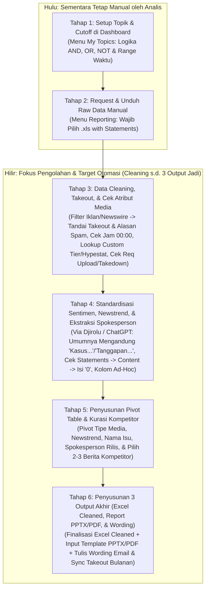
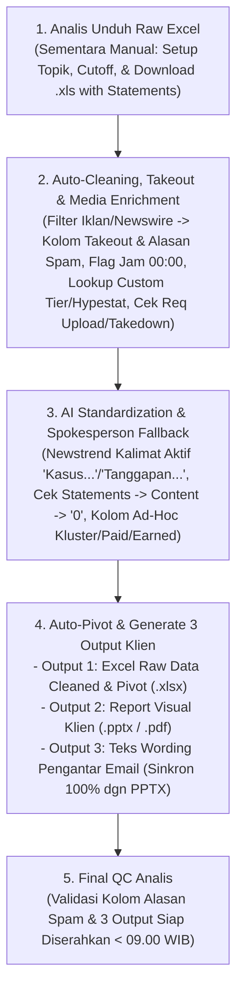

# Project Baseline (BRD): Otomasi Media Monitoring & Pelaporan Newstent
*(Dokumen Kebutuhan Bisnis & Operasional Non-Teknis — Untuk Manajemen, Mentor, dan Tim Analis)*

> **Catatan Dokumen:** Dokumen ini merupakan *Business Requirements Document (BRD)* yang merangkum latar belakang masalah, alur kerja operasional analis saat ini (*As-Is Workflow* termasuk studi kasus alur *Daily Report BRI*), kendala utama (*bottlenecks*), alur target setelah otomasi (*To-Be Workflow*), batasan ruang lingkup (*Scope*), serta target efisiensi biaya. Untuk spesifikasi teknis developer (*SDLC, Arsitektur AI, Data Dictionary, & SRS*), silakan merujuk ke [SRS.md](./SRS.md) dan dokumen desain arsitektur Phase 2 di [SAD.md](../phase-2-design/SAD.md).

---

## 1. Latar Belakang & Permasalahan Utama

Pada layanan *media monitoring* **Newstent (Newstensity)**, data pemberitaan (*online, print, electronic news*) dan percakapan media sosial diperoleh melalui mesin *crawling*. Berdasarkan pemaparan Analis Senior (studi kasus pengerjaan *Daily Report BRI*) dan observasi operasional, tim analis menghadapi tantangan utama pada tahap **pembersihan data (*data cleaning*), klasifikasi & standardisasi atribut, hingga penyusunan *pivot* dan laporan akhir**:

### A. Pembersihan Data (*Cleaning*), *Spam*, *Takeout*, & Akurasi *Cutoff*
- **Aturan Eksklusi Khusus Klien, *Spam*, & *Newswire*:** Data hasil unduhan masih bercampur dengan sampah teks (*"Baca Juga"*, *"Cek Berita Lainnya"*), berita *newswire*, serta konten yang tidak diinginkan oleh klien tertentu (contoh: **BRI tidak menginginkan berita yang bersifat iklan/promosi murni**).
- **Kewajiban Penandaan `Takeout` & `Alasan Spam`:** Berita yang masuk kategori *spam* atau *newswire* tidak boleh dihapus begitu saja tanpa jejak, melainkan harus **ditandai sebagai `Takeout`** dan dilengkapi **kolom `Alasan Spam`** agar mudah divalidasi saat *Quality Control (QC)*.
- **Sinkronisasi *Takeout* Isu Negatif Sensitif hingga *Monthly Report*:** Berita negatif yang bersifat sensitif umumnya di-*takeout* (atau tautannya telah di-*takedown*/menjadi tidak valid). Status *takeout* berita tersebut **wajib dicatat dan disinkronkan secara berkelanjutan hingga ke *Monthly Report*** agar tidak kembali terhitung pada rekapitulasi bulanan.
- **Risiko Jam Publikasi *Default* `00:00` terhadap Batas *Cutoff*:** Apabila portal berita tidak menyertakan jam publikasi, sistem Newstensity otomatis mengisi waktu *default* **`00:00`**. Hal ini menuntut kewaspadaan ekstra karena berisiko mengacaukan akurasi batas waktu (*cutoff*) penarikan laporan harian.
- **Duplikasi Data:** Sering terjadi duplikasi artikel maupun penyebaran rilis pers di banyak portal, di mana kolom **`ID`** berperan sebagai kunci unik (*unique key*), dengan volume mencapai maksimal **800 baris** per *file* Excel.

### B. Standardisasi *Newstrend*, Sentimen, & Atribut Media (Kendala *Djirolu* & ChatGPT)
- **Keterbatasan Tools Internal (*Djirolu*) & ChatGPT:** Saat ini, proses *Sentiment Correction* dan pembuatan *Newstrend* dibantu melalui **Djirolu** (website internal milik Binokular yang menggunakan LLM DeepSeek) maupun ChatGPT. Namun, **Djirolu sering kali berjalan lambat dan terkendala batas token rendah (*low token limit*)** saat memproses ratusan baris, sedangkan ChatGPT sering terkena *hit limit* setelah 2 klien.
- **Standarisasi Input pada `.xls with Statements` (Bukan `.xls with Newstrend`):**
  - Meskipun di dashboard terdapat opsi unduh *Excel with Newstrend*, hasil *Newstrend* bawaan tersebut tetap harus dirombak ulang berdasarkan isi kolom `Content` (melalui Djirolu/AI).
  - Sebaliknya, memilih **`Spreadsheet (.xls with Statements)`** jauh lebih menguntungkan karena **tetap memiliki kolom `Newstrends` di sheet `News` sekaligus memberikan sheet `Statements` terpisah** (berisi `Name`, `Position`, dan `Quote` narasumber) yang sangat krusial untuk mempercepat pencarian *Spokesperson*.
- **Aturan Format Kalimat & Pilihan Kata *Newstrend*:**
  - Format *Newstrend* harus mengikuti ketentuan masing-masing klien (misalnya berbentuk **kalimat aktif dengan jumlah kata maksimal tertentu**).
  - **Kalimat *Newstrend* biasanya mengandung kata yang mencerminkan sentimen berita**, contohnya:
    - Sentimen **Negatif**: biasanya mengandung/diawali kata **`"Kasus ..."`**
    - Sentimen **Netral**: biasanya mengandung/diawali kata **`"Tanggapan ..."`**
  - **Konsistensi Isu Negatif:** Apabila sebuah isu bersentimen negatif muncul kembali di artikel lain atau hari berikutnya, label sentimen negatif dan penamaan isunya **wajib konsisten**.
- **Pemeriksaan Atribut Media secara Detail & *Custom Tier* Klien:** Analis harus memperhatikan dan mengelompokkan atribut media yang meliputi:
  - **`Content Type`**: Membedakan antara berita **Rilis (*Press Release*)** vs. **Organik**.
  - **`Media Tier` Standar vs. *Custom Tier* Klien & Nilai Media**: Selain *tier* standar Binokular (`tier bino`) dan pengecekan nilai/trafik media melalui **Hypestat**, beberapa klien memiliki standar **Tier Media sendiri** (contoh referensi BNI: `beritasatu.com` tergolong Tier 1 di Binokular, namun masuk Tier 2 pada daftar `TIER BNI` yang memuat 13.000+ media).
  - **`Media Type Detail`**: Membedakan antara **Newswire** (yang wajib di-*takeout*) vs. **Media Bazar** vs. media organik.
  - **Cek Silang Daftar Link Klien (`Req Upload` / `Takedown`):** Pada kasus tertentu (seperti laporan krisis/isu), analis juga perlu mencocokkan daftar tautan berita rilis yang diminta klien (*Req Upload*) maupun daftar berita yang sudah di-*takedown* terhadap data *crawling*.

### C. Beban Kerja *Pivot*, Pencarian *Spokesperson* Berita Rilis, & Kurasi Berita Kompetitor
- **Pencarian *Spokesperson* & Jabatan yang Sangat Menyita Waktu:**
  - Untuk berita **Rilis**, kolom **`Spokesperson` (Narasumber)** dan **`Jabatan`** wajib dimasukkan ke dalam *Pivot Table*.
  - Analis harus mengambil data tersebut dari sheet `Statements`. Namun, jika di sheet `Statements` kosong, analis **wajib mencari dan membaca manual di dalam kolom `Content` berita**, dan mengisinya dengan angka **`0`** apabila tetap tidak ditemukan di keduanya. Proses pengecekan silang ini merupakan **salah satu pekerjaan yang paling menyita waktu analis**.
- **Kurasi Berita Kompetitor:**
  - Untuk pemantauan kompetitor harian, analis harus memilih **2–3 berita bersentimen positif dan negatif** berdasarkan **sudut pandang (*POV*) kompetitor itu sendiri** dengan mempertimbangkan **`Media Tier`**-nya.

### D. Tekanan *Deadline* Pagi, Tiga Output Utama Klien, & Permintaan Kolom *Ad-Hoc*
- **Tekanan *Deadline* 09.00 WIB (Multi-Klien):** Tim harus menyelesaikan laporan harian pagi dengan tenggat ketat (umumnya pukul **09.00 WIB**) untuk hingga **3 klien sekaligus**, di samping laporan *Weekly*, *Monthly*, *Ad-hoc*, dan *Crisis* (dengan *cutoff* tertentu, misal pukul 15.00 WIB).
- **Tiga Output Utama yang Diberikan ke Klien (*Triple Deliverables*):**
  Berdasarkan referensi hasil kerja analis (studi kasus BNI Jember), setiap pengerjaan laporan menghasilkan **3 output utama**:
  1. **File Excel *Raw Data Cleaned* & *Pivot* (`.xlsx`):** Dataset berita/sosmed yang sudah bersih dari *spam/takeout/takedown*, sentimen & *Newstrend*-nya telah dikoreksi, *Spokesperson & Jabatan* serta *Custom Media Tier* klien terisi, dan dilengkapi sheet *Pivot* yang akurat (bebas *formula error* seperti `#REF!`).
  2. **File Laporan Presentasi (`.pptx` / `.pdf`):** Laporan visual berisi *Executive Summary*, *Media Breakdown*, *Timeline*, kurasi berita kompetitor, *PR Analysis*, dan rekomendasi aksi sesuai *template* klien.
  3. **Teks *Wording* (Pengantar / *Body Email*):** Ringkasan teks terstruktur (*Perkembangan Sentimen*, rincian angka Media/Tier, *Timeline Isu*, dan *Arah Percakapan Publik*) yang siap disalin ke *body email* klien dengan angka yang 100% sinkron dengan isi PPTX.
- **Perubahan Template & Kolom *Ad-Hoc* (`Kluster`, `Paid`, `Earned`):** Template laporan klien kerap berubah dan sering kali terdapat permintaan penambahan kolom secara mendadak (*ad-hoc*), seperti pengelompokan **`Kluster`**, **`Paid`**, maupun **`Earned`**.
- **Ketidakakuratan Pembuatan Template Langsung oleh AI:** Percobaan meminta AI (ChatGPT) menyusun langsung tabel/template laporan akhir sering menghasilkan kesalahan fatal, seperti **ketidaksesuaian (*mismatch*) antara `Nama Media` dengan `URL` berita**.

---

## 2. Alur Kerja Operasional Saat Ini (*As-Is Workflow*)

Untuk tahap awal proyek ini (berdasarkan pemetaan diskusi sementara), **Tahap 1 dan Tahap 2 (Hulu)** sementara diposisikan tetap berjalan secara manual di dashboard, sedangkan **Tahap 3 hingga Tahap 6 (Hilir — dari Data Cleaning hingga 3 Output Laporan Jadi)** dijadikan fokus utama yang akan diotomasi:

### Detail Alur Kerja Saat Ini:
1. **Tahap 1 & 2 — Pengaturan Topik, *Cutoff*, & Unduh Data `.xls with Statements` (Sementara Tetap Manual):**
   - Analis mengatur kata kunci (`AND`, `OR`, `NOT`) pada menu **My Topics**, menentukan rentang waktu (*cutoff*), lalu mengunduh file Excel mentah (maksimal 800 baris) dari menu **Reporting -> Request Data** dengan memilih format **`Spreadsheet (.xls with Statements)`** agar mendapatkan sheet `News` sekaligus sheet `Statements` terpisah.
2. **Tahap 3 — *Cleaning*, Penandaan *Takeout*, & Validasi Atribut Media:**
   - Memeriksa duplikasi `ID`, memvalidasi jam publikasi `00:00` terhadap batas *cutoff*, serta memeriksa `Media Type Detail` (*Newswire* vs. *Media Bazar*) dan `Media Tier` (via *Hypestat*).
   - Menandai berita *spam*, iklan (misal aturan BRI), berita *newswire*, serta berita negatif sensitif yang di-*takeout* ke dalam status **`Takeout`** beserta kolom **`Alasan Spam`**, sekaligus mencatatnya untuk sinkronisasi *Monthly Report*.
3. **Tahap 4 — Koreksi Sentimen, Standardisasi *Newstrend* (via *Djirolu* / ChatGPT), & Pencarian *Spokesperson*:**
   - Menggunakan **Djirolu** (website internal Binokular berbasis DeepSeek) atau ChatGPT (*Master Prompt*) beserta pemeriksaan manual pada kolom `Content` untuk mengoreksi sentimen sesuai *POV* klien/kompetitor.
   - Menulis ulang `Newstrends` menjadi kalimat aktif sesuai standar klien (dengan batas maksimal kata tertentu dan biasanya mengandung kata seperti *"Kasus..."* untuk negatif atau *"Tanggapan..."* untuk netral) serta menjaga konsistensi sentimen untuk isu negatif yang berulang.
   - Mengisi kolom tambahan *ad-hoc* (`Content Type`: Rilis vs. Organik, `Kluster`, `Paid` vs. `Earned`).
   - Melakukan pengecekan `Spokesperson` dan `Jabatan` untuk berita rilis: mengambil dari sheet `Statements`, atau mencari manual di dalam teks `Content` jika kosong, lalu mengisi `0` jika tidak ada di keduanya.
4. **Tahap 5 — Pembuatan *Pivot Table* & Kurasi Berita Kompetitor:**
   - Menyusun *Pivot Table* utama di Excel yang mencakup **Tipe Media**, **Newstrend**, **Nama Isu**, serta **Spokesperson & Jabatan** (khusus berita rilis).
   - Memilih 2–3 berita positif dan negatif per kompetitor berdasarkan *POV* kompetitor dan *Media Tier*-nya.
5. **Tahap 6 — Penyusunan 2 Output Laporan Akhir (*Raw Data Cleaned Excel* & *Report PPTX/PDF*):**
   - Merapikan file **Excel *Raw Data Cleaned*** untuk diserahkan ke klien, lalu memindahkan hasil *Pivot*, grafik, dan daftar tautan berita ke dalam *template* **PPTX / PDF** klien secara manual agar nama media dan URL tidak tertukar.

---

## 3. Kendala Utama (*Bottlenecks*) yang Menghambat Operasional

1. **Keterbatasan *Djirolu* (Lambat & *Low Token*) serta *Hit Limit* ChatGPT**
   - Penggunaan **Djirolu** (web internal berbasis DeepSeek milik Binokular) untuk *Sentiment Correction* dan *Newstrend* sering terkendala **proses yang lambat dan batas kapasitas token yang kecil (*low token limit*)** sehingga tidak sanggup memproses ratusan baris sekaligus dengan cepat.
   - Sementara itu, penggunaan ChatGPT Web sering terkena **hit limit** setelah 2 klien, dan jika AI diminta menyusun template/tabel laporan secara langsung, AI sering mengalami halusinasi seperti **tertukarnya `Nama Media` dengan `URL` berita**.
2. **Pencarian *Spokesperson* Berita Rilis (`Statements` $\rightarrow$ `Content` $\rightarrow$ `0`) Sangat Menyita Waktu**
   - Keharusan mengecek isi artikel (`Content`) satu per satu ketika sheet `Statements` kosong untuk mengisi nama narasumber dan jabatan pada berita rilis memakan porsi waktu terbesar analis.
3. **Standardisasi Kalimat *Newstrend*, Kolom *Ad-Hoc*, & Sinkronisasi *Takeout* Bulanan Masih Manual**
   - Menjaga konsistensi awalan kalimat *Newstrend* (*"Kasus..."* / *"Tanggapan..."*), menambah kolom mendadak (*Kluster, Paid, Earned*), mengecek *Media Tier* di Hypestat, serta melacak berita negatif yang sudah di-*takeout* agar tidak masuk kembali di *Monthly Report* sangat rawan terlewat jika dikerjakan di bawah tekanan *deadline* pukul 09.00 WIB.

---

## 4. Alur Kerja Target Setelah Otomasi (*To-Be Workflow*)

Sebagai pendekatan awal pengembangan, **pengaturan topik dan pengunduhan Excel dari dashboard sementara tetap dilakukan manual oleh analis**, kemudian sistem otomasi mengambil alih seluruh proses mulai dari *Data Cleaning* hingga menghasilkan **3 output akhir untuk klien (*Raw Data Cleaned Excel*, *Report PPTX/PDF*, & *Wording*)**:

### Keunggulan Utama Sistem *To-Be* untuk Tim Analis:
1. **Antarmuka Web Lokal (*Local Web UI*) yang Ramah Analis & Interaktif:**
   - Analis tidak perlu berurusan dengan perintah terminal maupun mengedit file konfigurasi secara manual. Cukup melalui browser di perangkat lokal, analis dapat melakukan *drag-and-drop* file `.xls with Statements`, memantau *progress bar* proses secara *real-time*, melakukan **QC interaktif** (tab khusus pengecekan berita berjam `00:00`, tab *Takeout & Alasan Spam*, serta tab *Berita Rilis & Spokesperson `0`*), menambah kolom *ad-hoc* lewat formulir, dan memilih kolom mana saja yang diekspor ke klien (*Column Picker*).
2. **Menghasilkan 3 Output Utama Sekaligus (*Raw Data Cleaned Excel*, *Report PPTX/PDF*, & *Wording*):**
   - **Output 1 — File Excel *Raw Data Cleaned* & *Pivot* (`.xlsx`):** Siap diserahkan kepada klien yang meminta data Excel bersih, lengkap dengan format rapi, *Custom Tier* klien (seperti `TIER BNI`), *highlight* warna otomatis (*conditional formatting*), **rumus *Pivot* dinamis** bebas error `#REF!`, serta sheet `Takeout_Spam` / `Takedown` (berisi kolom **`Alasan_Spam`**) untuk keperluan QC.
   - **Output 2 — File Laporan Presentasi (`.pptx` / `.pdf`):** Visualisasi grafik, rekapitulasi isu, kurasi berita kompetitor, dan narasi analisis langsung terisi ke dalam *template* klien.
   - **Output 3 — Teks *Wording* (Siap *Copy-Paste* ke Email Klien):** Ringkasan teks *Perkembangan Sentimen*, rincian angka Media/Tier, *Timeline Isu*, dan *Arah Percakapan Publik* yang di-generate dari **sumber angka yang sama persis** dengan PPTX (menghilangkan risiko selisih angka antara *Wording* dan *Slide* PPTX).
3. **Penandaan `Takeout` & `Alasan Spam` + Memori Sinkronisasi *Monthly Report*:**
   - Sistem tidak membuang baris secara gelap, melainkan menambahkan kolom **`Status_Takeout`** dan **`Alasan_Spam`** (misal: *"Takeout - Iklan/Promosi BRI"*, *"Takeout - Newswire"*, *"Takeout - Isu Negatif Sensitif"*), serta menyimpannya ke database lokal agar otomatis tersinkronisasi saat penarikan *Weekly* maupun *Monthly Report*.
4. **Otomasi 3-Langkah *Spokesperson* & Jabatan (`Statements` $\rightarrow$ `Content` $\rightarrow$ `0`):**
   - Sistem secara otomatis mencocokkan narasumber dari sheet `Statements`. Khusus untuk baris yang kosong di `Statements`, AI otomatis memindai paragraf `Content` berita tersebut untuk mengekstrak nama narasumber dan jabatannya, atau otomatis mengisinya dengan **`0`** jika tidak ditemukan.
5. **Standardisasi *Newstrend* & Dukungan Kolom *Ad-Hoc* Fleksibel:**
   - Aturan kalimat aktif, batas maksimal kata, serta kecenderungan pilihan kata sentimen (biasanya mengandung *"Kasus..."* untuk negatif atau *"Tanggapan..."* untuk netral) dikunci di profil klien, termasuk memori isu negatif agar sentimennya selalu konsisten.
   - Jika klien meminta kolom tambahan mendadak seperti **`Kluster`**, **`Content Type` (Rilis vs. Organik)**, atau **`Paid` vs. `Earned`**, analis cukup menambahkannya lewat form di Web UI tanpa perlu mengubah kode program.
6. **Anti-Halusinasi URL & Nama Media pada Laporan Akhir:**
   - Berbeda dengan pembuatan laporan langsung lewat ChatGPT yang sering salah memasangkan nama media dan URL, pada sistem ini **pemasangan `Nama Media`, `Judul`, dan `URL` dikunci 100% oleh program Python langsung dari baris Excel aslinya**, sementara AI hanya bertugas mengisi label klasifikasi dan narasi ringkasan.

---

## 5. Ruang Lingkup Proyek (*Project Scope*) & Ukuran Keberhasilan (*KPI*)

### A. Ruang Lingkup Tahap Awal (*In-Scope v1*) vs. Di Luar Ruang Lingkup (*Out-of-Scope v1*)

| Termasuk Ruang Lingkup Otomasi (*In-Scope v1*) | Di Luar Ruang Lingkup Otomasi (*Out-of-Scope / Sementara Manual*) |
| :--- | :--- |
| - **Antarmuka Web Lokal (*Local Web UI*):** Aplikasi web lokal yang memudahkan analis mengunggah file `.xls with Statements`, memantau progres, melakukan *review/QC* tabel mirip Excel di browser (*Flag `00:00`*, *Takeout*, *Spokesperson*), mengatur kolom *ad-hoc*, serta mengunduh/menyalin ketiga output akhir. - **Pembersihan, Takeout & Validasi Cutoff:** Deduplikasi `ID`, penandaan `Takeout` + `Alasan Spam` (termasuk filter iklan/newswire), *flagging* berita dengan jam *default* `00:00`, cek silang daftar link klien (`Req Upload` / `Takedown`), dan sinkronisasi database *Takeout* hingga *Monthly Report*. - **Standardisasi Newstrend, Sentimen & Atribut Media:** Koreksi sentimen sesuai POV klien/kompetitor, pembentukan *Newstrend* kalimat aktif dengan batas maksimal kata (umumnya mengandung *"Kasus..."* / *"Tanggapan..."*), klasifikasi *Rilis vs. Organik*, *Newswire vs. Media Bazar*, *lookup Custom Media Tier klien (mis. Tier-BNI) / Hypestat*, serta kolom *ad-hoc* (*Kluster, Paid, Earned*). - **Otomasi Spokesperson & Pivot:** Ekstraksi *Spokesperson & Jabatan* (`Statements` $\rightarrow$ `Content` $\rightarrow$ `0`), pembuatan *Pivot* (Tipe Media, Newstrend, Nama Isu, Spokesperson Rilis), dan pemilihan 2–3 berita positif/negatif kompetitor berdasarkan *Media Tier*. - **Pembuatan 3 Output Akhir Klien:** (1) File Excel *Raw Data Cleaned* + *Pivot* ber-rumus dinamis (`.xlsx`), (2) File Laporan Akhir (`.pptx` / `.pdf`) sesuai *template* klien tanpa risiko *mismatch* `Nama Media` dan `URL`, serta (3) Teks ***Wording*** siap *copy-paste* yang 100% sinkron angkanya dengan PPTX. | - **Pengaturan Topik (`My Topics`):** Pembuatan topik dan perangkaian logika `AND`, `OR`, `NOT` di dashboard Newstensity sementara tetap dilakukan manual oleh analis. - **Penentuan *Range* Waktu (*Cutoff*) & *Request/Download* Data:** Proses *request* dan pengunduhan file Excel mentah (`.xls with Statements`) dari menu *Reporting* dashboard Newstensity sementara tetap dijalankan manual. - **Pengiriman Email / Push Mail:** Fokus otomasi berhenti hingga ketiga output (*Raw Data Cleaned Excel*, *Report PPTX/PDF*, & *Wording*) selesai dan siap diserahkan. - **Deployment Cloud/Server Produksi & Chatbot:** Pada tahap v1, Web UI berjalan ringan di perangkat lokal analis (belum termasuk integrasi *chatbot* WA/Telegram). |

### B. Perbandingan Manfaat Bisnis & Target KPI Operasional

| Aspek Operasional | Kondisi Saat Ini (Manual + ChatGPT Web) | Target Sistem Otomasi Baru (KPI) |
| :--- | :--- | :--- |
| **Kapasitas & Kecepatan Pagi Hari** | Rawan *hit limit* setelah 2 klien; pengecekan *Spokesperson* & *Newstrend* sangat menyita waktu. | **Bebas *Hit Limit* & Cepat** — Memproses hingga 800 baris lengkap dengan *Spokesperson* & *Pivot* dalam **$< 5$ menit/klien**. |
| **Validasi *Spam* & *Monthly Sync*** | Pengecekan manual dan rawan terhitung ulang saat rekap bulanan. | **Terdokumentasi & Tersinkronisasi** — Tersedia kolom `Alasan Spam` untuk QC cepat dan sinkronisasi status `Takeout` otomatis hingga *Monthly Report*. |
| **Akurasi Nama Media, URL, & Pivot** | Pembuatan template langsung via AI sering salah memasangkan Nama Media & URL. | **Akurasi Data & Pasangan URL 100%** — Nama Media, URL, dan angka Pivot dijamin 100% sesuai data asli tanpa halusinasi AI. |
| **Estimasi Efisiensi Biaya Operasional AI** | Langganan akun AI bulanan tetap (estimasi ~Rp 330.000/akun/bulan untuk ChatGPT Plus) namun masih rentan terkena batas kuota pakai (*hit limit*). | **Estimasi Biaya Sangat Hemat: ~Rp 335/laporan 800 baris (*Off-Peak*, sebelum 08.00 WIB / *Weekend*) atau ~Rp 665/laporan (*Peak*, 08.00–09.00 WIB)—sekitar ~Rp 40.000 – Rp 56.000/bulan (*Off-Peak*) hingga ~Rp 72.000 – Rp 88.000/bulan (*Peak*) untuk 90+ laporan harian + *testing*.** *Dasar perhitungan:* Mengacu pada tarif resmi *pay-as-you-go* **DeepSeek API (`DeepSeek-Flash`)** yang memberikan **diskon 50% pada jam *Off-Peak* (< 08.00 WIB & akhir pekan)** serta *Automatic Context Caching*, dikombinasikan dengan penyaringan lokal sehingga 1 laporan 800 baris hanya mengonsumsi **~85.000 – 115.000 token** *(tabel tarif resmi & rincian simulasi tersedia di [SRS.md](./SRS.md))*. |
