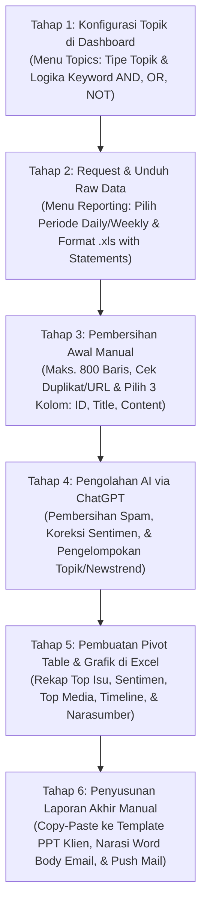
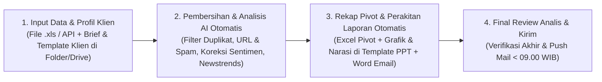

# Project Baseline (BRD): Otomasi Media Monitoring & Pelaporan Newstent
*(Dokumen Kebutuhan Bisnis & Operasional Non-Teknis — Untuk Manajemen, Mentor, dan Tim Analis)*

> **Catatan Dokumen:** Dokumen ini merupakan *Business Requirements Document (BRD)* yang merangkum latar belakang masalah, alur kerja operasional analis saat ini (*As-Is Workflow*), kendala utama (*bottlenecks*), alur target setelah otomasi (*To-Be Workflow*), batasan ruang lingkup (*Scope*), serta target efisiensi biaya. Untuk spesifikasi teknis developer (*SDLC, Arsitektur AI, Data Dictionary, & SRS*), silakan merujuk ke [SYSTEM_REQUIREMENTS.md](./SYSTEM_REQUIREMENTS.md) dan catatan diskusi arsitektur di [ARCHITECTURE_DISCUSSION.md](../phase-2-design/ARCHITECTURE_DISCUSSION.md).

---

## 1. Latar Belakang & Permasalahan Utama

Pada layanan *media monitoring* **Newstent (Newstensity)**, data pemberitaan (*online, print, electronic news*) dan percakapan media sosial diperoleh melalui mesin *crawling*. Dalam kegiatan operasional sehari-hari untuk melayani klien Binokular, tim analis menghadapi empat tantangan utama:

### A. Kualitas Data Mentah (*Raw Data*) dari Hasil *Crawling*
- **Sampah Teks (*Boilerplate Noise*):** Data hasil *crawling* sering kali masih membawa teks sisipan dari portal berita—seperti *"Baca Juga"* atau *"Cek Berita Lainnya"*—yang memicu masuknya artikel *spam* (konten tidak relevan dengan topik klien).
- **Pola URL Non-Berita & Tautan Bermasalah:** Pada media *online*, terkadang halaman indeks, daftar tag (`/tag/`, `/search`, `/indeks`), atau halaman utama portal ikut terjaring. Sebaliknya, pada media cetak (*print*) dan elektronik (*TV/Radio*), kolom URL memang kosong atau berisi tautan internal *clipping* sehingga tidak boleh salah dianggap sebagai *spam*. Untuk berita penting (*highlight*/isu negatif), validitas tautan sangat krusial karena klien sering mengklik langsung tautan di dalam laporan.
- **Duplikasi & Berita Sindikasi:** Sering terjadi duplikasi artikel maupun penyebaran satu rilis pers yang sama di puluhan portal media daerah. Kolom **`ID`** pada data mentah memiliki peran krusial sebagai pengenal unik (*unique key*) untuk menyaring duplikasi tersebut.
- **Volume Data:** Rata-rata volume data mentah yang diolah mencapai maksimal **800 baris** per *file* Excel untuk satu penarikan laporan.

### B. Tekanan Waktu (*Deadline* Pagi) & Beban Multi-Klien
- Mayoritas klien meminta **Laporan Harian (*Daily Report*)** dikirim setiap pagi dengan batas waktu (*deadline*) pukul **09.00 WIB**.
- Pada jam kritis tersebut, tim sering kali harus menyelesaikan laporan untuk **3 klien sekaligus**.
- Selain *Daily Report*, terdapat pula permintaan laporan dengan periode dan sifat yang beragam, seperti **Weekly Report** (rentang 1 minggu), **Ad-hoc Report**, hingga **Crisis Monitoring**.

### C. Kebutuhan Analisis & Format Template yang Berbeda Tiap Klien
Setiap klien memiliki *brief*, fokus pemantauan, dan desain *template* laporan akhir (*deliverables*) yang berbeda-beda:
- **Fokus Reputasi Tokoh (*Person*):** Klien ingin mengetahui seberapa sering seorang tokoh muncul di media, apakah tokoh tersebut menjadi **pokok/topik utama bahasan** atau **hanya sekadar disebut (*mentioned*)**, serta apa saja pernyataan (*quotes*) yang disampaikan di media.
- **Fokus Performa *Brand* & Kompetitor:** Klien ingin mengukur total pemberitaan (*coverage*), besaran jangkauan/*views*, serta perbandingan porsi pemberitaan (*Share of Voice*) terhadap **kompetitor**.
- **Variasi Format & Template Klien:** Ada klien yang meminta laporan dalam bentuk presentasi **PowerPoint (PPT)** dengan desain/*layout* khusus milik klien (yang disimpan di folder lokal atau Google Drive bersama), ringkasan narasi di dokumen **Word** (untuk *body email*), serta pengiriman **Push Mail** terjadwal sesuai jam yang disepakati.

---

## 2. Alur Kerja Operasional Saat Ini (*As-Is Workflow*)

Saat ini, proses pengerjaan laporan dari penarikan data hingga pengiriman ke klien melalui **6 tahapan manual dan semi-manual**:

### Tahap 1: Pembuatan & Pengaturan Topik di Dashboard Newstensity
Berdasarkan panduan pengguna ([USERGUIDE NEWSTENSITY.pdf](file:///D:/Personal/Binokular/USERGUIDE%20NEWSTENSITY.pdf)), analis menyiapkan topik pantauan di menu **Topics -> My Topics**:
- Memilih kategori topik sesuai kebutuhan (**Regular** untuk pantauan rutin, **Alert**, **Press Release**, atau **Crisis**).
- Menentukan kata kunci utama (*Main Keyword*) dan merangkai logika pencarian menggunakan penghubung **`AND`** (memuat semua kata kunci), **`OR`** (memuat salah satu kata kunci), dan **`NOT`** (mengecualikan kata kunci tertentu).
- Membuat **Sub Topik** di bawah topik utama jika diperlukan pemantauan khusus (misalnya per program atau per kompetitor).

### Tahap 2: Penarikan Data Mentah (*Request Data*)
Analis mengunduh data mentah melalui menu **Reporting -> Request Data**:
- Menentukan rentang tanggal (*Range Date*) sesuai jenis laporan: **1 hari** (*Daily*), **1 minggu** (*Weekly*), atau tanggal tertentu (*Ad-hoc*).
- Memilih 1 topik yang ingin diunduh (untuk *News* maupun *Social Media* seperti Twitter/X, Instagram, Facebook, YouTube, dan TikTok).
- **Pemilihan Format `.xls with Statements`:**
  Analis memilih **`Spreadsheet (.xls with Statements)`** karena menghasilkan **dua lembar kerja (*sheet*) yang saling terhubung**:
  1. **Sheet `News`**: Berisi daftar berita utama (`ID`, `Title`, `Content`, `Media Name`, `Page/URL`, `Sentiment`, dll.).
  2. **Sheet `Statements`**: Memisahkan setiap kutipan narasumber ke dalam tabel rapi berisi nama tokoh (`Name`), jabatan (`Position`), sentimen kutipan (`Sentiment`), dan isi kutipan (`Quote`), yang terhubung ke sheet `News` melalui kolom `Report id`. Data ini sangat dibutuhkan untuk menyusun bagian **Top Spokesperson (Narasumber)** di laporan klien.
- Analis menunggu proses persiapan file di menu **Download File** hingga statusnya berubah dari *"In Progress"* menjadi *"Download"*.

### Tahap 3: Pembersihan Awal (*Pre-Cleaning*) di Excel
Setelah file Excel diunduh (maksimal 800 baris), analis melakukan penyaringan awal (termasuk memeriksa duplikasi dan pola URL mencurigakan) serta memilih **3 kolom terpenting** untuk bahan analisis AI:
1. **`ID`** — Kunci unik setiap baris berita agar data tidak tertukar atau ganda.
2. **`Title`** — Judul berita yang mewakili inti topik bahasan.
3. **`Content`** — Isi berita untuk memastikan kesesuaian konteks dan sentimen.

### Tahap 4: Pemrosesan Data dengan Bantuan AI (ChatGPT)
Analis memasukkan data tersebut ke dalam ChatGPT menggunakan **Master Prompt** yang sudah distandardisasi untuk menjalankan 4 instruksi berurutan:
1. **Deteksi Spam & Validasi Entitas (*Spam Detection & Entity Validation*):** Membuang berita sampah/*noise* dan memastikan entitas klien yang dibahas sudah tepat.
2. **Koreksi Sentimen (*Sentiment Correction*):** Membaca isi berita dan memperbaiki label sentimen (*Positif, Netral, Negatif*) agar sesuai dengan sudut pandang (*POV*) dan *brief* klien.
3. **Klasifikasi Isu (*Issue-Signature Topic Classification*):** Mengidentifikasi peristiwa inti yang dibahas pada masing-masing berita.
4. **Penyeragaman Topik Global (*Global Canonical Topic Normalization / Newstrend*):** Mengelompokkan berita-berita yang membahas peristiwa serupa ke dalam satu nama topik (**Newstrend**) yang seragam di seluruh tabel, lalu menghasilkan satu file Excel bersih.

### Tahap 5: Pembuatan *Pivot Table* & Grafik di Excel
Setelah mendapatkan file Excel bersih dari ChatGPT, analis mengolah angka rekapitulasi secara manual menggunakan **Pivot Table** di Excel untuk mendapatkan:
- Total pemberitaan (*Total Coverage*) dan persentase sentimen positif, netral, serta negatif.
- Daftar **Top Issue / Newstrend** teratas beserta rincian sentimennya.
- Daftar **Top 10 Media** (media cetak, *online*, dan elektronik).
- Grafik tren jumlah berita harian (*Timeline*), sebaran wilayah media (*Nasional/Daerah/Internasional*), tingkatan media (*Tier 1, 2, 3*), serta daftar **Top Spokesperson** dari sheet `Statements`.

### Tahap 6: Penyusunan Laporan Akhir (*PPT, Word, & Push Mail*)
Analis membuka file *template* **PowerPoint (PPT)** milik masing-masing klien, memindahkan grafik dan tabel dari hasil *Pivot* Excel, mengetik ringkasan analisis (*Executive Summary* & *Insight* per halaman) sambil menyesuaikan panjang tulisan agar tidak menabrak tata letak (*layout*) *slide*, melakukan *spot-check* tautan URL berita utama, menyusun narasi pengantar di **Microsoft Word** untuk *body email*, dan menjadwalkan pengiriman **Push Mail** ke klien.

---

## 3. Kendala Utama (*Bottlenecks*) yang Menghambat Operasional

Meskipun penggunaan ChatGPT sudah membantu mempercepat tahap pembersihan data dibanding cara manual penuh, masih terdapat **3 kendala besar**:

1. **Kuota ChatGPT Sering Habis (*Hit Limit*) di Jam Sibuk**
   - Mengolah hingga 800 baris berita dengan aturan analisis mendalam sangat menguras kuota pesan ChatGPT.
   - Ketika tim harus mengejar *deadline* jam 09.00 pagi untuk 3 klien, **sering kali setelah menyelesaikan 2 klien, akun ChatGPT mencapai batas kuota (*hit limit*)**. Akibatnya, **klien ke-3 terpaksa dikerjakan secara manual** dan berisiko terlambat dikirim.
2. **Pembuatan *Pivot Table* dan Pengisian Template PPT/Word Masih 100% Manual**
   - Bantuan AI saat ini baru berhenti sampai keluarnya tabel Excel bersih (Tahap 4).
   - Proses membuat *Pivot Table* (Tahap 5), memperbarui grafik di *template* PPT tiap klien, menjaga agar panjang teks narasi pas dengan kotak *slide*, hingga menulis ringkasan di Word (*body email*) (Tahap 6) masih memakan waktu lama setiap pagi.
3. **Penarikan Data di Dashboard Harus Satu per Satu**
   - Pengambilan data di menu *Reporting* hanya bisa dilakukan untuk satu topik dalam satu waktu dan harus menunggu antrean unduhan selesai sebelum bisa lanjut ke topik berikutnya.

---

## 4. Alur Kerja Target Setelah Otomasi (*To-Be Workflow*)

Melalui proyek otomasi ini, tahapan manual dari Tahap 3 hingga Tahap 6 disatukan ke dalam **satu alur otomatis berbasis Profil & Template Klien**:

### Cara Kerja Alur Baru (*To-Be*) Bagi Tim Analis:
1. **Setup Profil & Template Klien Sekali di Awal (*One-Time Onboarding*):**
   - Setiap klien memiliki satu folder khusus (dapat disimpan di folder bersama / *Google Drive for Desktop*) yang berisi **Profil Brief Klien** (aturan sentimen, daftar tokoh/kompetitor, warna grafik) serta **File Template PPT & Word** asli milik klien yang sudah diberi penanda kotak teks dan grafik.
   - Profil ini bersifat tetap dan hanya diubah apabila ada permintaan perubahan *brief* atau ganti desain dari klien.
2. **Eksekusi Harian Satu Klik (Pembersihan $\rightarrow$ Analisis AI $\rightarrow$ Pivot $\rightarrow$ Draf Laporan):**
   - Setiap pagi, sistem membaca *raw data* (`.xls with Statements` atau via API), langsung membersihkan duplikat `ID`, memfilter pola URL sampah, mengoreksi sentimen sesuai *brief* klien, menyeragamkan **Newstrend**, serta menyaring sheet `Statements` secara otomatis tanpa batasan *hit limit* ChatGPT.
   - Setelah data bersih, sistem **otomatis menghitung seluruh tabel Pivot** dan menyalurkannya secara serentak ke:
     - **File Excel Final (`.xlsx`)** yang sudah lengkap dengan sheet `News` bersih, `Statements` terfilter, dan sheet `pivot` beserta grafiknya.
     - **File Presentasi PowerPoint (`.pptx`)** sesuai *template* klien, di mana grafik dan tabel otomatis terisi angka terbaru, dan kotak teks otomatis terisi narasi analisis AI dengan panjang kata yang sudah disesuaikan agar rapi dan tidak menabrak *layout*.
     - **File Microsoft Word (`.docx`)** berisi narasi ringkasan eksekutif untuk *body email*.
3. **Peran Analis Beralih ke *Quality Control (Final Review)*:**
   - Analis tidak perlu lagi menghabiskan waktu untuk *cleaning* ratusan baris, membuat *Pivot Table*, atau *copy-paste* grafik satu per satu. Analis cukup memeriksa hasil draf PPT, Word, dan Excel yang sudah jadi (grafik di PPT tetap berupa grafik asli PowerPoint sehingga masih bisa diedit langsung jika diperlukan), lalu mengirimkannya sebelum pukul 09.00 WIB.

---

## 5. Ruang Lingkup Proyek (*Project Scope*) & Ukuran Keberhasilan (*KPI*)

### A. Ruang Lingkup Tahap Awal (*In-Scope v1*) vs. Di Luar Ruang Lingkup (*Out-of-Scope v1*)

| Termasuk Ruang Lingkup (*In-Scope v1*) | Di Luar Ruang Lingkup Awal (*Out-of-Scope v1*) |
| :--- | :--- |
| - Pemrosesan otomatis file `.xls with Statements` (hingga 800 baris/klien) & penarikan API Newstensity. - Pembersihan duplikat `ID`, sinkronisasi `Statements`, filter pola URL sampah, dan penghapusan teks *"Baca Juga"*. - Analisis AI bebas *hit limit* untuk *Spam Detection*, *Role Tokoh/Brand*, *Sentiment Correction* berbasis *brief* klien, dan *Global Newstrend*. - Pembuatan otomatis sheet `pivot` di Excel, pengisian grafik & narasi ke *template* PPT klien, serta pembuatan dokumen Word (*body email*). | - Pembuatan aplikasi Web Dashboard baru (eksekusi v1 berjalan ringan di perangkat lokal + integrasi folder/Google Drive). - Pembuatan mesin *web crawler* berita sendiri (sumber data tetap berasal dari Newstensity). - Integrasi *autonomous chat bot* (seperti kendali lewat WhatsApp/Telegram) yang baru akan dipertimbangkan sebagai pengembangan lanjutan setelah *core engine* stabil. |

### B. Perbandingan Manfaat Bisnis & Target KPI Operasional

| Aspek Operasional | Kondisi Saat Ini (Manual + ChatGPT Web) | Target Sistem Otomasi Baru (KPI) |
| :--- | :--- | :--- |
| **Kapasitas Klien Pagi Hari** | Rawan *hit limit* setelah 2 klien; klien ke-3 terpaksa manual. | **Bebas *Hit Limit*** — Mampu memproses 3+ klien secara berurutan dengan waktu proses **$< 5$ menit per klien**. |
| **Kesesuaian Analisis & Angka** | Pembuatan *Pivot* manual rawan selisih *copy-paste* saat terburu-buru. | **Akurasi Angka Pivot 100% Identik** antara Excel, PPT, dan Word; kesesuaian klasifikasi AI $\ge 85\text{–}90\%$ terhadap standar analis senior. |
| **Kerapian Layout PPT & Word** | *Copy-paste* grafik, tabel, dan ketik narasi manual setiap hari. | **Sesuai Template Klien** — Posisi elemen terkunci rapi sesuai template, grafik tetap *editable* di PowerPoint, dan panjang teks terkontrol. |
| **Efisiensi Biaya Operasional AI** | Langganan akun AI bulanan tetap (~Rp 330.000/akun/bulan) namun masih terkena batas kuota pakai. | **Sangat Hemat (~Rp 350 – Rp 550 perak per laporan 800 baris)** atau hanya sekitar **Rp 40.000 – Rp 70.000/bulan** untuk 90+ laporan harian beserta pengujian. |
