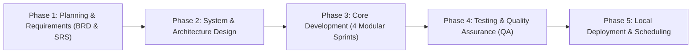
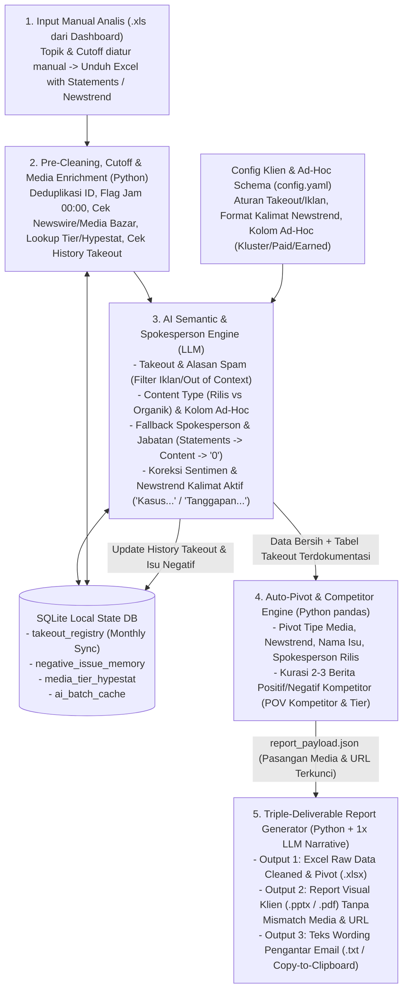

# System Requirements Specification (SRS) & SDLC Plan
**Project:** End-to-End Media Monitoring & Reporting Automation (Newstent)

> **Catatan Dokumen:** Dokumen ini adalah spesifikasi teknis (*Software Requirements Specification / SRS*) khusus untuk **Developer / AI Engineer**, telah disesuaikan dengan standar operasional pengerjaan *Daily/Monthly Report* Analis Senior (studi kasus alur BRI). Untuk dokumen bisnis non-teknis (*BRD*), lihat [BRD.md](./BRD.md). Untuk desain arsitektur detail Phase 2 (*Software Architecture Document*), lihat [SAD.md](../phase-2-design/SAD.md).

---

## 1. Metodologi SDLC & Keputusan Arsitektur Utama

### A. Tahapan SDLC (*Iterative & Incremental SDLC*)

Mengingat pengembangan dimulai dari lingkungan lokal (*local environment*) dengan fokus mengotomasi tahap **Data Cleaning $\rightarrow$ Klasifikasi & Ekstraksi Spokesperson $\rightarrow$ Pivot & SoV $\rightarrow$ Laporan Akhir** sebelum pukul 09.00 WIB, metode SDLC yang digunakan adalah **Iterative & Incremental SDLC**:

| Fase SDLC | Fokus & Aktivitas Utama | *Deliverables* / Output |
| :--- | :--- | :--- |
| **Phase 1: Planning & Requirement Analysis** | Pemetaan alur analis senior (studi kasus BRI), aturan *Takeout & Alasan Spam*, standardisasi *Newstrend* berawalan sentimen, logika 3-tingkat *Spokesperson* (`Statements` $\rightarrow$ `Content` $\rightarrow$ `0`), analisis kompetitor/SoV, serta kolom *ad-hoc*. | `BRD.md` & `SRS.md` |
| **Phase 2: System & AI Architecture Design** | Perancangan skema SQLite (`ai_cache`, `takeout_registry` untuk sinkronisasi bulanan, `negative_issue_memory`, & `media_hypestat_lookup`), struktur fleksibel `config.yaml`, `report_payload.json`, dan arsitektur **Next.js + FastAPI**. | `SAD.md` (`docs/phase-2-design/`) |
| **Phase 3: Implementation (Modular Build)** | **Sprint 1:** Ingestion Excel (`.xls with Statements` via `python-calamine`), Validasi Jam `00:00` (*Cutoff*), Lookup *Custom Media Tier/Hypestat* & *Newswire/Media Bazar*, serta Sinkronisasi *Takeout* Historis. **Sprint 2:** Cloud AI Semantic Engine (*Spam/Iklan Takeout + Alasan*, *Newstrend Kalimat Aktif*, *3-Tier Spokesperson Extraction*, & *Ad-Hoc Columns*). **Sprint 3:** Auto-Pivot Engine (*Tipe Media, Newstrend, Nama Isu, Spokesperson Rilis*), Kurasi 2–3 Berita Kompetitor, & Triple-Deliverable Generator (`xlsxwriter`/`openpyxl` + `python-pptx` + `Wording`). **Sprint 4:** Local Web UI (**Next.js** Frontend + **FastAPI** Backend + SSE Progress + Spreadsheet QC Table + Ad-Hoc Column & Column Picker). | Source Code Modular (`src/`, `backend/`, `frontend/`) |
| **Phase 4: Testing & Quality Control (QA)** | Uji coba menggunakan dataset riil (maks. 800 baris), validasi akurasi *Takeout*, *Spokesperson*, *Sentiment*, dan *Newstrend* terhadap kurasi analis senior, serta verifikasi 0 selisih angka *Pivot*. | Laporan Hasil QA & Benchmark Performa |
| **Phase 5: Local Deployment & Handover** | Paket skrip *one-click launcher* lokal (FastAPI + Next.js) agar analis dapat langsung menjalankan sistem di laptop Windows sebelum pukul 09.00 WIB. | Sistem Produksi Lokal Siap Pakai |

### B. Keputusan Arsitektur Engine: *Decoupled Local Web App* (Next.js + FastAPI + Deterministic Python Core)
1. **Hulu Manual (Standar Unduhan `.xls with Statements`), Hilir Otomatis Terkontrol:**
   - Pengaturan topik (`My Topics`), penentuan rentang waktu (*cutoff*), serta *request* dan pengunduhan *raw data* Excel dari dashboard Newstensity **tetap dijalankan manual oleh analis**.
   - **Standar Format Unduhan Wajib `Spreadsheet (.xls with Statements)`:** Analis cukup selalu memilih `.xls with Statements` (dibanding `.xls with Newstrend`), karena:
     1. *Newstrend* bawaan dashboard tetap harus disesuaikan ulang dengan isi `Content` dan aturan kalimat aktif ber-prefix sentimen (`"Kasus..."` / `"Tanggapan..."`).
     2. `.xls with Statements` memberikan **sheet `Statements` terpisah** (`Report id`, `Name`, `Position`, `Quote`) yang menghemat 70%+ kerja ekstraksi *Spokesperson* di Tingkat 1 dengan biaya 0 token AI.
2. **Alat Bantu Otomasi Alur Kerja Analis yang Cepat & Bebas Batas Token:**
   - Dalam praktik operasional saat ini, pengolahan sentimen dan *Newstrend* pada *tool* web yang ada sering terkendala proses yang lambat dan batas token rendah (*low token limit*), sementara ChatGPT Web terkena *hit limit* setelah 2 klien.
   - Sebagai **alat bantu otomasi alur kerja analis (*Analyst Workflow Automation Tool*)**, sistem ini memanggil Cloud AI (DeepSeek/OpenRouter) melalui **Micro-Batching (25–35 baris/call) secara paralel/asinkron (`asyncio`)**, **Integer ID Mapping** (memangkas 32.000 token hash ID), **Smart Context Slicing**, dan **Local SQLite Cache**, sehingga 800 baris tidak pernah terkena *low token limit* dan selesai dalam $< 3$ menit.
3. **Arsitektur 3 Lapis (*Core Engine* Terpisah dari *Web UI*):**
   - **`src/` (Deterministic Python Core):** Memegang kendali penuh atas integritas pasangan data (`ID`, `Media Name`, `Page/URL`, `Date`), *Auto-Pivot*, dan *Dual-Deliverable Generator* (mencegah *mismatch* Nama Media & URL oleh AI).
   - **`backend/` (FastAPI):** Membungkus `src/` menjadi REST API + *Server-Sent Events (SSE)* untuk *progress bar real-time*.
   - **`frontend/` (Next.js):** Memberikan antarmuka web lokal interaktif (upload *drag-and-drop*, tabel QC mirip Excel di browser, form kolom *ad-hoc*, dan *Column Picker* ekspor klien).

---

## 2. Spesifikasi Cloud AI, Matriks Tugas, & Strategi Optimasi Biaya API

### A. Pemilihan Model Cloud AI (Fokus *Open-Source / Open-Weights*: Akurat & Murah)

| Peran di Sistem | Model & Provider | Estimasi Biaya | Alasan Pemilihan & Karakteristik |
| :--- | :--- | :--- | :--- |
| **Primary Model (Default)** | **DeepSeek-Flash (`deepseek-flash` / V4.1-Flash)** & **DeepSeek-V4-Pro** *(via DeepSeek API Resmi / OpenRouter)* | **Off-Peak (< 08.00 WIB / Weekend):** \$0.003 Hit / \$0.15 Miss / \$0.60 Out per 1M Token **Peak (08.00–11.00 WIB):** \$0.006 Hit / \$0.30 Miss / \$1.20 Out per 1M Token | - **Penalaran Logika Terbaik di Kelas Open-Source:** Sangat presisi dalam mengeksekusi aturan spesifik klien (seperti filter iklan BRI, *prefix Newstrend* `"Kasus..."` / `"Tanggapan..."`, ekstraksi *Spokesperson* dari `Content`, dan kolom *ad-hoc*). - **Automatic Context Caching:** *System Prompt* & *Client Brief* yang berulang otomatis di-*cache* di server (diskon hingga 98% pada *Cache Hit*). - **Diskon Off-Peak 50%:** Eksekusi sebelum pukul **08.00 WIB** atau akhir pekan otomatis mendapat tarif separuh harga. - **Bebas Vendor Lock-in:** 100% *OpenAI-compatible*. |
| **Secondary Open-Source Model** | **Qwen 2.5 72B / Qwen 3** *(via OpenRouter / DeepInfra / Alibaba Cloud)* | ~\$0.12 – \$0.30 / 1M Token | Sangat kuat pada tata bahasa Indonesia (penyusunan kalimat aktif *Newstrend* dengan batas maksimal kata), cocok sebagai *secondary model* atau *fallback*. |
| **Fast Open-Source Fallback** | **Llama 3.3 70B Instruct** *(via Groq Cloud API)* | **Free Dev Tier** / Paid: ~\$0.59 / 1M Token | Kecepatan *inference* ekstrem (>300 token/detik), menjadi cadangan instan di jam sibuk pagi hari. |
| **Optional Backup** | **Gemini 2.5 Flash** *(via Google AI Studio)* | **Free Tier** tersedia | Cadangan gratis dengan *context window* 1M token dan *Native JSON Schema* saat pengujian lokal. |

### B. Komparasi Mendalam Antar Kandidat Model Cloud AI

| Parameter Evaluasi | **DeepSeek-V4.1 / V3.1** *(Open-Source)* | **Qwen 2.5 72B / Qwen 3** *(Open-Source)* | **Llama 3.3 70B (Groq)** *(Open-Source)* | **Gemini 2.5 Flash** *(Proprietary)* | **GPT-4o-mini / 4.1-mini** *(Proprietary)* |
| :--- | :--- | :--- | :--- | :--- | :--- |
| **Kepatuhan Aturan Kompleks Klien** *(Filter Iklan, Prefix "Kasus..."/"Tanggapan...", POV)* | ⭐⭐⭐⭐⭐ (Sangat Presisi) | ⭐⭐⭐⭐ (Presisi) | ⭐⭐⭐ (Kadang terlalu kaku/literal) | ⭐⭐⭐⭐ (Presisi) | ⭐⭐⭐⭐⭐ (Sangat mirip ChatGPT Web) |
| **Ekstraksi *Spokesperson & Jabatan* dari `Content`** | ⭐⭐⭐⭐⭐ (Tajam) | ⭐⭐⭐⭐⭐ (Sangat Natural untuk ID) | ⭐⭐⭐ (Cukup) | ⭐⭐⭐⭐⭐ (Tajam) | ⭐⭐⭐⭐ (Baik) |
| **Kestabilan Output JSON (*Batch Processing*)** | ⭐⭐⭐⭐ (Stabil dengan JSON mode) | ⭐⭐⭐⭐ (Stabil) | ⭐⭐⭐ (Kadang gagal di *batch* besar) | ⭐⭐⭐⭐⭐ (*Native Schema* paling ketat) | ⭐⭐⭐⭐⭐ (*Structured Outputs* ketat) |
| **Kecepatan Respon (*Latency*)** | ⭐⭐⭐ (Sedang) | ⭐⭐⭐⭐ (Cepat) | ⭐⭐⭐⭐⭐ (Ekstrem: >300 tok/s) | ⭐⭐⭐⭐⭐ (Sangat Cepat) | ⭐⭐⭐⭐ (Cepat) |
| **Efisiensi Biaya & *Caching*** | ⭐⭐⭐⭐⭐ (*Auto Disk Cache* diskon s.d. 90%) | ⭐⭐⭐⭐ (Sangat Murah) | ⭐⭐⭐⭐ (Ada Free Dev Tier) | ⭐⭐⭐⭐⭐ (Ada Free Tier + Murah) | ⭐⭐⭐⭐ (Murah) |

### C. Matriks Kecocokan Model per Tahapan Workflow (*Task-to-Model Mapping*)

| Tahap Workflow | Model / Engine yang **BAGUS (Recommended)** | Model / Engine yang **TIDAK BAGUS (Avoid)** | Alasan Engineering |
| :--- | :--- | :--- | :--- |
| **1. Deduplikasi `ID`, Flag Jam `00:00`, Filter *Newswire*, Lookup *Hypestat/Media Bazar*, & Sync *Takeout* Bulanan** | **Python Murni + SQLite Lookup** (`pandas`, `re`, `sqlite3`) — **0 Token AI** | **Semua LLM** | Validasi jam `00:00`, pencocokan daftar domain *Newswire/Media Bazar*, *Media Tier/Hypestat*, dan sinkronisasi ID *Takeout* bulanan wajib 100% deterministik di Python. |
| **2. Deteksi *Spam/Iklan* (`Takeout` + `Alasan_Spam`) & Klasifikasi `Content_Type` (*Rilis vs Organik*)** | **DeepSeek-V4.1/V3.1 (Instruct)**, **Qwen 3 / 2.5 72B**, atau **Gemini 2.5 Flash** | **Model Kecil (<14B)** & **Model *Reasoning* Murni (R1/o1)** | Butuh pemahaman konteks untuk membedakan berita organik vs. berita rilis vs. iklan murni (seperti aturan eksklusi iklan BRI) sekaligus menuliskan `Alasan_Spam` yang jelas. |
| **3. Ekstraksi *Spokesperson & Jabatan* Fallback (`Statements` $\rightarrow$ `Content` $\rightarrow$ `0`)** | **Python (`Statements` join) $\rightarrow$ DeepSeek/Qwen (Hanya jika `Statements` kosong) $\rightarrow$ Python (`0` default)** | Meminta LLM mengekstrak ulang baris yang sudah ada di `Statements` | Menghemat waktu dan token: Python mengisi dulu dari sheet `Statements`; LLM hanya membaca `Content` untuk baris yang kosong; jika tidak ditemukan, Python otomatis mengisi `0`. |
| **4. *Sentiment Correction* (POV Klien & POV Kompetitor) + Memori Konsistensi Isu Negatif** | **DeepSeek-V4.1/V3.1 (Instruct)** + **SQLite Negative Issue Memory** | **IndoBERT / Lexicon** & **Llama 3.3 70B** | Sentimen harus menilai dari POV klien (atau POV kompetitor untuk kurasi berita kompetitor) dan wajib konsisten negatif apabila isu yang sama muncul kembali. |
| **5. Standardisasi `Newstrends` Kalimat Aktif (`"Kasus..."` / `"Tanggapan..."`)** | **Pass 1 (Per Batch) + Pass 2 (Global Normalization via DeepSeek / Qwen)** | *Newstrend* mentah bawaan Newstensity | *Newstrend* disesuaikan dengan isi `Content`, berbentuk kalimat aktif dengan batas maksimal kata sesuai aturan klien, dan umumnya mengandung kata yang mencerminkan sentimen (*"Kasus..."* / *"Tanggapan..."*). |
| **6. Penyusunan *Pivot*, Kurasi 2–3 Berita Kompetitor, SoV Bulanan, & Injeksi Template** | **Python Murni** (`pandas`, `openpyxl`, `python-pptx`, `docxtpl`) — **0 Token AI** | **Meminta LLM membuat template/tabel berita langsung** | **Kritis:** Meminta AI menyusun tabel berita/template secara langsung sering menyebabkan *mismatch* antara `Nama Media` dan `URL`. Python wajib mengunci pasangan data asli. |

### D. 6 Komponen Penghemat Biaya API (*AI Engineering Cost Guardrails*)

1. **Exact & Near-Duplicate Grouping (`rapidfuzz` + URL Normalization):** Mengelompokkan berita rilis/sindikasi yang identik ($\ge 90\%$ mirip) sehingga hanya 1 perwakilan klaster yang dikirim ke AI.
2. **Pre-Takeout Mekanis (0 Token untuk *Newswire* & *Historical Takeout*):** Berita dengan `Media Type Detail == Newswire` atau berita negatif yang sudah tercatat di database `takeout_registry` langsung ditandai `Takeout` oleh Python tanpa perlu memanggil API LLM.
3. **Selective Spokesperson Extraction & Smart Context Slicing:** Baris yang sudah memiliki narasumber lengkap di sheet `Statements` tidak perlu diekstrak ulang oleh LLM; untuk baris lainnya, `Content` dipotong menjadi *Smart Snippet* (~100–120 token).
4. **Temporary Integer ID Mapping:** Mengganti hash `ID` 64-karakter menjadi integer (`1, 2, 3...`) saat berkomunikasi dengan LLM (hemat $\pm 32.000$ token per 800 baris).
5. **Micro-Batching (25–35 Berita/Call) & Dynamic Ad-Hoc JSON Schema (`Pydantic`):** Mengirim berita per kloter dengan skema JSON padat yang otomatis menyertakan kolom *ad-hoc* jika diaktifkan di `config.yaml`.
6. **Local SQLite Multi-Table Caching (`sqlite3`):** Menyimpan hasil klasifikasi AI, memori isu negatif, daftar domain *Hypestat/Media Tier*, dan riwayat *Takeout* di database lokal (`data/newstent_state.db`) sehingga *re-run* dan kompilasi *Monthly Report* memakan 0 token.

### E. Tarif Resmi DeepSeek API & Simulasi Biaya Bulanan (800 Baris per Run)

Mengacu pada dokumentasi tarif resmi **DeepSeek API (`api-docs.deepseek.com`)** per **1 juta token** (dengan perbedaan tarif *Off-Peak* vs. *Peak*):

| Model Resmi DeepSeek | Jam Eksekusi (WIB) | Input (*Cache Hit*) | Input (*Cache Miss*) | Output |
| :--- | :--- | :--- | :--- | :--- |
| **`DeepSeek-Flash`** *(V4.1-Flash)* | **Off-Peak (Diskon 50%):** Di luar jam *Peak* (termasuk **< 08.00 WIB** & *Weekend* penuh) **Peak:** Senin–Jumat **08.00–11.00 WIB** & **13.00–17.00 WIB** *(01:00–04:00 & 06:00–10:00 UTC)* | \$0.003 \$0.006 | \$0.15 \$0.30 | \$0.60 \$1.20 |
| **`DeepSeek-V4-Pro`** *(Opsional Pass 3)* | **Off-Peak (Diskon 50%)** **Peak** | \$0.022 \$0.044 | \$0.66 \$1.32 | \$1.98 \$3.96 |

#### Simulasi Biaya Operasional (Asumsi 800 Baris Baru: ~25k *Cache Hit* + ~50k *Cache Miss* + ~22k Output, Kurs Rp 16.000/USD)
- **Konsumsi Token per 1x Full Run (800 Baris Baru):** ~85.000 – 115.000 Token total (*Pass 1 Batching* + *Pass 2 Global Newstrend & Negative Consistency* + *Pass 3 Narrative Engine*).
- **Biaya 1x Full Run — *Off-Peak* (Dijalankan < 08.00 WIB / *Weekend*, `DeepSeek-Flash`):** **~\$0.021 USD (~Rp 335 perak)**.
- **Biaya 1x Full Run — *Peak* (Dijalankan 08.00–09.00 WIB Senin–Jumat, `DeepSeek-Flash`):** **~\$0.042 USD (~Rp 665 perak)**.
- **Biaya Re-Run Testing / Sinkronisasi Monthly Report (SQLite Cache Hit):** **Rp 0 – Rp 50 perak**.
- **Estimasi Anggaran 1 Bulan Penuh (90 Report Harian + 30x Testing Full Run):**
  - Jika mayoritas dijalankan **< 08.00 WIB (*Off-Peak*)**: **~\$2.50 – \$3.50 USD (~Rp 40.000 – Rp 56.000 / bulan)**.
  - Jika mayoritas dijalankan **08.00–09.00 WIB (*Peak*)**: **~\$4.50 – \$5.50 USD (~Rp 72.000 – Rp 88.000 / bulan)**.
  - *(Opsional: Menambahkan `DeepSeek-V4-Pro` khusus untuk Pass 3 Executive Summary hanya menambah ~Rp 100–Rp 190 perak per laporan).*

---

## 3. Alur Pipeline End-to-End & Arsitektur Sinkronisasi Data

---

## 4. Kebutuhan Fungsional (*Functional Requirements*)

### FR-01: Manual Upstream Ingestion (`.xls with Statements`) & Flexible Client Configuration (`config.yaml`)
- **FR-01.1 (Standar Input `.xls with Statements`):** Pengaturan topik (`My Topics`), penentuan batas waktu (*cutoff*), dan pengunduhan file Excel dari menu *Reporting* tetap dilakukan manual oleh analis dengan memilih format standar **`Spreadsheet (.xls with Statements)`** agar sistem memperoleh sheet `News` dan sheet `Statements` sekaligus (dibaca menggunakan *engine* **`python-calamine`** agar cepat dan tahan terhadap format `.xls` lama).
- **FR-01.2 (Konfigurasi Klien & Kolom Ad-Hoc Dinamis):** Sistem membaca `clients/<nama_klien>/config.yaml` yang mendefinisikan:
  - Aturan eksklusi khusus klien (contoh: aturan BRI yang mengecualikan berita iklan/promosi).
  - Aturan format kalimat *Newstrend* (kalimat aktif, minimal jumlah kata, dan aturan awalan/*prefix* per sentimen).
  - Definisi **Kolom Tambahan Ad-Hoc** (seperti `Kluster`, `Paid` vs. `Earned`, `Content_Type`, `Nama_Isu`) yang dapat diaktifkan/ditambahkan sewaktu-waktu sesuai perubahan permintaan klien.

### FR-02: Pre-Cleaning, Validasi Jam `00:00` (*Cutoff*), Atribut Media, & Sinkronisasi *Takeout*
- **FR-02.1 (Deduplikasi `ID` & Sinkronisasi `Statements`):** Deduplikasi eksak berbasis `ID` pada sheet `News` dan sinkronisasi relasional dengan kolom `Report id` pada sheet `Statements`.
- **FR-02.2 (Deteksi Jam Publikasi Default `00:00` untuk Akurasi *Cutoff*):**
  - Sistem memeriksa kolom `Date`. Apabila jam publikasi bernilai **`00:00`** (nilai *default* sistem Newstensity saat berita tidak memiliki jam tayang), sistem otomatis memberikan penanda **`Flag_Cutoff_00` = True** agar analis dapat memvalidasi kesesuaiannya dengan batas *cutoff* harian.
- **FR-02.3 (Enrichment Atribut Media: *Newswire vs. Media Bazar*, *Custom Media Tier* Klien, & *Hypestat*):**
  - Sistem memvalidasi dan mengelompokkan atribut **`Media Type Detail`** untuk membedakan antara **Newswire**, **Media Bazar**, dan media organik/arus utama. Berita yang teridentifikasi sebagai **Newswire** otomatis ditandai sebagai **`Takeout`** dengan alasan `"Takeout - Newswire"`.
  - Sistem mendukung tabel referensi master media di SQLite (`media_master`) yang menyimpan **`tier_bino`** (standar Binokular), **`client_custom_tier`** (aturan tier khusus klien seperti **`TIER BNI`** dari 13.000+ daftar media, di mana misal `beritasatu.com` bernilai Tier 1 di Binokular tetapi Tier 2 di BNI), serta estimasi nilai/trafik **Hypestat**, sehingga menggantikan kebutuhan VLOOKUP manual berulang di Excel.
- **FR-02.4 (Penandaan `Takeout`, `Alasan_Spam`, Cek Silang `Req Upload`/`Takedown`, & Sinkronisasi Historis hingga *Monthly Report*):**
  - Berita yang masuk kategori *spam*, *newswire*, iklan klien, maupun **berita negatif sensitif yang di-*takeout* / *takedown* (atau tautannya menjadi *invalid/404*)** tidak dihapus tanpa jejak, melainkan dipisahkan/diberi status **`Status_Takeout = Takeout`** dan wajib memiliki isi pada kolom **`Alasan_Spam`**.
  - Sistem mendukung pencocokan otomatis (*URL matching*) terhadap daftar link kiriman klien (seperti daftar **`Req Upload`** berita rilis/counter-narrative atau daftar **`Takedown` / moderasi**) terhadap sheet `News`.
  - Setiap `ID` dan `Page/URL` berita yang berstatus `Takeout` / `Takedown` disimpan secara persisten ke dalam tabel SQLite **`takeout_registry`** untuk sinkronisasi otomatis ke *Weekly* dan *Monthly Report*.

### FR-03: Standardisasi *Newstrend*, Konsistensi Sentimen, *Spokesperson Fallback*, & Kolom *Ad-Hoc*
- **FR-03.1 (Penyesuaian *Newstrend* Berbasis `Content` & Format Kalimat Aktif):**
  - Sistem tidak menggunakan mentah-mentah kolom `Newstrends` bawaan Newstensity, melainkan mengevaluasi ulang berdasarkan isi kolom **`Content`** dan `Title`.
  - Format `Newstrends` dibentuk sesuai konfigurasi klien (contoh: **berbentuk kalimat aktif dengan batas maksimal kata tertentu**) dan **biasanya mengandung kata yang mencerminkan sentimen berita**:
    - Sentimen **Negative**: biasanya mengandung/diawali kata seperti **`"Kasus ..."`**
    - Sentimen **Neutral**: biasanya mengandung/diawali kata seperti **`"Tanggapan ..."`**
    - Sentimen **Positive**: kalimat aktif yang merepresentasikan aksi/kinerja positif.
  - Selain `Newstrends` (kalimat lengkap), sistem juga mengekstrak **`Nama_Isu`** (label isu ringkas) untuk kebutuhan pengelompokan *Pivot*.
- **FR-03.2 (Konsistensi Sentimen Negatif Lintas Waktu & Berita):**
  - Sistem menyimpan daftar isu negatif yang telah teridentifikasi ke dalam tabel SQLite **`negative_issue_memory`**. Apabila isu/peristiwa yang sama muncul kembali pada berita lain atau hari berikutnya, sistem wajib mempertahankan label sentimen **`negative`** dan nama isu kanonikal yang konsisten.
- **FR-03.3 (Klasifikasi `Content_Type` & Logika 3-Tingkat *Spokesperson + Jabatan*):**
  - Sistem mengklasifikasikan setiap berita ke dalam atribut **`Content_Type`**: **Rilis (*Press Release*)** vs. **Organik**.
  - Untuk mengisi kolom **`Spokesperson`** dan **`Jabatan` (`Position`)** (yang wajib masuk ke dalam *Pivot* untuk berita **Rilis**), sistem mengeksekusi **Logika 3-Tingkat (*3-Tier Fallback*)** secara otomatis:
    1. **Tingkat 1 (Sheet `Statements`):** Mencari `Name` dan `Position` pada sheet `Statements` berdasarkan kecocokan `Report id == ID`.
    2. **Tingkat 2 (Ekstraksi AI dari `Content`):** Jika pada sheet `Statements` kosong/tidak ditemukan, LLM memindai teks pada kolom `Content` berita tersebut untuk mengekstrak nama narasumber (`Spokesperson`) beserta jabatannya (`Jabatan`).
    3. **Tingkat 3 (Default `0`):** Apabila di sheet `Statements` maupun di dalam kolom `Content` tetap tidak ditemukan narasumber, sistem **wajib mengisi kolom `Spokesperson` dan `Jabatan` dengan nilai `0`** (bukan *blank/null*).
- **FR-03.4 (Ekstraksi Kolom Tambahan *Ad-Hoc*):**
  - Sistem mendukung pengisian otomatis kolom-kolom *ad-hoc* yang didefinisikan pada `config.yaml`, seperti **`Kluster`** (pengelompokan tema/divisi klien) serta klasifikasi **`Paid`** vs. **`Earned`** media.

### FR-04: Penyusunan Pivot Utama & Kurasi Berita Kompetitor
- **FR-04.1 (Pivot Utama & Pivot Spokesperson Berita Rilis):**
  - Python (`pandas`) menyusun tabel-tabel *Pivot* utama yang mencakup:
    1. **Pivot Tipe Media (`Media Type` & `Media Type Detail`)**
    2. **Pivot `Newstrends` & `Nama_Isu` vs. Sentimen**
    3. **Pivot Khusus Berita Rilis (`Content_Type == Rilis`):** Menampilkan rekapitulasi **`Spokesperson`** dan **`Jabatan`** (termasuk baris bernilai `0` jika tanpa narasumber) beserta jumlah pemberitaannya.
- **FR-04.2 (Kurasi Otomatis Berita Kompetitor Berbasis POV Kompetitor & Media Tier):**
  - Untuk pemantauan kompetitor harian/mingguan, sistem mengevaluasi sentimen berita kompetitor berdasarkan **sudut pandang (*POV*) kompetitor tersebut** (bukan POV klien utama).
  - Sistem secara otomatis memilih dan merekomendasikan **2–3 berita bersentimen Positif dan 2–3 berita bersentimen Negatif** terbaik untuk masing-masing kompetitor dengan memprioritaskan **`Media Tier`** tertinggi (*Tier 1* diutamakan).

### FR-05: Triple-Deliverable Generation (*Raw Data Cleaned Excel*, *Report PPTX/PDF*, & *Wording*) & Anti-Mismatch Media-URL
Berdasarkan referensi *output* riil analis (studi kasus BNI Jember), sistem menghasilkan **tiga output utama** (tanpa otomasi *Push Mail*):
- **FR-05.1 (Deliverable 1 — File Excel *Raw Data Cleaned & Pivot* `.xlsx` dengan *Excel Engineering*):**
  - Menghasilkan file `.xlsx` final menggunakan **`xlsxwriter`** (workbook baru) dan **`openpyxl`** (template Excel klien):
    - Sheet **`News_Clean`**: *Raw data cleaned* siap pakai lengkap dengan `Date` & `Time` terpisah, *Client Custom Tier* (mis. `TIER BNI`), `Content_Type`, `Spokesperson`, `Jabatan`, `Nama_Isu`, `Newstrends` terstandardisasi, `Flag_Cutoff_00`, serta kolom *ad-hoc* (`Kluster`, `Paid/Earned`). Dilengkapi *Excel Table*, *freeze panes*, *auto-width*, *clickable hyperlink* URL, dan **Conditional Formatting**.
    - Sheet **`Takeout_Spam` / `Takedown`**: Daftar berita yang di-*takeout*/*takedown* (*spam, iklan, newswire, isu negatif sensitif*) lengkap dengan kolom **`Alasan_Spam`** untuk mempermudah validasi analis.
    - Sheet **`Statements`** (terfilter) dan Sheet **`Pivot`**: Menggunakan **rumus Excel dinamis (`COUNTIFS`, `SUM`)** yang 100% bebas error `#REF!` serta *Native Excel Chart*.
- **FR-05.2 (Deliverable 2 — File Laporan Presentasi / Dokumen Visual `.pptx` / `.pdf` dengan Anti-Mismatch):**
  - AI **dilarang** menyusun tabel daftar berita atau menuliskan ulang URL/Nama Media secara bebas.
  - Seluruh daftar berita *highlight* (termasuk 2–3 berita positif/negatif kompetitor) diambil langsung oleh Python dari *DataFrame* asli berdasarkan kunci `ID`, sehingga pasangan **`Judul` — `Media Name` — `Media Tier` — `Page/URL`** dijamin **100% akurat dan tidak mungkin tertukar**.
  - Mendukung pemetaan fleksibel ke *template* `.pptx` klien melalui `config.yaml` serta ekspor ke `.pdf`.
- **FR-05.3 (Deliverable 3 — Teks *Wording* Pengantar Email `.txt` / *Copy-to-Clipboard*):**
  - Menghasilkan teks ***Wording*** terstruktur (Salam + periode & *cutoff*, *Perkembangan Sentimen* beserta rincian angka Media Online/Sosmed/Engagement/Tier, *Timeline Perkembangan Isu*, dan *Arah Percakapan Publik*).
  - Di-generate langsung dari **`report_payload.json` + `narrative.json`** yang sama dengan PPTX sehingga menjamin **0% inkonsistensi angka** antara *Wording* dan *Slide* PPTX.

### FR-06: Local Web UI (Next.js + FastAPI) & Interactive Excel QC Assistant
Untuk mempermudah pengoperasian harian oleh analis non-teknis tanpa harus membuka terminal atau mengedit file `config.yaml` secara manual:
- **FR-06.1 (Upload & Live Batch Progress):** Antarmuka Next.js menyediakan *drag-and-drop* upload `.xls with Statements`, pemilihan profil klien, serta *progress bar real-time* per *batch* melalui **Server-Sent Events (SSE)** dari FastAPI.
- **FR-06.2 (Interactive Spreadsheet QC Table):** Menampilkan hasil pengolahan dalam tabel interaktif mirip Excel (`AG Grid Community` / `@tanstack/react-table`) dengan **3 tab filter cepat**:
  1. **Tab *"Perlu Dicek (`00:00`)"***: Menyaring khusus berita dengan `Flag_Cutoff_00` agar analis dapat memvalidasi batas *cutoff* harian.
  2. **Tab *"Takeout & Alasan Spam"***: Memungkinkan analis meninjau alasan *takeout*, mengembalikan berita ke *Clean*, atau menandai berita negatif sensitif baru untuk langsung disinkronkan ke SQLite `takeout_registry` bulanan.
  3. **Tab *"Berita Rilis & Spokesperson (`0`)"***: Menyaring berita rilis yang narasumbernya bernilai `0` untuk *double check* cepat.
- **FR-06.3 (Ad-Hoc Column Form & Client Export Column Picker):** Analis dapat menambah/mengubah kolom *ad-hoc* (`Kluster`, `Paid/Earned`) lewat formulir UI, memilih kolom mana saja yang diekspor khusus untuk file Excel klien (*Column Picker*), lalu mengunduh **Output 1 (`.xlsx`)** dan **Output 2 (`.pptx` / `.pdf`)** dengan satu klik.

---

## 5. Kontrak Data & Kamus Kolom (*Data Dictionary / Data Contract*)

### A. Sheet `News` (Kolom Standar Newstensity + Kolom Enriched Otomasi)

| Nama Kolom | Kategori | Peran & Aturan dalam Pipeline Otomasi |
| :--- | :--- | :--- |
| **`ID`** | Standar (PK) | Kunci unik deduplikasi baris, referensi `Report id` di `Statements`, dan kunci sinkronisasi `takeout_registry` bulanan. |
| **`Title`** & **`Content`** | Standar | Input utama analisis AI: evaluasi ulang `Newstrends`, deteksi iklan/spam, koreksi sentimen, dan ekstraksi *fallback* `Spokesperson` + `Jabatan`. |
| **`Date`** | Standar | Diekstrak tanggal & jamnya. Jika jam bernilai **`00:00`**, otomatis ditandai pada kolom `Flag_Cutoff_00` untuk kewaspadaan batas *cutoff*. |
| **`Media Name`** & **`Page/URL`** | Standar | Dikunci secara deterministik oleh Python berdasarkan `ID` (tidak boleh ditulis ulang oleh AI) agar tidak pernah terjadi *mismatch* Nama Media dan URL. |
| **`Media Type`** & **`Media Type Detail`** | Standar / Enriched | `Media Type` (*online/print/electronic*) masuk ke Pivot utama. `Media Type Detail` membedakan **Newswire** (otomatis `Takeout`) vs. **Media Bazar** vs. media organik. |
| **`Media Tier`** & **`Oplah/Daily Visitor`** | Standar / Enriched | Divalidasi/diperkaya menggunakan referensi lokal **Hypestat**; digunakan untuk prioritas pemilihan 2–3 berita kompetitor dan Pivot Tier. |
| **`Sentiment`** | Diperbarui AI | Dikoreksi sesuai POV Klien (atau POV Kompetitor pada topik kompetitor). Wajib konsisten **`negative`** jika isu tercatat di `negative_issue_memory`. |
| **`Newstrends`** | Diperbarui AI | Disesuaikan dengan isi `Content`, berbentuk **kalimat aktif dengan batas maksimal kata tertentu**, dan biasanya mengandung kata sesuai sentimen (seperti **`"Kasus..."`** untuk negatif, **`"Tanggapan..."`** untuk netral). |
| **`Nama_Isu`** | **Kolom Baru** | Label ringkas identitas isu/peristiwa untuk pengelompokan Pivot utama berdampingan dengan `Newstrends`. |
| **`Status_Takeout`** & **`Alasan_Spam`** | **Kolom Baru** | Menandai baris `Keep` vs. `Takeout` beserta alasan jelas (misal: *"Iklan/Promosi BRI"*, *"Newswire"*, *"Spam/Out of Context"*, *"Takeout Negatif Sensitif"*). |
| **`Flag_Cutoff_00`** | **Kolom Baru** | Bernilai `WARNING_00:00` jika jam publikasi berita adalah *default* `00:00`, memudahkan verifikasi *cutoff* harian. |
| **`Content_Type`** | **Kolom Baru** | Klasifikasi **`Rilis`** vs. **`Organik`**. Menentukan berita mana yang wajib masuk ke Pivot *Spokesperson*. |
| **`Spokesperson`** & **`Jabatan`** | **Kolom Baru** | Diambil dari `Statements` $\rightarrow$ jika kosong diekstrak oleh AI dari `Content` $\rightarrow$ jika tetap tidak ada wajib diisi **`0`**. |
| **`Kluster`**, **`Paid_Earned`**, **` Custom_*`** | **Kolom Ad-Hoc** | Kolom dinamis yang otomatis ditambahkan dan diisi apabila diaktifkan pada `config.yaml` klien. |

---

## 6. Kebutuhan Non-Fungsional (*NFR*) & Kriteria Kelulusan (*Acceptance Criteria*)

### A. Non-Functional Requirements (NFR)

| Kode | Kategori | Spesifikasi Kebutuhan |
| :--- | :--- | :--- |
| **NFR-01** | **Performance & SLA** | Pemrosesan 1 klien (hingga 800 baris) mulai dari input Excel mentah hingga output Excel Pivot + PPT/Word selesai dalam **$< 3\text{–}5$ menit**. |
| **NFR-02** | **Hardware Footprint** | Berjalan ringan di laptop Windows standar (CPU standar, RAM 8–16 GB) tanpa membutuhkan GPU lokal. |
| **NFR-03** | **Zero Media-URL Mismatch** | Pasangan `ID`, `Judul`, `Media Name`, dan `Page/URL` pada setiap tabel laporan/template wajib 100% berasal dari *lookup* Python atas data asli (0% kemungkinan tertukar oleh AI). |
| **NFR-04** | **Cross-Period Takeout Consistency** | Berita negatif sensitif yang telah ditandai `Takeout` pada laporan harian wajib otomatis teridentifikasi sebagai `Takeout` saat memproses *Weekly* maupun *Monthly Report*. |

### B. Kriteria Kelulusan UAT / QA (*Acceptance Criteria* untuk Phase 4)
1. **Validasi `Takeout` & `Alasan_Spam`:** 100% berita *newswire* dan berita yang masuk daftar `takeout_registry` bulanan otomatis terfilter ke dalam kategori `Takeout` lengkap dengan kolom `Alasan_Spam`, serta berita dengan jam `00:00` ter-flag dengan benar.
2. **Kepatuhan Format `Newstrends` & Konsistensi Sentimen Negatif:** 100% baris `Newstrends` mematuhi aturan kalimat aktif, jumlah kata minimal, serta awalan selaras sentimen (`"Kasus..."` untuk negatif, `"Tanggapan..."` untuk netral), dan isu negatif berulang memiliki sentimen negatif yang konsisten.
3. **Kelengkapan *Spokesperson & Jabatan* Berita Rilis:** 100% berita berkategori `Rilis` memiliki nilai pada kolom `Spokesperson` dan `Jabatan` (dari `Statements` atau ekstraksi `Content`), dan 100% terisi angka `0` apabila narasumber tidak ditemukan di keduanya (0 sel *blank*).
4. **Akurasi Pivot & Kurasi Kompetitor:** Perhitungan Pivot (Tipe Media, Newstrend, Nama Isu, Spokesperson Rilis) memiliki selisih 0% terhadap hitungan manual Excel, serta pemilihan 2–3 berita kompetitor memiliki 0 kesalahan pemasangan `Nama Media` dan `URL`.
5. **Efisiensi Waktu & Biaya:** Eksekusi 800 baris selesai dalam **$< 5$ menit** dengan biaya API **$< \text{Rp }1.000$ per laporan**.

---

## 7. Matriks Asumsi, Risiko, & Mitigasi (*Assumptions & Risks*)

| Kategori | Deskripsi Asumsi / Risiko | Strategi Mitigasi pada Sistem |
| :--- | :--- | :--- |
| **Batasan Hulu Manual** | Pengaturan topik (`My Topics`), *cutoff*, dan *download* Excel masih dilakukan manual oleh analis. | Sistem menyediakan folder *watch/input* sederhana di mana analis cukup menaruh file `.xls` hasil unduhan, lalu menjalankan 1 perintah/klik untuk memproses sisanya secara otomatis. |
| **Risiko Perubahan Kolom *Ad-Hoc* Klien** | Klien meminta kolom baru secara mendadak (misal `Kluster`, `Paid/Earned`, atau kategori khusus). | Skema prompt dan *output parser* (`Pydantic`) membaca daftar `custom_columns` langsung dari `config.yaml` klien sehingga analis/engineer cukup menambah definisi kolom di YAML tanpa mengubah kode inti. |
| **Risiko *Mismatch* Nama Media & URL oleh AI** | Saat AI disuruh membuat tabel/template berita langsung, AI sering mengarang atau menukar URL antar media. | AI hanya pernah menerima indeks integer (`idx: 1, 2, 3`) dan hanya mengembalikan label klasifikasi. Penggabungan kembali dengan `Media Name` dan `Page/URL` dilakukan 100% oleh `pandas` berdasarkan `ID`. |
| **Risiko Berita Negatif *Takeout* Masuk Lagi di *Monthly Report*** | Tautan berita negatif yang sudah di-*takeout* di laporan harian ikut terunduh kembali saat tarik data bulanan. | Tabel SQLite `takeout_registry` menyimpan hash `ID` dan URL yang sudah di-*takeout* pada level harian sehingga otomatis di-*takeout* saat kompilasi *Monthly Report*. |

---

## 8. Spesifikasi *Tech Stack* & Library (Lokal)

| Komponen | Teknologi / Library | Kegunaan |
| :--- | :--- | :--- |
| **Core Engine & Backend** | `Python 3.11+`, `FastAPI`, `uvicorn` | *Core engine* otomasi deterministik (`src/`) dan REST API + *Server-Sent Events (SSE)* lokal (`backend/`). |
| **Frontend Web UI (Lokal)** | `Next.js`, `Tailwind CSS`, `shadcn/ui`, `AG Grid Community` / `@tanstack/react-table` | Antarmuka web lokal interaktif: upload *drag-and-drop*, *progress bar* live, tabel QC mirip Excel (*inline editing*), form kolom *ad-hoc*, dan *Column Picker*. |
| **Excel Processing Engine** | `pandas`, **`python-calamine`** (Rust reader), **`xlsxwriter`**, **`openpyxl`** | `python-calamine` untuk baca `.xls`/`.xlsx` 5–10x lebih cepat & anti-error; `xlsxwriter` untuk menulis file baru lengkap dengan rumus Excel dinamis (`COUNTIFS`/`SUM`), *Conditional Formatting*, *Excel Table*, *auto-width*, & *Native Chart*; `openpyxl` untuk mengisi *template* Excel klien yang sudah ada. |
| **Text Deduplication & Pre-Cleaning** | `rapidfuzz`, `re` (Regex), `urllib.parse` | Pengelompokan berita sindikasi ($\ge 90\%$ mirip), normalisasi URL, dan pembersihan *noise* hasil *crawling*. |
| **Cloud AI SDK & Validation** | `openai` (DeepSeek, Qwen/OpenRouter, Groq, OpenAI), `google-genai`, `pydantic` | Pemrosesan *batch* semantik (*Takeout reason, Newstrend prefix, Spokesperson extraction from Content, Ad-hoc columns*) dengan validasi skema JSON ketat. |
| **Local State & Caching DB** | `sqlite3` (Built-in Python) | Menyimpan 4 tabel lokal: `ai_cache`, `takeout_registry` (sinkronisasi *Monthly Report*), `negative_issue_memory` (konsistensi isu negatif), dan `media_tier_hypestat`. |
| **Report Generators** | `python-pptx`, `matplotlib` / `seaborn` | Injeksi data & *native chart* ke `template.pptx` klien secara deterministik (tanpa risiko *mismatch* Media & URL) serta ekspor `.pdf`. |
| **Config & Environment** | `python-dotenv`, `PyYAML` | Manajemen *API Keys* (`.env`) dan profil *brief* + kolom *ad-hoc* per klien (`clients/<klien>/config.yaml`). |
