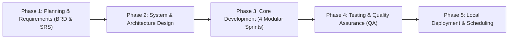
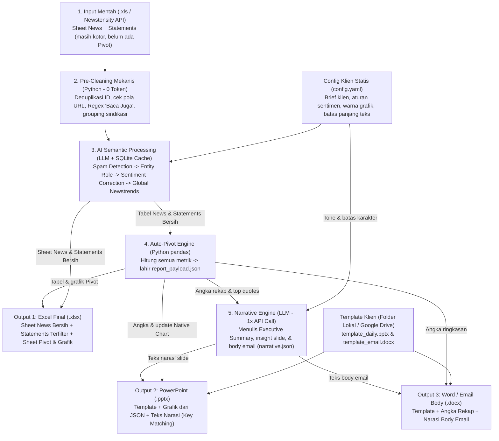

# System Requirements Specification (SRS) & SDLC Plan
**Project:** End-to-End Media Monitoring & Reporting Automation (Newstent)

> **Catatan Dokumen:** Dokumen ini adalah spesifikasi teknis (*Software Requirements Specification / SRS*) khusus untuk **Developer / AI Engineer**. Untuk dokumen bisnis dan operasional non-teknis (*BRD*), lihat [PROJECT_BASELINE.md](./PROJECT_BASELINE.md). Untuk catatan tanya-jawab pendalaman arsitektur, lihat [ARCHITECTURE_DISCUSSION.md](../phase-2-design/ARCHITECTURE_DISCUSSION.md).

---

## 1. Metodologi SDLC & Keputusan Arsitektur Utama

### A. Tahapan SDLC (*Iterative & Incremental SDLC*)

Mengingat pengembangan dimulai dari lingkungan lokal (*local environment*) dengan target mengatasi *deadline* operasional harian pukul 09.00 WIB, metode SDLC yang digunakan adalah **Iterative & Incremental SDLC**:

| Fase SDLC | Fokus & Aktivitas Utama | *Deliverables* / Output |
| :--- | :--- | :--- |
| **Phase 1: Planning & Requirement Analysis** | Identifikasi *pain points* analis, alur *Request Data* (`.xls with Statements`), aturan *Master Prompt*, batasan *Scope*, *Data Dictionary*, serta *Acceptance Criteria*. | `PROJECT_BASELINE.md`, `SYSTEM_REQUIREMENTS.md`, & `ARCHITECTURE_DISCUSSION.md` |
| **Phase 2: System & AI Architecture Design** | Perancangan skema SQLite *cache*, struktur `config.yaml` (statis), skema `report_payload.json` & `narrative.json` (dinamis), desain *batch prompt*, serta konvensi *Key Matching* PPT/Word. | Dokumen Desain Arsitektur & Spesifikasi Modul (`phase 2/`) |
| **Phase 3: Implementation (Modular Build)** | **Sprint 1:** Ingestion & Pre-Cleaning Mekanis (Deduplikasi `ID`, Validasi Pola URL, Regex, *Syndicated Grouping*). **Sprint 2:** Cloud AI Semantic Engine (4 Tahap *Master Prompt* + SQLite Cache). **Sprint 3:** Auto-Pivot Engine (`report_payload.json`) & Excel Generator. **Sprint 4:** Template-Driven PPT & Word Generator (`narrative.json` + *Key Matching*) & Push Mail. | Source Code Python Modular (`src/`) |
| **Phase 4: Testing & Quality Control (QA)** | Uji coba menggunakan dataset riil (maks. 800 baris), validasi akurasi *Sentiment & Newstrend* terhadap standar analis senior, verifikasi 0 selisih angka *Pivot*, dan audit biaya API. | Laporan Hasil QA & Benchmark Performa |
| **Phase 5: Local Deployment & Automation** | Pembuatan *Task Scheduler* / CLI tunggal untuk mengeksekusi $\ge 3$ klien secara berurutan pada pagi hari sebelum pukul 09.00 WIB (serta opsional ekspansi *ChatOps*). | Sistem Produksi Lokal Siap Pakai |

### B. Keputusan Arsitektur Engine: *Custom Deterministic Python Pipeline* vs. *Autonomous Agent*
- **Keputusan Core Engine (Wajib Custom Python Pipeline):** Seluruh alur pemrosesan data hingga pembuatan laporan dibangun sebagai **pipeline Python deterministik**, bukan diserahkan ke *autonomous agent framework* (seperti *Hermes Agent*).
  - **Alasan:** Sekitar 70% tahapan (deduplikasi `ID`, sinkronisasi `Statements`, filter pola URL, perhitungan matematika *Pivot Table*, dan injeksi *layout* PPT/Word) bersifat deterministik yang membutuhkan konsistensi 100%, waktu eksekusi cepat ($< 3\text{–}5$ menit/klien), serta kontrol biaya ketat (~Rp 350–550/report) tanpa *agentic reasoning loop* yang boros token.
- **Opsi Hybrid (Opsional di Phase 5):** Jika di masa depan dibutuhkan antarmuka *ChatOps* (Telegram/WhatsApp) atau *autonomous scheduler*, *framework* seperti Hermes Agent hanya boleh ditempatkan sebagai **Layer 2 (Operator/Trigger)** yang memanggil CLI Python (*Layer 1 Core Engine*), bukan sebagai pengolah data.

---

## 2. Spesifikasi Cloud AI, Matriks Tugas, & Strategi Optimasi Biaya API

Karena keterbatasan spesifikasi perangkat lokal (laptop) untuk menjalankan LLM berukuran besar, komputasi semantik dialihkan ke **Open-Source Cloud AI API** dengan arsitektur *OpenAI-Compatible Multi-Provider Fallback*.

### A. Pemilihan Model Cloud AI (Fokus *Open-Source / Open-Weights*: Akurat & Murah)

| Peran di Sistem | Model & Provider | Estimasi Biaya | Alasan Pemilihan & Karakteristik |
| :--- | :--- | :--- | :--- |
| **Primary Model (Default)** | **DeepSeek-V4.1 / DeepSeek-V3.1 (`deepseek-chat`)** *(via DeepSeek API / OpenRouter / DeepInfra)* | ~Rp 2.000–Rp 4.000 per 1M Token (diskon *Auto-Cache* hingga 75–90%) | - **Penalaran Logika Terbaik di Kelas Open-Source:** Sangat presisi dalam mengeksekusi instruksi berlapis pada *Master Prompt* (*asymmetric sentiment rule*, *direct negative targeting*, dan validasi entitas DIM/DAM/DSI). - **Automatic Context Caching:** *Master Prompt* & *Client Brief* yang berulang otomatis di-*cache* oleh server. - **Bebas Vendor Lock-in:** *Open-weights* & 100% *OpenAI-compatible* (`base_url` dapat dialihkan ke OpenRouter/DeepInfra kapan saja). |
| **Secondary Open-Source Model** | **Qwen 2.5 72B / Qwen 3** *(via OpenRouter / DeepInfra / Alibaba Cloud)* | ~\$0.12 – \$0.30 / 1M Token | Sangat kuat pada pemahaman konteks Bahasa Indonesia/Asia Tenggara, cocok sebagai *secondary model* atau *fallback*. |
| **Fast Open-Source Fallback** | **Llama 3.3 70B Instruct** *(via Groq Cloud API)* | **Free Dev Tier** / Paid: ~\$0.59 / 1M Token | Kecepatan *inference* ekstrem (>300 token/detik), menjadi cadangan instan apabila *endpoint* utama mengalami lonjakan trafik di pagi hari. |
| **Optional Backup** | **Gemini 2.5 Flash** *(via Google AI Studio)* | **Free Tier** tersedia | Cadangan gratis dengan *context window* 1M token dan *Native JSON Schema* saat pengujian lokal. |

> **Aturan Mode Instruct vs. Mode Reasoning pada DeepSeek:**
> - **Tahap Batch Processing Data (800 baris):** Wajib menggunakan mode **Chat / Instruct (non-thinking)** dengan `response_format={"type": "json_object"}` agar *output* langsung berupa JSON ringkas tanpa membuang token *chain-of-thought*.
> - **Tahap Akhir (1x Call Global Topic Normalization & 1x Call Narrative Engine):** Dapat menggunakan mode **Reasoning / Thinking** agar pengelompokan isu dan penulisan *Executive Summary* / rekomendasi PR di PPT setajam analis senior.

### B. Komparasi Mendalam Antar Kandidat Model Cloud AI

| Parameter Evaluasi | **DeepSeek-V4.1 / V3.1** *(Open-Source)* | **Qwen 2.5 72B / Qwen 3** *(Open-Source)* | **Llama 3.3 70B (Groq)** *(Open-Source)* | **Gemini 2.5 Flash** *(Proprietary)* | **GPT-4o-mini / 4.1-mini** *(Proprietary)* |
| :--- | :--- | :--- | :--- | :--- | :--- |
| **Kepatuhan Logika *Master Prompt*** *(Asymmetric Rule & Entity Validation)* | ⭐⭐⭐⭐⭐ (Sangat Presisi) | ⭐⭐⭐⭐ (Presisi) | ⭐⭐⭐ (Kadang terlalu kaku/literal) | ⭐⭐⭐⭐ (Presisi) | ⭐⭐⭐⭐⭐ (Sangat mirip ChatGPT Web) |
| **Nuansa Bahasa Indonesia & Konteks Media Lokal** | ⭐⭐⭐⭐ (Sangat Baik) | ⭐⭐⭐⭐⭐ (Paling natural untuk Asia/ID) | ⭐⭐⭐ (Terkadang terasa terjemahan) | ⭐⭐⭐⭐⭐ (Sangat Baik) | ⭐⭐⭐⭐ (Sangat Baik) |
| **Kestabilan Output JSON (*Batch Processing*)** | ⭐⭐⭐⭐ (Stabil dengan JSON mode) | ⭐⭐⭐⭐ (Stabil) | ⭐⭐⭐ (Kadang gagal di *batch* besar) | ⭐⭐⭐⭐⭐ (*Native Schema* paling ketat) | ⭐⭐⭐⭐⭐ (*Structured Outputs* ketat) |
| **Kecepatan Respon (*Latency*)** | ⭐⭐⭐ (Sedang, tergantung trafik) | ⭐⭐⭐⭐ (Cepat) | ⭐⭐⭐⭐⭐ (Ekstrem: >300 tok/s) | ⭐⭐⭐⭐⭐ (Sangat Cepat) | ⭐⭐⭐⭐ (Cepat) |
| **Efisiensi Biaya & *Caching*** | ⭐⭐⭐⭐⭐ (*Auto Disk Cache* diskon s.d. 90%) | ⭐⭐⭐⭐ (Sangat Murah) | ⭐⭐⭐⭐ (Ada Free Dev Tier) | ⭐⭐⭐⭐⭐ (Ada Free Tier + Murah) | ⭐⭐⭐⭐ (Murah) |

### C. Matriks Kecocokan Model per Tahapan Workflow (*Task-to-Model Mapping*)

| Tahap Workflow | Model / Engine yang **BAGUS (Recommended)** | Model / Engine yang **TIDAK BAGUS (Avoid)** | Alasan Engineering |
| :--- | :--- | :--- | :--- |
| **1. Deduplikasi `ID`, Sinkronisasi `Statements`, Validasi Pola URL, & Hapus *"Baca Juga"*** | **Python Murni** (`pandas`, `re` Regex, `urllib.parse`, `rapidfuzz`) — **0 Token AI** | **Semua LLM** | Tugas deterministik/mekanis. Mengirim URL atau teks *"Baca Juga"* ke LLM membuang token, lambat, dan berisiko halusinasi. |
| **2. *Spam Detection* & *Entity Role Validation*** *(Subjek Utama vs. Mentioned, Validasi DIM/DAM/DSI)* | **DeepSeek-V4.1/V3.1 (Instruct)**, **Qwen 3 / 2.5 72B**, atau **Gemini 2.5 Flash** | **Model Kecil (<14B, mis. Llama 8B)** & **Model *Reasoning* Murni (R1/o1)** | Model kecil (<14B) sering gagal membedakan tokoh sebagai *Subjek Utama* vs *Mentioned*. Model *Reasoning* murni terlalu lambat untuk memfilter ratusan baris. |
| **3. *Sentiment Correction* Berbasis POV Klien** *(Asymmetric Sentiment Rule & Direct Negative Targeting)* | **DeepSeek-V4.1/V3.1 (Instruct)** & **GPT-4o-mini / 4.1-mini** | **IndoBERT / Klasifikasi Tradisional** & **Llama 3.3 70B** | Sentimen klien $\neq$ sentimen kalimat umum. IndoBERT buta terhadap *POV Klien*. Llama 3.3 cenderung melabeli *Negative* secara literal jika ada kata *"bencana/kasus"* meskipun isi beritanya memuji kinerja klien. |
| **4A. *Issue-Signature Extraction* (Pass 1 — Per Batch 30 Berita)** | **DeepSeek (Instruct)** / **Qwen 72B** | Model yang bertele-tele (*verbose*) | Menghasilkan label peristiwa singkat (3–6 kata) secara padat dalam JSON per kloter 30 berita. |
| **4B. *Global Canonical Topic Normalization (Newstrend)*** *(Pass 2 — 1x Panggilan Global)* | **DeepSeek (V4.1 / Reasoning)** atau **Gemini 2.5 Flash** | Normalisasi terpisah *batch-by-batch* | Normalisasi topik harus melihat daftar seluruh isu unik dalam 1 panggilan global agar peristiwa yang sama tidak terpecah menjadi 2 nama berbeda di *Pivot Table*. |
| **5. Perhitungan *Pivot Table* (`report_payload.json`) & Pembuatan Grafik/Layout PPT** | **Python Murni** (`pandas`, `openpyxl`, `python-pptx`, `docxtpl`) — **0 Token AI** | **Semua LLM** | LLM tidak boleh menghitung angka *Pivot* (rawan salah aritmatika) dan tidak boleh mengatur koordinat/layout PPT karena LLM *"buta spasial"*. |
| **6. Penulisan *Executive Summary*, *Slide Insights*, & Narasi Word (`narrative.json`)** | **DeepSeek (V4.1 / Mode Reasoning)** atau **Gemini 2.5 Pro/Flash** *(1x Call di Akhir)* | **Llama 3.3** atau Model Kecil | Hanya dipanggil 1 kali di akhir dengan membaca angka pasti dari `report_payload.json` dan batas panjang kata dari `config.yaml`. |

### D. 6 Komponen Penghemat Biaya API (*AI Engineering Cost Guardrails*)

1. **Exact & Near-Duplicate Grouping (`rapidfuzz` + URL Normalization):** Menghapus duplikat `ID` dan URL yang dinormalisasi, serta mengelompokkan berita sindikasi portal daerah ($\ge 90\%$ mirip). Hanya **1 berita perwakilan** per klaster yang dikirim ke AI.
2. **Regex Boilerplate Stripping & Smart Context Slicing (`re`):** Membuang teks *"Baca Juga"* / *"Cek Berita Lainnya"* dengan Regex lokal, lalu memotong `Content` menjadi **`Title` + 2 Kalimat Awal + Kalimat yang memuat Keyword Klien/Entitas** (~100 token/berita).
3. **Temporary Integer ID Mapping:** Mengganti `ID` hash 64-karakter menjadi integer sederhana (`1, 2, 3...`) saat dikirim ke LLM, lalu memetakannya kembali ke `ID` asli di Python (hemat $\pm 32.000$ token per 800 baris).
4. **Micro-Batching (25–40 Berita/Call) & Compact JSON Schema (`Pydantic`):** Mengirim 30 berita per 1 panggilan API dengan kunci JSON pendek (`idx`, `spam`, `role`, `sent`, `issue`).
5. **Two-Pass Global Canonical Topic Normalization:** Pass 1 berjalan per *batch* 30 berita untuk ekstraksi `issue` kasar; Pass 2 berjalan 1 kali secara global hanya untuk daftar nama topik unik guna membentuk `Newstrends` baku.
6. **Local SQLite Caching (`sqlite3`):** Menyimpan hasil klasifikasi AI di `data/ai_cache.db` berdasarkan `hash(ID + Client_Rule_Version)`. *Re-run* saat testing kode maupun penggabungan data *Daily* ke *Weekly Report* memakan **0 token (Rp 0)**.

### E. Estimasi Kebutuhan Token & Simulasi Biaya Bulanan (800 Baris per Run)

| Tahap Pemrosesan AI | Estimasi Input Token | Estimasi Output Token | Keterangan |
| :--- | :--- | :--- | :--- |
| **Pass 1: Batch Processing** *(Spam, Role, Sentiment, Issue Awal)* | ~60.000 – 85.000 token | ~15.000 – 22.000 token | ~30 berita/batch setelah deduplikasi & *Smart Context Slicing* + diskon *auto-cache*. |
| **Pass 2: Global Topic Normalization** *(1x Call Daftar Topik)* | ~1.500 token | ~800 token | Hanya mengirim daftar ~35–50 nama isu unik untuk disatukan menjadi `Newstrends`. |
| **Pass 3: Narrative Engine (`narrative.json`)** *(1x Call di Akhir)* | ~2.500 token | ~2.200 token | Membaca `report_payload.json` + aturan `config.yaml` untuk narasi PPT & Word. |
| **Total per 1x Full Run (800 Baris Baru)** | **~64.000 – 89.000 Token** | **~18.000 – 25.000 Token** | **Total keseluruhan: ~82.000 – 114.000 Token per 800 baris** |

| Skenario Penggunaan | Frekuensi dalam 1 Bulan | Estimasi Total Biaya (USD) | Estimasi Total Biaya (IDR) |
| :--- | :--- | :--- | :--- |
| **1x Full Run (800 Baris Baru dari Nol)** | 1x Run (tanpa *cache*) | **\$0.020 – \$0.035** | **~Rp 320 – Rp 560 perak** |
| **1x Re-Run Testing (Uji Pivot/PPT/Excel dgn data sama)** | Berkali-kali (*SQLite Cache Hit*) | **\$0.000 – \$0.003** | **Rp 0 – Rp 50 perak** |
| **Fase Testing Intensif 1 Bulan** | 50x *Full Run* (ganti prompt) + 200x *Re-run Cache* | **~\$1.20 – \$1.80 / bulan** | **~Rp 20.000 – Rp 30.000 / bulan** |
| **Operasional Penuh (3 Klien/Hari $\times$ 30 Hari) + Testing** | 90x *Daily Report* + 30x *Testing Full Run* (120x Run $\times$ 800 baris) | **~\$2.50 – \$4.20 / bulan** | **~Rp 40.000 – Rp 68.000 / bulan** |

---

## 3. Alur Pipeline End-to-End & Pemisahan State Data

> **Prinsip Urutan Pipeline:** Perhitungan *Pivot* (`report_payload.json`) **wajib dijalankan setelah** *Pre-Cleaning*, *Spam Filtering*, *Sentiment Correction*, dan *Global Newstrends* selesai, agar seluruh angka agregasi di Excel, grafik PPT, dan narasi Word berasal dari satu sumber data bersih yang sama (*Single Source of Truth*).

### Pemisahan 3 Komponen Data (`config.yaml` vs. `report_payload.json` vs. `narrative.json`)

| Komponen | Sifat & Waktu Pembuatan | Fungsi & Isi Utama |
| :--- | :--- | :--- |
| **`config.yaml`** *(Profil Klien)* | **Statis** — Dibuat sekali saat *onboarding* klien baru (hanya berubah jika ada revisi *brief* / ganti *template* dari klien). | Menyimpan entitas utama, kompetitor, aturan POV sentimen, palet warna grafik, *path* file `template.pptx`/`.docx`, serta **batas panjang kata/karakter per kotak teks slide**. |
| **`report_payload.json`** *(Rekap Pivot)* | **Dinamis (Internal)** — Dihasilkan 100% otomatis oleh Python (`pandas`) pada Tahap 4 setiap kali proses jalan. | Berisi **teks & angka murni hasil perhitungan Pivot** (Total Coverage, % Sentimen, Top Issue vs Sentiment, Top 10 Media, Timeline, Tier/Scope, Share of Voice, Top Spokesperson & Quotes). Menjadi *Single Source of Truth* untuk Excel, PPT, Word, dan LLM Narasi. |
| **`narrative.json`** *(Teks Analisis)* | **Dinamis (Internal)** — Dihasilkan oleh LLM (1x panggilan di Tahap 5) berdasarkan `report_payload.json` + `config.yaml`. | Berisi teks *Executive Summary*, *insight* per slide, rekomendasi PR, dan narasi *body email* dengan nama *key* yang sama persis dengan tag `{{placeholder}}` di *template* PPT/Word. |

---

## 4. Kebutuhan Fungsional (*Functional Requirements*)

### FR-01: Data Ingestion & Static Client Configuration (`config.yaml`)
- **FR-01.1:** Sistem dapat membaca *file* unduhan Newstensity berformat **`.xls` / `.xlsx` (`Spreadsheet with Statements`)** yang memiliki sheet `News` dan `Statements`, maupun menarik data melalui **Newstensity API** berdasarkan `topic_id` dan rentang tanggal (*Daily, Weekly, Ad-hoc, Crisis*).
- **FR-01.2:** Sistem membaca file konfigurasi statis per klien (`clients/<nama_klien>/config.yaml`) beserta file *template* (`.pptx` dan `.docx`) yang tersimpan di folder lokal maupun folder yang disinkronkan melalui **Google Drive for Desktop**.

### FR-02: Pre-Processing Mekanis, Validasi Pola URL, & Sinkronisasi Relasional
- **FR-02.1 (Deduplikasi `ID` & Relasi `Statements`):** Sistem melakukan deduplikasi eksak menggunakan kolom `ID` pada sheet `News`. Setiap `ID` yang dihapus (karena duplikat maupun *spam*) otomatis menghapus baris terkait pada sheet `Statements` melalui relasi kolom `Report id`.
- **FR-02.2 (Validasi & Normalisasi URL Statis — 0 Token LLM):**
  - URL **tidak dikirim ke LLM**. Python menormalisasi URL (menghapus parameter `?utm_*`, `?page=*`, dan menyeragamkan `m.` vs `www.`) sebagai lapis deduplikasi tambahan.
  - Khusus untuk `Media Type == Online`, sistem menandai (*flag*) URL yang rusak (*malformed*), hanya berisi domain utama tanpa *path/slug* artikel, atau mengandung pola halaman non-berita (`/tag/`, `/search`, `/indeks`, `/topic/`, `/category/`).
  - Untuk `Media Type == Print` atau `Electronic`, kolom URL yang kosong atau berisi link internal *clipping* **dianggap valid (bukan spam)**.
  - Sistem **tidak melakukan *live HTTP ping* massal ke 800 URL** (untuk menghindari pelanggaran SLA waktu dan *false positive* akibat blokir Cloudflare `403`), namun mendukung opsi *selective live HTTP check* khusus pada **5–15 URL berita *highlight*** yang tautannya akan dicantumkan di slide PPT atau *body email*.
- **FR-02.3 (Boilerplate Stripping & Near-Duplicate Grouping):** Sistem membersihkan teks sampah (*"Baca Juga"*, *"Cek Berita Lainnya"*) menggunakan Regex dan mengelompokkan berita sindikasi yang memiliki kemiripan $\ge 90\%$ menggunakan `rapidfuzz`.

### FR-03: AI Semantic Processing (4-Step Master Prompt Engine)
- **FR-03.1 (Spam & Entity Validation):** Mengklasifikasikan apakah artikel relevan dengan entitas klien atau merupakan *spam*/konten di luar konteks kueri.
- **FR-03.2 (Entity Role & Competitor Detection):**
  - Untuk klien **Tokoh (*Person*)**: Mengklasifikasikan apakah tokoh menjadi **Subjek/Topik Utama (`Main`)** atau hanya **Disebut (`Mentioned`)**.
  - Untuk klien **Brand**: Mengidentifikasi cakupan *brand* utama vs. kompetitor.
- **FR-03.3 (Sentiment Correction):** Mengoreksi kolom `Sentiment` (`positive`, `neutral`, `negative`) berdasarkan pembacaan isi berita terhadap perspektif (*POV*) dan aturan di `config.yaml` klien (*asymmetric sentiment rule* & *direct negative targeting*).
- **FR-03.4 (Two-Pass Issue-Signature & Global Canonical Topic Normalization):** Mengisi kolom `Newstrends` dengan topik peristiwa yang telah dinormalisasi secara global di seluruh *dataset*.

### FR-04: Automated Pivot Engine (`report_payload.json`)
Dari tabel `News` dan `Statements` yang telah bersih dan terkoreksi, Python (`pandas`) secara otomatis menghitung dan mengekspor struktur data **`report_payload.json`** yang memuat:
- **FR-04.1:** Total *Coverage* (jumlah artikel News & percakapan Social Media, total *Oplah/Daily Visitor*, *Monthly Visit*, *Viral Reach*, *PR Value*, & *AD Value*).
- **FR-04.2:** Matriks **Top Issue / Newstrend vs. Sentiment** (`positive`, `neutral`, `negative`, dan `Grand Total` diurutkan dari isu terbesar).
- **FR-04.3:** Distribusi & Persentase Sentimen Keseluruhan (`% Positive`, `% Neutral`, `% Negative`).
- **FR-04.4:** **Top 10 Media Share** (keseluruhan dan dipecah per `Media Type`: *Online*, *Print*, *Electronic*).
- **FR-04.5:** **Timeline Pemberitaan Harian**, distribusi **Media Tier** (*Tier 1, 2, 3*), **Media Scope** (*Nasional, Daerah, Internasional*), dan **Share of Voice** (perbandingan tokoh/brand/kompetitor).
- **FR-04.6:** **Top Spokesperson & Key Quotes** yang diagregasi dari sheet `Statements` (`Name`, `Position`, `Sentiment`, dan kutipan `Quote` teratas).

### FR-05: Template-Driven Multi-Format Report Engine (`Excel`, `PPT`, `Word`, & `Push Mail`)
- **FR-05.1 (Final Excel Output `.xlsx`):** Menghasilkan 1 *file* Excel bersih yang memuat sheet `News` (lengkap dengan hasil koreksi sentimen & `Newstrends`), sheet `Statements` (terfilter), dan sheet `pivot` (lengkap dengan tabel rekapitulasi dan grafik bawaan Excel dari `report_payload.json`).
- **FR-05.2 (Template-Driven PPT Generator & *Key Matching*):**
  - Layout dan posisi elemen 100% dikunci pada file `template.pptx` masing-masing klien (LLM tidak mengatur koordinat/layout).
  - **Key Matching Kotak Teks:** Python memindai tag `{{nama_key}}` di dalam kotak teks slide dan menggantinya dengan teks dari `narrative.json` / `report_payload.json` sambil mempertahankan format font asli.
  - **Key Matching Grafik & Tabel (*Selection Pane*):** Python mencocokkan properti `shape.name` pada objek grafik/tabel (misal `CHART_SENTIMENT`, `CHART_TIMELINE`, `TBL_TOP_MEDIA`) untuk memperbarui data di balik **Native PowerPoint Chart** (sehingga grafik tetap tajam dan *editable* oleh analis di PowerPoint) atau menyisipkan gambar `.png` (`matplotlib`) untuk grafik khusus.
  - **Dynamic Slide Pagination:** Jika jumlah baris data (misal daftar kutipan narasumber) melebihi kapasitas 1 slide, Python otomatis menduplikasi slide template dan membagi data ke halaman berikutnya (*chunking*).
  - **3-Layer Text Length Control:** Panjang narasi dikendalikan melalui: (1) batas kata/karakter eksplisit di `config.yaml` yang masuk ke prompt LLM, (2) validasi panjang karakter di Python (`Pydantic`) dengan *auto re-summarize* jika berlebih, dan (3) pengaturan *Auto-Fit / Shrink text on overflow* pada kotak teks `template.pptx`.
- **FR-05.3 (Automated Word / Email Body Generator `.docx`):** Menggunakan `docxtpl` untuk menyuntikkan angka `report_payload.json` dan narasi `narrative.json` ke dalam `template_email.docx` klien.
- **FR-05.4 (Scheduled Push Mail):** Mendukung pengiriman laporan otomatis sesuai jadwal *deadline* masing-masing klien.

---

## 5. Kontrak Data & Kamus Kolom (*Data Dictionary / Data Contract*)

Berdasarkan struktur file unduhan standar Newstensity (`Spreadsheet .xls with Statements`), berikut adalah skema kolom yang menjadi kontrak input-output sistem:

### A. Sheet `News` (27 Kolom Standar + Kolom Enriched Otomasi)

| Nama Kolom | Tipe | Peran dalam Pipeline Otomasi |
| :--- | :--- | :--- |
| **`ID`** | String (Hash 64-char) | **[Primary Key]** Kunci utama deduplikasi baris & referensi ke `Report id` di sheet `Statements`. Diubah sementara menjadi integer saat dikirim ke LLM. |
| **`Title`** | String | **[Input Utama AI & Grouping]** Judul berita untuk *syndicated grouping* (`rapidfuzz`) dan input analisis LLM. |
| **`Date`** | Datetime (`YYYY-MM-DD HH:MM`) | **[Input Pivot]** Waktu publikasi berita; diekstrak menjadi kolom `Tanggal` (`YYYY-MM-DD`) untuk Pivot *Timeline Harian*. |
| **`Media Name`** | String | **[Input Pivot]** Nama portal/media untuk perhitungan *Top 10 Media Share*. |
| **`Media Type`** | String (`online`/`print`/`electronic`) | **[Input Filter & Pivot]** Menentukan aturan validasi URL (hanya `online` yang dicek pola URL-nya) dan pemisahan *Top 10 Media* per tipe. |
| **`Page/URL`** | String (URL) | **[Input Pre-Cleaning]** Dinormalisasi & divalidasi polanya oleh Python (`/tag/`, `/search`, `/indeks`, dll.) tanpa dikirim ke LLM. |
| **`Scope`** & **`Media Region`** | String | **[Input Pivot]** Cakupan media (*Nasional, Daerah, Internasional*) dan provinsi/wilayah media. |
| **`Sentiment`** | String (`positive`/`neutral`/`negative`) | **[Diperbarui oleh AI]** Nilai bawaan mesin Newstensity akan **ditimpa/dikoreksi** oleh hasil *Sentiment Correction* LLM sesuai POV klien. |
| **`Newstrends`** | String | **[Diperbarui oleh AI]** Nilai bawaan akan **ditimpa** dengan hasil *Two-Pass Global Canonical Topic Normalization* dari LLM. |
| **`Content`** | Text | **[Input Pre-Cleaning & AI]** Dibersihkan dari teks *"Baca Juga"* dengan Regex, lalu dipotong (*Smart Context Slicing*) sebelum dikirim ke LLM. |
| **`Entity`** & **`Statements`** | String | Kolom entitas & ringkasan kutipan mentah pada baris berita (tetap dipertahankan di Excel final). |
| **`PR Value`**, **`AD Value`**, **`Media Tier`**, **`Oplah/Daily Visitor`**, **`Monthly Visit`** | Numeric / String | **[Input Pivot]** Dipertahankan utuh dan diagregasi oleh `pandas` untuk metrik *Total PR/AD Value*, *Views/Reach*, dan distribusi *Media Tier 1/2/3*. |
| `Reporter/Jounalist`, `Link PDF`, `Size`, `Color`, `Dewan Pers`, `Location`, `Link Detail`, `Media Type Detail`, `News Type` | String / Metadata | **[Preserved Columns]** Dipertahankan 100% utuh sesuai aturan *Master Prompt* ("Pertahankan seluruh raw data"). |
| **`Is_Spam`** & **`Entity_Role`** *(Kolom Tambahan Internal)* | Boolean / String (`main`/`mentioned`) | **[Output AI Baru]** Penanda hasil deteksi spam otomatis dan peran tokoh/brand untuk filtering serta analisis reputasi. |

### B. Sheet `Statements` (6 Kolom Standar)

| Nama Kolom | Tipe | Peran dalam Pipeline Otomasi |
| :--- | :--- | :--- |
| **`Report id`** | String (Hash 64-char) | **[Foreign Key]** Terhubung ke kolom `ID` pada sheet `News`. Jika baris `ID` di `News` terbuang (duplikat/spam), baris dengan `Report id` tersebut wajib ikut dihapus. |
| **`Date`** | Datetime | Tanggal berita kutipan berasal. |
| **`Name`** | String | **[Input Pivot Spokesperson]** Nama tokoh/narasumber yang memberikan pernyataan. |
| **`Position`** | String | **[Input Pivot Spokesperson]** Jabatan/afiliasi narasumber. |
| **`Sentiment`** | String | Sentimen kutipan pernyataan tokoh. |
| **`Quote`** | Text | **[Input Highlight & Narrative LLM]** Teks kutipan langsung narasumber yang ditampilkan pada tabel *Top Spokesperson* dan dirujuk oleh LLM saat menyusun *Executive Summary*. |

---

## 6. Kebutuhan Non-Fungsional (*NFR*) & Kriteria Kelulusan (*Acceptance Criteria*)

### A. Non-Functional Requirements (NFR)

| Kode | Kategori | Spesifikasi Kebutuhan |
| :--- | :--- | :--- |
| **NFR-01** | **Performance & SLA** | Pemrosesan 1 klien (hingga 800 baris) dari *input raw data* hingga menjadi *output* Excel + PPT + Word harus selesai dalam waktu **$< 3\text{–}5$ menit**, sehingga $\ge 3$ klien pagi dapat selesai jauh sebelum pukul **09.00 WIB**. |
| **NFR-02** | **Hardware Footprint** | Dapat berjalan lancar pada laptop standar Windows (CPU standar, RAM 8–16 GB, tanpa kebutuhan GPU diskrit maupun Docker/Linux berat). |
| **NFR-03** | **Reliability & Fallback** | Jika API LLM utama mengalami gangguan atau *rate limit*, sistem melakukan *auto-retry* dengan *exponential backoff* atau beralih ke *fallback provider* tanpa mengulang proses dari awal (berkat SQLite *checkpoint/cache*). |
| **NFR-04** | **Data Integrity** | Seluruh kolom asli *raw data* tetap dipertahankan, dan wajib ada konsistensi angka 100% (0 selisih) antara sheet `News`, `Statements`, `pivot`, grafik PPT, dan dokumen Word. |

### B. Kriteria Kelulusan UAT / QA (*Acceptance Criteria* untuk Phase 4)
Sistem dinyatakan lulus uji (*Ready for Production*) pada Phase 4 apabila memenuhi 5 indikator terukur berikut:
1. **Akurasi Deduplikasi & Relasi:** 0% duplikasi `ID` yang lolos pada sheet `News`, dan 100% baris `Statements` hanya memuat `Report id` yang eksis pada sheet `News` bersih.
2. **Kualitas Klasifikasi AI (Spam, Sentimen, & Newstrend):** Tingkat kesepakatan (*agreement rate*) hasil koreksi sentimen dan *filtering spam* AI minimal **$\ge 85\text{–}90\%$** dibandingkan hasil kurasi manual analis senior pada dataset uji.
3. **Presisi Matematika Pivot:** Angka pada sheet `pivot` dan grafik PPT yang dihasilkan Python memiliki **kesesuaian 100% (0 selisih)** dengan perhitungan *Pivot Table* manual Excel pada data bersih yang sama.
4. **Kepatuhan Layout PPT & Word:** Tidak ada teks narasi yang terpotong atau keluar dari kotak (*overflow*) pada slide PPT berkat mekanisme *3-Layer Text Length Control* dan *Key Matching*.
5. **Efisiensi Waktu & Biaya:** Waktu eksekusi 1 laporan (800 baris) **$< 5$ menit** dengan konsumsi biaya API **$< \text{Rp }1.000$ per laporan**.

---

## 7. Matriks Asumsi, Risiko, & Mitigasi (*Assumptions & Risks*)

| Kategori | Deskripsi Asumsi / Risiko | Strategi Mitigasi pada Sistem |
| :--- | :--- | :--- |
| **Asumsi Template** | Setiap klien memiliki variasi desain PPT/Word, namun strukturnya dapat distandardisasi dengan penanda *placeholder*. | Analis/desainer cukup menuliskan tag `{{nama_key}}` dan menamai objek grafik di *Selection Pane* (`CHART_*`, `TBL_*`) **sekali saja** saat *onboarding* template klien di folder lokal / Google Drive. |
| **Risiko API Down di Jam Kritis** | Server API LLM utama (misal DeepSeek) mengalami antrean padat atau *down* pada pukul 07.30–08.30 WIB. | Menggunakan *OpenRouter* (yang otomatis merutekan ke banyak *provider* infrastruktur) + konfigurasi *auto-fallback* ke Qwen / Llama 3.3 (Groq) / Gemini 2.5 Flash + penyimpanan *checkpoint* di SQLite. |
| **Risiko Perubahan Kolom Export Newstensity** | Urutan kolom pada unduhan `.xls` Newstensity berubah atau terdapat perbedaan spasi/huruf besar-kecil. | Pembacaan kolom di `pandas` wajib berbasis **nama header yang dinormalisasi** (*case-insensitive & trimmed*), bukan berdasarkan indeks nomor kolom (`0, 1, 2...`), disertai validasi skema di awal (*fail-fast check*). |
| **Risiko Link Berita 404 (*Takedown*)** | Berita yang sempat tayang dan ter-*crawl* kemudian dihapus (*takedown*) oleh portal media sehingga link-nya 404. | Sistem tidak langsung menghapus URL 404 sebagai *spam* pada tahap *pre-cleaning*; pemeriksaan *live HTTP* hanya dilakukan secara selektif pada 5–15 link *highlight* agar analis mendapat peringatan untuk mengganti link *highlight* jika mati. |

---

## 8. Spesifikasi *Tech Stack* & Library (Lokal)

| Komponen | Teknologi / Library Python | Kegunaan |
| :--- | :--- | :--- |
| **Bahasa Pemrograman** | `Python 3.11+` | *Core engine* otomasi deterministik di lingkungan lokal Windows. |
| **Data Processing & Excel** | `pandas`, `openpyxl`, `xlrd`, `xlsxwriter` | Membaca `.xls`/`.xlsx`, manipulasi tabel `News` & `Statements`, serta membuat sheet `pivot` dan *native chart* Excel. |
| **Text Deduplication & Pre-Cleaning** | `rapidfuzz`, `re` (Regex), `urllib.parse` | Pengelompokan berita sindikasi ($\ge 90\%$ mirip), validasi/normalisasi pola URL statis, dan pembersihan *noise* hasil *crawling*. |
| **Cloud AI SDK & Validation** | `openai` (kompatibel untuk DeepSeek, Qwen/OpenRouter, Groq, OpenAI), `google-genai`, `pydantic` | Integrasi multi-provider Cloud AI dengan validasi skema JSON ketat (*Structured Outputs*) dan kontrol batas panjang karakter narasi. |
| **Local Caching** | `sqlite3` (Built-in Python) | Menyimpan *cache* hasil klasifikasi AI di lokal (`data/ai_cache.db`) agar *re-run* dan kompilasi *Weekly Report* memakan 0 token. |
| **Report Generators** | `python-pptx`, `docxtpl` (`python-docx`), `matplotlib` / `seaborn` | Injeksi data & *native chart* ke `template.pptx` via *Key Matching*, *rendering* dokumen Word (`.docx`) untuk *body email*, dan pembuatan grafik `.png` kustom. |
| **Config & Environment** | `python-dotenv`, `PyYAML` | Manajemen *API Keys* (`.env`) dan profil *brief* statis per klien (`clients/<klien>/config.yaml`). |
