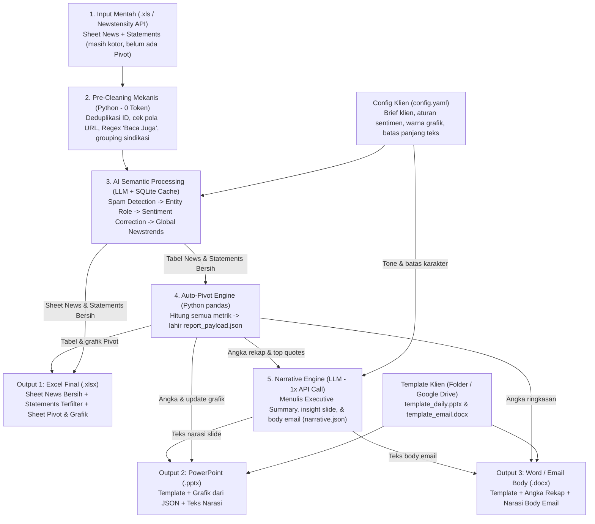

# Catatan Diskusi Arsitektur & Alur End-to-End (Newstent Automation)

> **Konteks Dokumen:** Dokumen ini merangkum hasil diskusi pendalaman arsitektur berdasarkan [PROJECT_BASELINE.md](../phase-1-requirements/PROJECT_BASELINE.md) dan [SYSTEM_REQUIREMENTS.md](../phase-1-requirements/SYSTEM_REQUIREMENTS.md), mencakup keputusan pemilihan *engine*, strategi validasi URL, skema *multi-template reporting*, pemisahan `config.yaml` vs. data harian, serta alur lengkap *end-to-end* sistem.

---

## 1. Keputusan Arsitektur: Custom Python Pipeline vs. Hermes Agent

**Kesimpulan:** Bangun **Custom Python Pipeline sesuai rancangan Phase 1 sebagai *Core Engine***, bukan menyerahkan proses pengolahan data ke *autonomous agent* seperti Hermes Agent.

| Aspek | Custom Python Pipeline (Phase 1) | Hermes Agent (Autonomous Agent) |
| :--- | :--- | :--- |
| **Akurasi & Konsistensi Data** | **100% Deterministik.** Deduplikasi `ID`, sinkronisasi `Statements`, perhitungan *Pivot*, dan angka grafik dijamin sinkron. | **Non-deterministik.** Berbasis *agentic loop*, rawan salah hitung, format berubah, atau *edge case* gagal di jam sibuk. |
| **Biaya Token API** | **Super Hemat (~Rp 320–560 / 800 baris)** berkat *micro-batching*, *Integer ID mapping*, *smart slicing*, dan SQLite cache. | **Jauh lebih boros.** Siklus *plan → tool call → observe → retry* membakar banyak token dan sulit dikontrol. |
| **Kecepatan & SLA (< 09.00 WIB)** | **Cepat & Terprediksi (< 3–5 menit/klien).** Aman untuk mengejar 3+ klien sebelum *deadline* pagi. | **Lebih lambat & tidak pasti** karena *reasoning* bertahap antar *tool call*. |
| **Setup & Maintenance Lokal** | **Ringan.** Cukup Python 3.11+ di laptop Windows (sesuai NFR-02) dan mudah di-debug. | **Lebih berat.** Umumnya butuh Linux/WSL2/Docker, *daemon*, dan *debugging* perilaku agent lebih rumit. |
| **Fleksibilitas Tugas *Ad-hoc*** | Kaku—mengikuti *workflow* dan konfigurasi klien yang sudah terdefinisi. | **Sangat unggul** untuk riset mendadak (*Crisis Monitoring*) atau perintah via Telegram/WA/Slack. |

### Opsi Hybrid (Opsional di Phase 5 / Ekspansi)
Jika ingin memanfaatkan keunggulan chat gateway atau *scheduling* Hermes Agent di masa depan, gunakan pendekatan dua lapis:
1. **Layer 1 (*Core Engine* — Wajib Custom Python):** Menangani seluruh pipeline data hingga output melalui 1 perintah CLI (misal `python main.py --client klien_a --period daily`).
2. **Layer 2 (*Orchestrator / ChatOps* — Opsional Hermes Agent):** Hanya bertindak sebagai operator yang mengeksekusi script CLI tersebut, mengirim hasil ke grup analis, atau membantu analisis *ad-hoc* / krisis.

---

## 2. Validasi URL pada Proses Pemeriksaan Spam

Dalam praktik analis senior *media monitoring*, 800 URL tidak dibuka satu per satu sebelum pukul 09.00 WIB, melainkan dicek secara **berbasis pola (*pattern-based*)** dan ***spot-check*** pada berita kritis.

### Pengaruh URL Tidak Valid Berdasarkan Jenis Media
1. **Media Cetak (*Print*) & Elektronik (*TV/Radio*):** URL sering kosong atau berupa tautan internal *clipping*. **Bukan spam**—tidak boleh dihapus hanya karena URL kosong.
2. **Media Online — URL Rusak (*Malformed*) atau Halaman Indeks:** URL tanpa *slug* (hanya *homepage*) atau berpola `/tag/`, `/search`, `/indeks`, `/topic/`, `/category/` adalah indikator kuat *crawler error* / *spam*.
3. **Media Online — URL 404 / Mati (*Dead Link*):** **Tidak otomatis spam.** Berita bisa 404 karena di-*takedown* redaksi (sering terjadi pada kasus krisis/ralat berita), sehingga tetap perlu dicatat dengan hati-hati, bukan langsung dibuang.

### Implementasi di Sistem Otomasi (100% Python, 0 Token LLM)
URL **tidak perlu dikirim ke LLM** agar tidak memboroskan token. Penanganannya dilakukan secara mekanis di tahap *Pre-Cleaning*:
- **Normalisasi URL untuk Deduplikasi:** Menghapus parameter *tracking* (`?utm_*`, `?page=2`, `?page=all`) dan menyamakan `m.` vs `www.` sebagai lapis tambahan deduplikasi selain `ID` dan `rapidfuzz`.
- **Flagging Pola URL Statis (khusus `Media Type == Online`):** Menandai baris jika URL kosong, *malformed*, hanya domain utama, mengandung pola indeks (`/tag/`, `/search`, `/indeks`), atau masuk *domain blacklist*.
- **Hindari *Live HTTP Ping* ke 800 URL:** Terlalu lambat (melanggar SLA `< 3–5 menit`) dan rawan terkena blokir Cloudflare (`403 Forbidden`) yang memicu *false positive*.
- ***Live Check* Selektif (Opsional):** Jika diperlukan, cek HTTP hanya pada **5–15 URL *highlight*** yang tautannya benar-benar dicantumkan di slide PPT atau *body email* Word agar klien tidak mengklik link mati.

---

## 3. Otomasi Pembuatan Report Multi-Template & Kontrol Layout

Pendekatan yang digunakan adalah **Hybrid (Template-Driven / *Placeholder Mapping*)**:
- **Layout, Desain, Angka, & Grafik → 100% Template Asli + Python.** LLM tidak boleh mengatur posisi atau koordinat elemen karena LLM berbasis teks bersifat *"buta spasial"* dan rawan menghasilkan layout yang tumpang tindih (*overlapping*).
- **Narasi & *Insight* → LLM (1–2x API Call di Akhir).** LLM hanya berperan menulis *Executive Summary*, *key insight* per slide, rekomendasi PR, dan narasi *body email* dalam format JSON terstruktur.

### Struktur Folder Klien & Integrasi Google Drive
```text
clients/
├── klien_a_tokoh/
│   ├── config.yaml            # Profil klien, aturan sentimen, warna grafik, batas teks
│   ├── template_daily.pptx    # Template PPT asli Klien A (sudah diberi placeholder & nama objek)
│   └── template_email.docx    # Template Word body email Klien A (syntax Jinja2 / docxtpl)
├── klien_b_brand/
│   ├── config.yaml
│   ├── template_daily.pptx
│   ├── template_weekly.pptx
│   └── template_email.docx
```

- **Integrasi Google Drive:** Untuk lingkungan lokal, cara paling praktis adalah menggunakan **Google Drive for Desktop** (di-*mount* sebagai folder lokal). Python cukup membaca file secara lokal, sementara tim analis/desainer dapat memperbarui template `.pptx`/`.docx` langsung di Drive tanpa perlu mengubah kode Python selama nama *placeholder*-nya tetap sama.
- **Dynamic Pagination (Slide Dinamis):** Jika data melampaui kapasitas 1 slide (misal 10 kutipan narasumber padahal 1 slide hanya muat 4), **Python** otomatis menduplikasi slide template dan membagi data (*chunking*: 4 + 4 + 2).

### Mekanisme Pemetaan Elemen ke Slide (*Key Matching*)
Sistem **tidak** bergantung pada nomor urut slide maupun koordinat `(x, y)`, melainkan mencocokkan **nama kunci yang sama persis** antara `template.pptx` dengan `report_payload.json` & `narrative.json`:
- **Kotak Teks (`{{nama_key}}`):** Di dalam `template.pptx`, kotak teks diisi tag seperti `{{exec_summary}}`, `{{sentiment_insight}}`, atau `{{total_coverage}}`. Python memindai semua slide lalu mengganti tag tersebut dengan nilai yang cocok dari JSON (sambil mempertahankan font, ukuran, dan warna asli).
- **Grafik & Tabel (*Selection Pane*):** Melalui menu PowerPoint **Home → Select → Selection Pane**, objek grafik/tabel diberi nama deskriptif sekali di awal (misal `CHART_SENTIMENT`, `CHART_TIMELINE`, `TBL_TOP_MEDIA`). Python mencocokkannya melalui properti `shape.name` untuk menyuntikkan data yang sesuai.

```text
[template.pptx]                   [report_payload.json & narrative.json]
├── Slide 2: {{exec_summary}}     ◄─── narrative["exec_summary"]
├── Slide 3: CHART_SENTIMENT      ◄─── report_payload["sentiment"]
├── Slide 3: {{sentiment_insight}}◄─── narrative["sentiment_insight"]
└── Slide 5: TBL_TOP_MEDIA        ◄─── report_payload["top_media"]
```

Dengan skema ini, urutan slide bisa ditukar atau kotak teks bisa digeser kapan saja di PowerPoint tanpa perlu mengubah kode Python.

### Kontrol Panjang Teks (3 Lapis Pengaman)
1. **Batas Eksplisit di `config.yaml`:** Diteruskan ke prompt LLM (misal: `TXT_EXEC_SUMMARY` maksimal 3 *bullet*, 15–18 kata/bullet; `TXT_SENTIMENT_INSIGHT` maksimal 220 karakter).
2. **Validasi Python (`Pydantic`):** Mengecek panjang karakter hasil LLM; jika melebihi batas, lakukan 1x *re-summarize* singkat.
3. **Pengaman Visual PowerPoint:** Aktifkan **`Shrink text on overflow`** (*Auto-Fit*) pada *text box* di `template.pptx` sehingga font otomatis menyesuaikan sedikit jika teks lebih panjang 1 baris.

---

## 4. Pemisahan `config.yaml` (Statis) vs. `report_payload.json` (Dinamis) & Visualisasi

| Aspek | `config.yaml` (Profil & Aturan Klien) | `report_payload.json` (Data Rekap & Pivot Harian) |
| :--- | :--- | :--- |
| **Sifat** | **Statis** — berasal dari *brief* klien, hanya berubah jika ada permintaan perubahan dari klien. | **Dinamis** — berubah setiap kali penarikan data dijalankan. |
| **Pembuatan** | Dibuat **sekali saat *onboarding* klien baru** (manual *copy-paste* atau dibantu script pemindai *placeholder* PPT). | Dihasilkan **100% otomatis oleh Python (`pandas`)** dari data bersih. |
| **Isi** | Entitas utama, kompetitor, aturan POV sentimen, palet warna, path template, batas panjang teks, jadwal *push mail*. | Angka & teks murni hasil Pivot (Total Coverage, % Sentimen, Top Issue vs Sentiment, Top 10 Media, Timeline, Top Spokesperson). |

### Contoh Struktur `config.yaml`
```yaml
client_name: "Klien A"
focus_type: "person" # person atau brand
main_entities:
  - "Nama Tokoh Utama"
  - "Inisial / Jabatan"
competitors: []

sentiment_rules:
  pov: "Kinerja & reputasi Tokoh Utama"
  notes: "Jika berita membahas bencana tapi memuji respon cepat tokoh, tetap Positif."

report:
  template_pptx: "templates/klien_a/daily.pptx"
  template_docx: "templates/klien_a/email_body.docx"
  chart_colors:
    positive: "#2E7D32"
    neutral: "#9E9E9E"
    negative: "#C62828"
  text_limits:
    TXT_EXEC_SUMMARY: "Maksimal 3 bullet points, tiap bullet 15-18 kata"
    TXT_SENTIMENT_INSIGHT: "1 paragraf singkat, maksimal 220 karakter"
```

### Cara Angka di `report_payload.json` Menjadi Visualisasi
`report_payload.json` hanya berisi **teks dan angka** (bukan gambar). Visualisasi dibentuk oleh Python pada tahap perakitan laporan:
1. **PowerPoint — Update *Native Chart* (Rekomendasi Utama):** `python-pptx` mengganti data di balik grafik bawaan PowerPoint pada `template.pptx` (dicari berdasarkan nama objek di *Selection Pane*, misal `CHART_SENTIMENT`). Hasilnya vektor tajam, warna ikut tema slide, dan **masih bisa diedit manual oleh analis di PowerPoint**.
2. **PowerPoint — Render `.png` (`matplotlib` / `seaborn`):** Digunakan untuk grafik kustom yang sulit dibuat dengan *native chart* (misal *Word Cloud* atau visualisasi khusus), lalu ditempel ke kotak *placeholder*.
3. **Excel — *Native Chart* (`openpyxl` / `xlsxwriter`):** Grafik Excel dibentuk langsung di sheet `pivot` dari sel tabel rekapitulasi yang baru ditulis Python.

---

## 5. Alur Lengkap End-to-End Pipeline (Raw Data → Output Final)

> **Catatan Urutan Penting:** Perhitungan Pivot (`report_payload.json`) dilakukan **setelah** proses *Pre-Cleaning*, *Spam Detection*, *Sentiment Correction*, dan *Global Canonical Topic Normalization (`Newstrends`)* selesai—bukan sebelumnya.



### Ringkasan 6 Tahap Eksekusi
1. **Tahap 1 — Data Ingestion:** Python (`pandas`) membaca file `.xls` (`Spreadsheet with Statements`) atau menarik data via API Newstensity menjadi tabel `News` dan `Statements` di memori.
2. **Tahap 2 — Pre-Cleaning Mekanis (Python):** Menghapus duplikat `ID`, menormalisasi & menandai pola URL sampah (khusus *online*), menghapus teks *boilerplate* (*"Baca Juga"*), mengelompokkan berita sindikasi (`rapidfuzz` ≥ 90%), dan menyinkronkan sheet `Statements` melalui `Report id`.
3. **Tahap 3 — AI Semantic Processing (LLM + SQLite Cache):** Memproses berita per *micro-batch* (25–40 berita/call) mengacu pada `config.yaml` untuk menentukan `spam`, `entity_role`, koreksi `sentiment`, dan *Two-Pass Global Canonical Topic Normalization* (`Newstrends`). Hasilnya disimpan di SQLite *cache* dan dituliskan kembali ke tabel `News`; baris *spam* dibuang beserta relasinya di `Statements`.
4. **Tahap 4 — Auto-Pivot & Lahirnya `report_payload.json` (Python):** `pandas` menghitung seluruh agregasi (Total Coverage, Views/PR Value, % Sentimen, matriks *Newstrend vs Sentiment*, Top 10 Media, Timeline, Media Tier/Scope, Share of Voice, dan Top Spokesperson/Quotes) lalu membungkusnya ke dalam satu *Single Source of Truth*: **`report_payload.json`**.
5. **Tahap 5 — Narrative Engine (LLM — 1x Call):** Mengirim `report_payload.json` + aturan *tone* & batas karakter dari `config.yaml` ke LLM untuk menghasilkan **`narrative.json`** (*Executive Summary*, *insight* per slide, rekomendasi, dan *body email*).
6. **Tahap 6 — Multi-Format Report Generation (Python):**
   - **Excel Final (`.xlsx`):** Menulis tabel `News` bersih + `Statements` terfilter + sheet `pivot` lengkap beserta grafik bawaan Excel.
   - **PowerPoint (`.pptx`):** Membuka `template.pptx` klien, mengisi grafik dari `report_payload.json`, dan mengisi kotak teks dari `narrative.json` (dengan validasi batas karakter & *auto-pagination*).
   - **Word / Email Body (`.docx`):** Membuka `template_email.docx` klien via `docxtpl` dan mengisi ringkasan angka serta narasi pengantar email.
