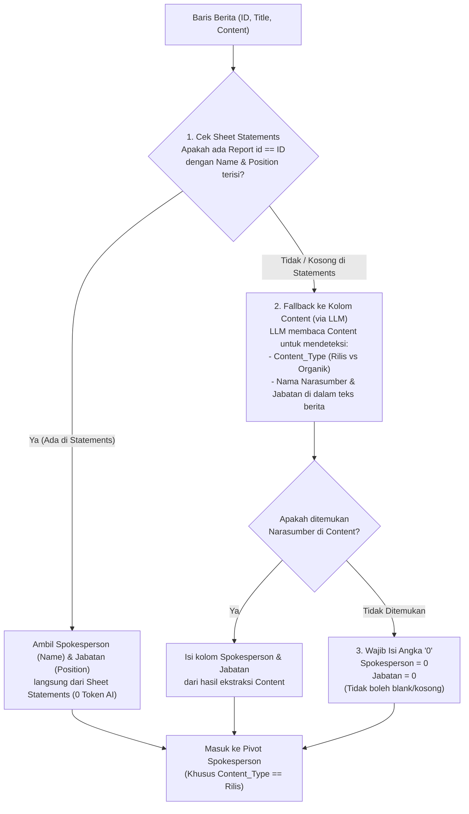
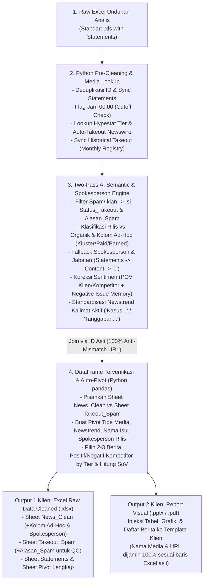

# Desain Arsitektur Sistem & Alur End-to-End (Phase 2 — Newstent Automation)

> **Konteks Dokumen:** Dokumen Phase 2 (*Software Architecture Document / SAD*) ini merancang arsitektur teknis berdasarkan kebutuhan terbaru dari pemaparan Analis Senior (studi kasus pengerjaan *Daily & Monthly Report BRI*) yang terdokumentasi pada [BRD.md](../phase-1-requirements/BRD.md) dan [SRS.md](../phase-1-requirements/SRS.md).

---

## 1. Batasan Sistem & Keputusan Arsitektur Core Engine

### A. Pemisahan Hulu (Sementara Manual: Standar `.xls with Statements`) vs. Hilir (Otomasi Penuh)
Sebagai pendekatan awal berdasarkan diskusi sementara:
- **Bagian Hulu (Tetap Manual oleh Analis dengan Standar `.xls with Statements`):** Pengaturan topik (`My Topics` dengan logika `AND, OR, NOT`), penentuan rentang waktu (*cutoff*), serta *request* dan pengunduhan *raw data* Excel dari dashboard Newstensity tetap dijalankan manual oleh analis.
  - **Keputusan Format Unduhan:** Analis distandardisasi untuk memilih **`Spreadsheet (.xls with Statements)`** (bukan `.xls with Newstrend`), karena:
    1. Sheet `News` pada `.xls with Statements` sudah memuat seluruh berita, ditambah **sheet `Statements` terpisah** (`Report id`, `Name`, `Position`, `Sentiment`, `Quote`) yang langsung menyuplai data *Spokesperson & Jabatan* (Tingkat 1) secara instan (0 token AI).
    2. *Newstrend* bawaan dashboard tetap harus disesuaikan ulang dengan isi `Content` dan aturan awalan kalimat (`"Kasus..."` / `"Tanggapan..."`), sedangkan pengolahan *batch* ratusan baris pada *tool* web yang ada sering terkendala kecepatan dan batas token rendah (*low token limit*).
- **Bagian Hilir (100% Diotomasi sebagai *Analyst Workflow Automation Tool*):** Begitu file `.xls with Statements` diunggah melalui **Local Web UI (Next.js + FastAPI)**, sistem mengeksekusi seluruh tahap **Data Cleaning, Penandaan `Takeout` + `Alasan Spam`, Standardisasi `Newstrend` & Sentimen, Pencarian 3-Tingkat `Spokesperson`, Penyusunan `Pivot` & Analisis Kompetitor/SoV, QC Interaktif, hingga Perakitan 2 Output Utama Klien (`.xlsx` & `.pptx`/`.pdf`)**.

### B. Mengapa Wajib *Custom Deterministic Python Pipeline* (Bukan *Free-Form AI Template Generation* / *Autonomous Agent*)?
Dari pengalaman operasional analis, meminta AI (ChatGPT) menyusun template atau tabel berita secara langsung sering menimbulkan ketidakakuratan fatal—seperti **ketidaksesuaian (*mismatch*) antara `Nama Media` dengan `URL` berita**, perubahan format kolom yang tidak konsisten, serta biaya token tinggi jika menggunakan *autonomous agent* (seperti Hermes Agent).

| Aspek Desain | Pendekatan Lama (AI Buat Tabel Langsung) | Arsitektur Baru (Deterministic Python + Targeted LLM) |
| :--- | :--- | :--- |
| **Pasangan `Nama Media` & `URL`** | Rawan tertukar (*hallucination/mismatch*) saat AI menyalin ulang tabel berita. | **100% Terkunci di Python.** AI tidak pernah menulis ulang URL atau Nama Media; AI hanya mengembalikan label klasifikasi berbasis indeks `idx`, lalu `pandas` menggabungkannya kembali ke baris asli. |
| **Penanganan *Spam* & *Newswire*** | Dihapus manual atau tidak tercatat alasannya. | Ditandai sebagai **`Takeout`** dilengkapi kolom **`Alasan_Spam`** + tersimpan di database SQLite untuk sinkronisasi otomatis ke *Monthly Report*. |
| **Pencarian *Spokesperson* Rilis** | Cek manual satu per satu dari `Statements` lalu baca `Content` berita jika kosong. | **Otomatis 3-Tingkat:** Python cek `Statements` $\rightarrow$ jika kosong AI ekstrak dari `Content` $\rightarrow$ jika tidak ada otomatis diisi **`0`**. |
| **Kolom *Ad-Hoc* (`Kluster`, `Paid/Earned`)** | Harus mengubah prompt manual berkali-kali. | Didefinisikan secara modular di `config.yaml` klien dan otomatis membentuk kolom baru di Excel & Pivot. |

---

## 2. Desain Database Lokal (`data/newstent_state.db`) untuk Konsistensi & Sinkronisasi Bulanan

Untuk menjawab tantangan **sinkronisasi berita *takeout* hingga ke *Monthly Report***, **konsistensi sentimen negatif pada isu berulang**, dan **validasi *Media Tier / Hypestat*** tanpa pengecekan manual berulang, sistem menggunakan database SQLite lokal dengan **4 tabel utama**:

```mermaid
erDiagram
    TAKEOUT_REGISTRY {
        string report_id PK "ID Berita atau Hash Normalized URL"
        string client_id "ID Klien (misal: bri)"
        string page_url "URL Berita (termasuk yg sudah invalid/404)"
        string status_takeout "Takeout"
        string alasan_spam "Iklan / Newswire / Negatif Sensitif / Spam"
        boolean is_sensitive_negative "True jika takeout isu negatif sensitif"
        date recorded_date "Tanggal dicatat pada Daily Report"
    }

    NEGATIVE_ISSUE_MEMORY {
        string issue_hash PK "Hash identitas peristiwa negatif"
        string client_id "ID Klien"
        string nama_isu "Nama isu ringkas"
        string canonical_newstrend "Kalimat aktif berawalan 'Kasus...'"
        string locked_sentiment "negative (dikunci agar selalu konsisten)"
        date last_seen "Tanggal terakhir isu muncul"
    }

    MEDIA_MASTER_HYPESTAT {
        string domain PK "Domain portal media (misal: detik.com)"
        string media_name "Nama resmi media"
        string media_tier "Tier 1 / Tier 2 / Tier 3"
        string media_type_detail "Organik / Newswire / Media Bazar"
        int hypestat_daily_visitor "Nilai visitor/trafik dari Hypestat"
        int media_value "Nilai valuasi media"
    }

    AI_BATCH_CACHE {
        string cache_key PK "Hash(ID + Client_Config_Version)"
        string json_result "Hasil lengkap klasifikasi AI per baris"
        datetime created_at "Waktu cache dibuat"
    }
```



### Cara Kerja Sinkronisasi *Daily* $\rightarrow$ *Monthly Report*:
1. **Sinkronisasi `takeout_registry`:** Ketika berita negatif yang bersifat sensitif di-*takeout* pada *Daily Report* (meskipun di akhir bulan tautan URL-nya sudah mati/invalid), `ID` dan `URL`-nya sudah terekam di `takeout_registry`. Saat analis mengolah file Excel *Monthly Report*, Python otomatis mencocokkan data dengan tabel ini dan langsung menandainya sebagai `Takeout` sehingga tidak ikut terhitung kembali di laporan bulanan.
2. **Konsistensi `negative_issue_memory`:** Setiap kali ada isu bersentimen negatif (contoh: `"Kasus Dugaan Penyalahgunaan..."`), identitas peristiwanya disimpan di `negative_issue_memory` dan dikirim sebagai *reference context* ke LLM agar apabila isu yang sama muncul lagi di berita lain atau keesokan harinya, sentimennya **wajib tetap negatif** dan nama *Newstrend*-nya tetap seragam.
3. **Otomasi Lookup `media_master_hypestat`:** Menyimpan kamus domain media yang memuat `Media Tier`, nilai pengunjung **Hypestat**, serta klasifikasi **`Newswire` vs. `Media Bazar`**. Berita dari domain berkategori `Newswire` langsung di-*takeout* oleh Python dalam 0 detik (0 token AI).

---

## 3. Desain Modul Pembersihan, Validasi Cutoff `00:00`, & Logika 3-Tingkat *Spokesperson*

### A. Validasi Jam Publikasi Default `00:00` (*Cutoff Guard*)
Sistem Newstensity mengisi jam **`00:00`** secara *default* apabila portal berita tidak menyertakan jam publikasi. Karena laporan harian menggunakan batas *cutoff* jam tertentu, Python menjalankan aturan berikut pada tahap *Pre-Cleaning*:
- Mengecek apakah komponen waktu pada kolom `Date` adalah `00:00` atau `00:00:00`.
- Jika ya, kolom **`Flag_Cutoff_00`** diisi dengan `"CEK_CUTOFF_00:00"`, dan pada file Excel final baris tersebut diberi warna *highlight* kuning lembut agar analis dapat langsung memverifikasi apakah berita tersebut masuk dalam rentang *cutoff* hari itu.

### B. Algoritma 3-Tingkat Ekstraksi *Spokesperson & Jabatan* (`Statements` $\rightarrow$ `Content` $\rightarrow$ `0`)
Penyusunan *Pivot Spokesperson & Jabatan* (wajib untuk berita **Rilis**) adalah tahap yang paling menguras waktu analis. Sistem mengotomasinya dengan alur keputusan berikut:



---

## 4. Desain Standardisasi *Newstrend*, Config Fleksibel, & Kolom *Ad-Hoc* (`config.yaml`)

Untuk mengakomodasi aturan spesifik klien (seperti BRI) serta perubahan *template* dan penambahan kolom *ad-hoc* yang sering terjadi, seluruh aturan bisnis didefinisikan secara deklaratif di dalam `clients/<nama_klien>/config.yaml`:

```yaml
client_id: "bri"
client_name: "Bank Rakyat Indonesia (BRI)"
focus_type: "brand_and_competitor"

# 1. Aturan Filtering Spam & Takeout Khusus Klien
takeout_rules:
  auto_takeout_newswire: true
  exclude_pure_ads: true
  client_specific_exclusions:
    - "Berita yang murni bersifat iklan, promo diskon/undian tanpa substansi korporasi/kinerja BRI"
    - "Berita pasar saham rutin yang hanya menyebut kode saham BBRI sekilas tanpa konteks"
  sync_sensitive_negative_to_monthly: true

# 2. Aturan Sentimen & Format Kalimat Newstrend
newstrend_rules:
  evaluate_from_content: true
  sentence_style: "active_sentence" # Kalimat aktif
  max_words: 12                     # Batas maksimal kata per Newstrend
  enforce_negative_consistency: true
  sentiment_wording_hints:
    negative: "Biasanya mengandung kata seperti 'Kasus ...'"
    neutral: "Biasanya mengandung kata seperti 'Tanggapan ...'"
    positive: "Kalimat aktif langsung (misal: 'BRI Salurkan Pembiayaan UMKM...')"

# 3. Aturan Spokesperson & Atribut Media
media_and_spokesperson:
  classify_content_type: ["Rilis", "Organik"]
  classify_media_detail: ["Organik", "Newswire", "Media Bazar"]
  spokesperson_fallback_to_content: true
  spokesperson_missing_value: "0" # Wajib diisi 0 jika tidak ada di Statements maupun Content

# 4. Kolom Tambahan Ad-Hoc (Dapat ditambah/diubah analis kapan saja)
adhoc_columns:
  - name: "Kluster"
    description: "Kelompokkan ke dalam: Korporasi & Keuangan, UMKM & KUR, Layanan Digital (BRImo), CSR, atau Hukum/Kriminal"
  - name: "Paid_Earned"
    description: "Klasifikasikan menjadi 'Paid' (jika advertorial/rilis berbayar/media bazar) atau 'Earned' (jika liputan organik jurnalis)"

# 5. Konfigurasi Kurasi Kompetitor
competitors:
  entities: ["Bank Mandiri", "BCA", "BNI", "BTN"]
  evaluate_using_competitor_pov: true
  daily_highlight_count_per_sentiment: 3 # Pilih 2-3 berita positif & negatif terbaik per kompetitor
  prioritize_by_media_tier: ["Tier 1", "Tier 2", "Tier 3"]
```

### Keunggulan Desain `config.yaml` Ini:
- Ketika klien tiba-tiba meminta kolom baru (misalnya `Kluster`, `Paid/Earned`, atau `Sub_Program`), engineer/analis **cukup menambahkan 3 baris di bagian `adhoc_columns` pada `config.yaml`**.
- Modul Python (`Pydantic` dynamic model builder) otomatis menyertakan kolom tersebut ke dalam *prompt batch* AI dan otomatis menampilkannya sebagai kolom baru di file Excel final maupun di sheet `Pivot`.

---

## 5. Desain Auto-Pivot Engine, Kurasi Kompetitor, & Anti-Mismatch Template

### A. Struktur `report_payload.json` (*Single Source of Truth*)
Setelah AI selesai mengisi klasifikasi dan Python memisahkan baris `Status_Takeout == "Takeout"` ke sheet `Takeout_Spam`, Python (`pandas`) menghitung tabel-tabel *Pivot* dari data bersih (`Status_Takeout == "Keep"`):

1. **Pivot 1 — Tipe Media (`Media Type` & `Media Type Detail`):** Distribusi pemberitaan *Online, Print, Electronic* serta rincian *Organik vs. Media Bazar* dan *Media Tier 1/2/3*.
2. **Pivot 2 — `Newstrends` & `Nama_Isu` vs. Sentimen:** Rekapitulasi isu utama lengkap dengan kalimat aktif `Newstrends` (berawalan `"Kasus..."` untuk negatif, `"Tanggapan..."` untuk netral) beserta jumlah berita positif, netral, negatif.
3. **Pivot 3 — *Spokesperson & Jabatan* (Khusus `Content_Type == "Rilis"`):** Mengelompokkan berita rilis berdasarkan `Spokesperson` dan `Jabatan` (termasuk baris bernilai `0` untuk berita rilis tanpa narasumber).
4. **Tabel Kurasi Kompetitor (2–3 Berita Positif & Negatif per Kompetitor):**
   - Untuk setiap kompetitor, `pandas` memfilter berita dengan sentimen `positive` dan `negative` (yang dinilai dari **POV kompetitor** tersebut).
   - Diurutkan berdasarkan **`Media Tier`** (*Tier 1* paling atas) dan nilai trafik **Hypestat (`Oplah/Daily Visitor`)**.
   - Diambil **2–3 baris teratas** per sentimen, lalu Python mengekstrak langsung kolom **`ID`, `Title`, `Media Name`, `Media Tier`, `Page/URL`, dan `Newstrends`** dari baris Excel asli.

### B. Mekanisme Anti-Mismatch pada Pembuatan 2 Output Utama Klien (Excel Cleaned & Report PPTX/PDF)

Sesuai kebutuhan klien, sistem otomasi difokuskan penuh dari tahap *Data Cleaning* hingga menghasilkan **2 output utama yang diserahkan ke klien** (tanpa otomasi *Push Mail*):
1. **Output 1 — File Excel *Raw Data Cleaned & Pivot* (`.xlsx`)**
2. **Output 2 — File Report Visual (`.pptx` / `.pdf`)**



Dengan arsitektur ini:
1. **Validasi Analis Sangat Cepat:** Analis dapat membuka sheet `Takeout_Spam` dan langsung melihat kolom **`Alasan_Spam`** untuk setiap berita yang dibuang, serta memeriksa baris berwarna kuning pada **`Flag_Cutoff_00`** untuk berita berjam `00:00`.
2. **Pekerjaan Terberat Analis Terotomasi Penuh:** Pencarian `Spokesperson` & `Jabatan` untuk berita rilis (`Statements` $\rightarrow$ `Content` $\rightarrow$ `0`) dan penulisan kalimat aktif `Newstrends` berawalan `"Kasus..."` / `"Tanggapan..."` selesai secara otomatis dalam hitungan menit.
3. **Zero URL/Media Mismatch:** Tidak ada lagi kejadian nama media A tertukar dengan URL media B pada laporan akhir karena AI tidak pernah diizinkan menyusun atau menyalin tabel URL.

---

## 6. Desain Local Web UI (Next.js + FastAPI) & *Excel Engineering*

Untuk memudahkan analis non-teknis mengoperasikan sistem secara lokal tanpa harus membuka terminal atau mengedit file `config.yaml` manual, sistem dibangun dengan **arsitektur 3 lapis terpisah (*Decoupled Local Web App*)**:

### A. Pemisahan 3 Lapisan Aplikasi
```text
Newstensity/
├── src/                  # Layer 1: Core Engine Python Murni (Cleaning, SQLite, AI Batch, Auto-Pivot, Generators)
├── backend/              # Layer 2: FastAPI Server (Port 8000) — REST API & SSE Live Progress
└── frontend/             # Layer 3: Next.js Web UI (Port 3000) — Tailwind, shadcn/ui, AG Grid / TanStack Table
```

### B. Daftar Endpoint Utama FastAPI (`backend/`)
1. `POST /api/upload` — Menerima file `.xls with Statements` & pilihan profil klien (`bri`, dll.), mengembalikan `job_id`.
2. `GET /api/process/{job_id}/stream` (**Server-Sent Events / SSE**) — Mengirim progres pemrosesan per *batch* secara *real-time* ke browser (*"Batch 4/15 selesai — Estimasi 40 detik"*).
3. `GET /api/qc/{job_id}` & `PATCH /api/qc/{job_id}` — Mengambil dan menyimpan hasil koreksi manual analis di tabel QC (*toggle* `Takeout`/`Keep`, edit `Alasan_Spam`, edit `Sentiment`/`Newstrends`, sekaligus *sync* ke SQLite `takeout_registry`).
4. `GET /api/clients/{client_id}/config` & `PUT /api/clients/{client_id}/config` — Membaca & memperbarui aturan klien beserta penambahan **Kolom Ad-Hoc** (`Kluster`, `Paid_Earned`) melalui formulir UI.
5. `POST /api/export/{job_id}` — Menghasilkan dan menyediakan tautan unduh untuk **2 Output Utama**: (1) Excel *Raw Data Cleaned & Pivot* (`.xlsx` sesuai pilihan *Column Picker*) dan (2) Report Visual (`.pptx` / `.pdf`).

### C. Fitur Utama Antarmuka Analis di Next.js (`frontend/`)
- **Interactive Spreadsheet QC (`AG Grid Community` / `@tanstack/react-table`):** Tabel mirip Excel di browser dengan 3 tab filter cepat:
  1. **Tab *"Perlu Dicek (`00:00`)"*** (`Flag_Cutoff_00`) untuk verifikasi batas *cutoff* harian.
  2. **Tab *"Takeout & Alasan Spam"*** untuk meninjau alasan *takeout* atau memulihkan baris yang keliru ditandai.
  3. **Tab *"Berita Rilis & Spokesperson (`0`)"*** untuk *double check* cepat berita rilis tanpa narasumber.
- **Client Export *Column Picker*:** Analis dapat mencentang kolom mana saja yang ikut diekspor pada file Excel untuk klien (misal menyembunyikan kolom bantu internal `Flag_Cutoff_00` / `Alasan_Spam` pada salinan klien, sementara menyertakan kolom *ad-hoc* `Kluster` & `Paid_Earned`).

### D. Strategi *Excel Engineering* (Library Python Khusus Excel)
| Tahap Excel | Library Python | Fungsi Spesifik |
| :--- | :--- | :--- |
| **Pembacaan `.xls`/`.xlsx`** | **`python-calamine`** *(via `pandas`)* | Membaca file export `.xls`/`.xlsx` dari Newstensity 5–10x lebih cepat dan bebas *error* format XML/binary lama. |
| **Pembuatan Workbook Baru** | **`xlsxwriter`** | Menulis `News_Clean`, `Takeout_Spam`, `Statements`, dan `Pivot` lengkap dengan **rumus Excel dinamis (`COUNTIFS`, `SUM`)** agar perubahan manual analis di Excel langsung memperbarui angka & grafik Pivot; disertai *Conditional Formatting* (kuning `00:00`, merah/hijau sentimen), *Excel Table*, *freeze panes*, *auto-width*, & *clickable URL*. |
| **Injeksi ke Template Excel Klien** | **`openpyxl`** | Digunakan apabila klien memiliki file *template* Excel baku dengan desain/*Pivot Table* bawaan yang harus dipertahankan saat data bersih disuntikkan. |
