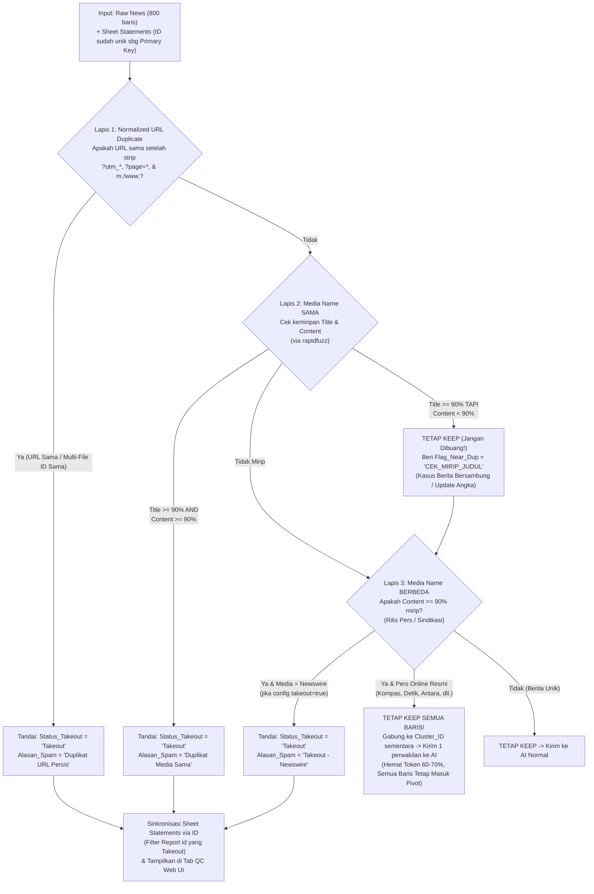
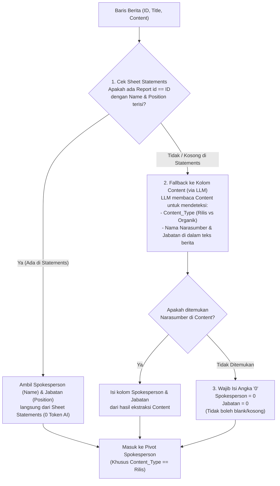
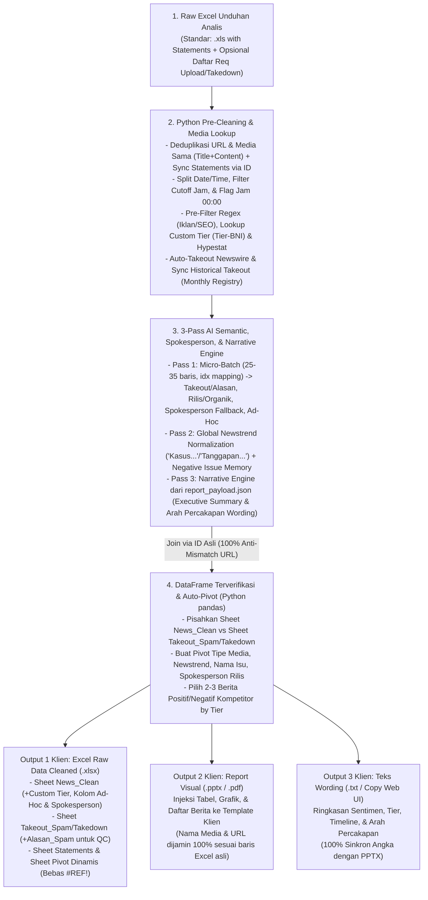

# Desain Arsitektur Sistem & Alur End-to-End (Phase 2 — Newstent Automation)

> **Konteks Dokumen:** Dokumen Phase 2 (*Software Architecture Document / SAD*) ini merancang arsitektur teknis berdasarkan kebutuhan terbaru dari pemaparan Analis Senior (studi kasus pengerjaan *Daily & Monthly Report BRI*) yang terdokumentasi pada [BRD.md](../phase-1-requirements/BRD.md) dan [SRS.md](../phase-1-requirements/SRS.md).

---

## 1. Batasan Sistem & Keputusan Arsitektur Core Engine

### A. Pemisahan Hulu (Sementara Manual: Standar `.xls with Statements`) vs. Hilir (Otomasi Penuh)
Sebagai pendekatan awal berdasarkan diskusi sementara:
- **Bagian Hulu (Tetap Manual oleh Analis dengan Standar `.xls with Statements`):** Pengaturan topik (`My Topics` dengan logika `AND, OR, NOT`), penentuan rentang waktu (*cutoff*), serta *request* dan pengunduhan *raw data* Excel dari dashboard Newstensity tetap dijalankan manual oleh analis.
  - **Keputusan Format Unduhan:** Analis distandardisasi untuk memilih **`Spreadsheet (.xls with Statements)`** (bukan `.xls with Newstrend`), karena:
    1. Sheet `News` pada `.xls with Statements` sudah memuat seluruh berita, ditambah **sheet `Statements` terpisah** (`Report id`, `Name`, `Position`, `Sentiment`, `Quote`) yang langsung menyuplai data *Spokesperson & Jabatan* (Tingkat 1) secara instan (0 token AI).
    2. *Newstrend* bawaan dashboard tetap harus disesuaikan ulang dengan isi `Content` dan aturan awalan kalimat (`"Kasus..."` / `"Tanggapan..."`), sedangkan pengolahan *batch* ratusan baris pada *tool* web yang ada sering terkendala kecepatan dan batas token rendah (*low token limit*).
- **Bagian Hilir (100% Diotomasi sebagai *Analyst Workflow Automation Tool*):** Begitu file `.xls with Statements` diunggah melalui **Local Web UI (Next.js + FastAPI)**, sistem mengeksekusi seluruh tahap **Data Cleaning, Penandaan `Takeout` + `Alasan Spam`, Cek Silang `Req Upload`/`Takedown`, Standardisasi `Newstrend` & Sentimen, Pencarian 3-Tingkat `Spokesperson`, Penyusunan `Pivot` & Analisis Kompetitor/SoV, QC Interaktif, hingga Perakitan 3 Output Utama Klien (`.xlsx`, `.pptx`/`.pdf`, & Teks *Wording*)**.

### B. Mengapa Wajib *Custom Deterministic Python Pipeline* (Bukan *Free-Form AI Template Generation* / *Autonomous Agent*)?
Dari pengalaman operasional analis, meminta AI (ChatGPT) menyusun template atau tabel berita secara langsung sering menimbulkan ketidakakuratan fatal—seperti **ketidaksesuaian (*mismatch*) antara `Nama Media` dengan `URL` berita**, perubahan format kolom yang tidak konsisten, serta biaya token tinggi jika menggunakan *autonomous agent* (seperti Hermes Agent).

| Aspek Desain | Pendekatan Lama (AI Buat Tabel Langsung) | Arsitektur Baru (Deterministic Python + Targeted LLM) |
| :--- | :--- | :--- |
| **Pasangan `Nama Media` & `URL`** | Rawan tertukar (*hallucination/mismatch*) saat AI menyalin ulang tabel berita. | **100% Terkunci di Python.** AI tidak pernah menulis ulang URL atau Nama Media; AI hanya mengembalikan label klasifikasi berbasis indeks `idx`, lalu `pandas` menggabungkannya kembali ke baris asli. |
| **Penanganan *Spam* & *Newswire*** | Dihapus manual atau tidak tercatat alasannya. | Ditandai sebagai **`Takeout`** dilengkapi kolom **`Alasan_Spam`** + tersimpan di database SQLite untuk sinkronisasi otomatis ke *Monthly Report*. |
| **Pencarian *Spokesperson* Rilis** | Cek manual satu per satu dari `Statements` lalu baca `Content` berita jika kosong. | **Otomatis 3-Tingkat:** Python cek `Statements` $\rightarrow$ jika kosong AI ekstrak dari `Content` $\rightarrow$ jika tidak ada otomatis diisi **`0`**. |
| **Kolom *Ad-Hoc* (`Kluster`, `Paid/Earned`)** | Harus mengubah prompt manual berkali-kali. | Didefinisikan secara modular di `config.yaml` klien dan otomatis membentuk kolom baru di Excel & Pivot. |

---

## 2. Desain Database Lokal (`data/newstent_state.db`) untuk Konsistensi & Sinkronisasi Bulanan

Untuk menjawab tantangan **sinkronisasi berita *takeout* hingga ke *Monthly Report***, **konsistensi sentimen negatif pada isu berulang**, dan **validasi *Media Tier / Hypestat*** tanpa pengecekan manual berulang, sistem menggunakan database SQLite lokal dengan **4 tabel utama**:

```mermaid
erDiagram
    TAKEOUT_REGISTRY {
        string report_id PK "ID Berita atau Hash Normalized URL"
        string client_id "ID Klien (misal: bri)"
        string page_url "URL Berita (termasuk yg sudah invalid/404)"
        string status_takeout "Takeout"
        string alasan_spam "Iklan / Newswire / Negatif Sensitif / Spam"
        boolean is_sensitive_negative "True jika takeout isu negatif sensitif"
        date recorded_date "Tanggal dicatat pada Daily Report"
    }

    NEGATIVE_ISSUE_MEMORY {
        string issue_hash PK "Hash identitas peristiwa negatif"
        string client_id "ID Klien"
        string nama_isu "Nama isu ringkas"
        string canonical_newstrend "Kalimat aktif berawalan 'Kasus...'"
        string locked_sentiment "negative (dikunci agar selalu konsisten)"
        date last_seen "Tanggal terakhir isu muncul"
    }

    MEDIA_MASTER_HYPESTAT {
        string domain PK "Domain portal media (misal: beritasatu.com)"
        string media_name "Nama resmi media"
        string tier_bino "Tier standar Binokular (Tier 1 / 2 / 3)"
        string client_custom_tier_json "Aturan Tier khusus klien (misal: TIER BNI = Tier 2)"
        string media_type_detail "Organik / Newswire / Media Bazar"
        int hypestat_daily_visitor "Nilai visitor/trafik dari Hypestat"
        int media_value "Nilai valuasi media"
    }

    AI_BATCH_CACHE {
        string cache_key PK "Hash(ID + Client_Config_Version)"
        string json_result "Hasil lengkap klasifikasi AI per baris"
        datetime created_at "Waktu cache dibuat"
    }
```



### Cara Kerja Sinkronisasi *Daily* $\rightarrow$ *Monthly Report*:
1. **Sinkronisasi `takeout_registry`:** Ketika berita negatif yang bersifat sensitif di-*takeout* pada *Daily Report* (meskipun di akhir bulan tautan URL-nya sudah mati/invalid), `ID` dan `URL`-nya sudah terekam di `takeout_registry`. Saat analis mengolah file Excel *Monthly Report*, Python otomatis mencocokkan data dengan tabel ini dan langsung menandainya sebagai `Takeout` sehingga tidak ikut terhitung kembali di laporan bulanan.
2. **Konsistensi `negative_issue_memory`:** Setiap kali ada isu bersentimen negatif (contoh: `"Kasus Dugaan Penyalahgunaan..."`), identitas peristiwanya disimpan di `negative_issue_memory` dan dikirim sebagai *reference context* ke LLM agar apabila isu yang sama muncul lagi di berita lain atau keesokan harinya, sentimennya **wajib tetap negatif** dan nama *Newstrend*-nya tetap seragam.
3. **Otomasi Lookup & Seeding `media_master_hypestat` (Termasuk *Custom Tier* Klien):** Menyimpan kamus domain media yang memuat `tier_bino` (standar Binokular), `client_custom_tier_json` (misal `{"bni": "Tier 2", "bri": "Tier 1"}` untuk daftar 13.000+ media khusus klien), nilai pengunjung **Hypestat**, serta klasifikasi **`Newswire` vs. `Media Bazar`**. Berita dari domain berkategori `Newswire` langsung di-*takeout* oleh Python dalam 0 detik (0 token AI).
   - **Alur *Seeding* & Pembaruan Data Master:** Analis/admin dapat mengimpor atau memperbarui daftar master media (termasuk file referensi `TIER BNI` / *Custom Tier* klien lain) dalam format `.xlsx` / `.csv` melalui skrip *seeder* awal atau endpoint `POST /api/media-master/import` di Local Web UI. Python menormalisasi domain (menghapus `http(s)://`, `www.`, `m.`) lalu melakukan *upsert* ke SQLite sehingga lookup berjalan $< 50\text{ ms}$ untuk 800 baris.

---

## 3. Desain Modul Pembersihan, Validasi Cutoff `00:00`, & Logika 3-Tingkat *Spokesperson*

### A. Pemisahan `Date`/`Time`, Filter *Cutoff* Otomatis, & Validasi Jam Default `00:00` (*Cutoff Guard*)
Berdasarkan perbandingan *raw data* vs. *cleaned data* riil (studi kasus BNI Jember), file mentah Newstensity menggabungkan tanggal dan jam dalam 1 kolom `Date` (`"2026-11-19 15:42"`) dan sering menyertakan berita yang melewati jam *cutoff* laporan (misal melewati pukul `15:00 WIB`), selain adanya berita berjam *default* **`00:00`**. Pada tahap *Pre-Cleaning*, Python menjalankan 3 aturan deterministik:
1. **Split `Date` & `Time`:** Memecah kolom `Date` mentah menjadi dua kolom terpisah (`Date` dan `Time`) sesuai format standar Excel analis.
2. **Filter *Cutoff* Jam Otomatis:** Membandingkan `Date + Time` terhadap parameter *cutoff* yang diinput analis di Web UI; baris yang melewati jam *cutoff* otomatis ditandai `Status_Takeout = "Takeout"` dengan `Alasan_Spam = "Lewat Jam Cutoff"`.
3. **Flag Jam Default `00:00`:** Jika komponen `Time` adalah `00:00`, kolom **`Flag_Cutoff_00`** diisi `"CEK_CUTOFF_00:00"` dan di-highlight kuning di Excel & tab QC Web UI.

### A2. Sanitasi Teks Sisipan (*Crawling Noise*) & Pre-Filter Regex Pola *Spam* (0 Token AI)
Sebelum memanggil Cloud AI, Python menjalankan dua langkah pembersihan deterministik berbasis Regex dari `config.yaml`:
1. **Sanitasi Teks Sisipan pada Kolom `Content` (*Content Noise Stripping*):** Menghapus blok teks *boilerplate* hasil *crawling* seperti `"Baca Juga: ..."`, `"Simak juga: ..."`, `"Cek Berita Lainnya..."`, atau tautan *cross-link* internal portal sebelum `Content` dipotong menjadi *Smart Snippet* untuk LLM. Langkah ini menjaga agar AI tidak salah membaca judul berita lain sebagai konteks sentimen atau narasumber.
2. **Pre-Filter Regex *Spam* SEO & Judul Iklan (Takeout Baris):** Langsung menandai baris sebagai `Status_Takeout = "Takeout"` untuk pola *spam* yang berulang secara mekanis (menghemat biaya token AI):
   - Judul berawalan **`^Iklan\s*[-–:]`** (misal: *"Iklan - PENGUMUMAN..."* pada media cetak).
   - Pola artikel SEO/*evergreen* non-isu (contoh sektor perbankan: *"Tabel Angsuran KUR"*, *"Simulasi Tabel Angsuran"*, *"Syarat Pengajuan KUR"*, *"Saldo KKS PKH BPNT"*).

### A3. Desain 3-Lapis Deduplikasi (*3-Layer Deduplication Engine* — 0 Token AI)
Berdasarkan audit data riil BNI Jember, kolom **`ID` hasil *crawling* Newstensity pada dasarnya sudah unik per baris** (0 duplikat `ID` dalam 1 file ekspor; peran utamanya adalah *Primary Key* untuk relasi `Statements`, pengunci pasangan `Media Name`/`URL`, dan *safety guard* saat menggabungkan banyak file harian ke bulanan). Oleh karena itu, **kriteria deteksi duplikasi yang sesungguhnya bukan dari `ID`**, melainkan dari **Normalized URL** dan **kemiripan `Title` + `Content` pada media yang sama** (tidak boleh hanya dari `Title` saja agar berita bersambung *Part 1/2* atau *update* angka tidak ikut terbuang), sedangkan berita rilis di **media resmi berbeda tetap dipertahankan**:



- **Lapis 1 (*Normalized URL Duplicate*):** Menormalisasi `Page/URL` (menghapus parameter `?utm_*`, `?page=*`, menyamakan `m.`/`www.`) untuk menangkap artikel yang ter-*crawl* ulang dengan `ID` berbeda *(ditambah pengecekan `ID` khusus saat menggabungkan beberapa file harian ke bulanan)*.
- **Lapis 2 (*Same-Media Near-Duplicate* — Syarat Ganda `AND`):** Pada `Media Name` yang sama, baris hanya ditandai `Takeout` jika **`Title` $\ge 90\%$ AND `Content` (500–1.000 karakter pertama) $\ge 90\%$**. Jika hanya `Title` yang mirip namun `Content` $< 90\%$, baris tetap `Keep` dengan penanda `Flag_Near_Dup` untuk QC analis.
- **Lapis 3 (*Cross-Media Token-Saving Grouping*):** Berita rilis dengan isi $\ge 90\%$ sama di **media resmi berbeda** tetap dipertahankan semua barisnya di Excel & Pivot; pengelompokan `Cluster_ID` hanya digunakan agar Python mengirim **1 perwakilan saja** ke DeepSeek API lalu menyalin hasil klasifikasinya ke seluruh anggota klaster.

### A4. Cek Silang Daftar Link Klien (`Req Upload` & `Takedown` — 0 Token AI)
Pada laporan harian maupun krisis, klien kerap mengirimkan daftar tautan berita rilis yang diminta tayang (**`Req Upload`**) atau daftar tautan berita negatif yang sudah di-***`Takedown`*** / diminta moderasi:
1. **Input Fleksibel di Web UI:** Saat mengunggah `.xls with Statements`, analis dapat (opsional) menempelkan (*paste*) daftar URL atau mengunggah file `.xlsx`/`.txt` untuk `Req Upload` dan/atau `Takedown`.
2. **Normalisasi & Pencocokan (`Normalized URL Matching`):** Python menormalisasi seluruh URL daftar klien (menghapus protokol, `www.`/`m.`, trailing slash, serta parameter `?utm_*`/`?page=*`) lalu mencocokkannya dengan kolom `Page/URL` pada sheet `News`.
3. **Aksi Otomatis:**
   - **Cocok `Takedown`:** Otomatis menandai `Status_Takeout = "Takeout"`, `Alasan_Spam = "Takeout - Daftar Takedown Klien"`, dan langsung mendaftarkan `ID` + `URL`-nya ke SQLite **`takeout_registry`** agar sinkron hingga *Monthly Report*.
   - **Cocok `Req Upload`:** Mengisi kolom bantu **`Status_Req_Upload = "Matched (Req Upload)"`** (serta menghasilkan ringkasan berapa URL `Req Upload` yang sudah ter-*crawl* vs. belum ditemukan pada data mentah).

### B. Algoritma 3-Tingkat Ekstraksi *Spokesperson & Jabatan* (`Statements` $\rightarrow$ `Content` $\rightarrow$ `0`)
Penyusunan *Pivot Spokesperson & Jabatan* (wajib untuk berita **Rilis**) adalah tahap yang paling menguras waktu analis. Sistem mengotomasinya dengan alur keputusan berikut:



---

## 4. Desain Standardisasi *Newstrend*, Config Fleksibel, & Kolom *Ad-Hoc* (`config.yaml`)

Untuk mengakomodasi aturan spesifik klien (seperti BRI) serta perubahan *template* dan penambahan kolom *ad-hoc* yang sering terjadi, seluruh aturan bisnis didefinisikan secara deklaratif di dalam `clients/<nama_klien>/config.yaml`:

```yaml
client_id: "bri"
client_name: "Bank Rakyat Indonesia (BRI)"
focus_type: "brand_and_competitor"

# 1. Aturan Sanitasi Content & Filtering Spam/Takeout Khusus Klien
takeout_rules:
  auto_takeout_newswire: true
  exclude_pure_ads: true
  content_noise_patterns: # Dihapus dari kolom Content sebelum dikirim ke AI
    - "(?i)baca juga\\s*:.*"
    - "(?i)cek berita lainnya.*"
    - "(?i)simak juga\\s*:.*"
  regex_spam_patterns: # Pre-filter 0 token AI di Python
    - "^Iklan\\s*[-–:]"
    - "Tabel Angsuran KUR|Simulasi Tabel Angsuran|Syarat Pengajuan KUR|Saldo KKS.*(PKH|BPNT)"
  client_specific_exclusions:
    - "Berita yang murni bersifat iklan, promo diskon/undian tanpa substansi korporasi/kinerja"
    - "Berita pasar saham rutin yang hanya menyebut kode saham sekilas tanpa konteks"
  sync_sensitive_negative_to_monthly: true

# 2. Aturan Sentimen & Format Kalimat Newstrend
newstrend_rules:
  evaluate_from_content: true
  sentence_style: "active_sentence" # Kalimat aktif
  max_words: 12                     # Batas maksimal kata per Newstrend
  enforce_negative_consistency: true
  sentiment_wording_hints:
    negative: "Biasanya mengandung kata seperti 'Kasus ...'"
    neutral: "Biasanya mengandung kata seperti 'Tanggapan ...'"
    positive: "Kalimat aktif langsung (misal: 'BRI Salurkan Pembiayaan UMKM...')"

# 3. Aturan Spokesperson, Atribut Media, & Custom Tier Klien
media_and_spokesperson:
  classify_content_type: ["Rilis", "Organik"]
  classify_media_detail: ["Organik", "Newswire", "Media Bazar"]
  custom_tier:
    enabled: true
    client_key: "bri"                 # Kunci lookup pada MEDIA_MASTER_HYPESTAT.client_custom_tier_json
    excel_column_name: "TIER BRI"     # Nama kolom Custom Tier di file Excel Cleaned
    fallback_to_bino_tier: true       # Gunakan tier_bino jika domain belum ada di daftar custom klien
  spokesperson_fallback_to_content: true
  spokesperson_missing_value: "0" # Wajib diisi 0 jika tidak ada di Statements maupun Content

# 4. Kolom Tambahan Ad-Hoc (Dapat ditambah/diubah analis kapan saja)
adhoc_columns:
  - name: "Kluster"
    description: "Kelompokkan ke dalam: Korporasi & Keuangan, UMKM & KUR, Layanan Digital (BRImo), CSR, atau Hukum/Kriminal"
  - name: "Paid_Earned"
    description: "Klasifikasikan menjadi 'Paid' (jika advertorial/rilis berbayar/media bazar) atau 'Earned' (jika liputan organik jurnalis)"

# 5. Konfigurasi Kurasi Kompetitor (Opsional: set enabled: false untuk laporan krisis/single-brand)
competitors:
  enabled: true
  entities: ["Bank Mandiri", "BCA", "BNI", "BTN"]
  evaluate_using_competitor_pov: true
  daily_highlight_count_per_sentiment: 3 # Pilih 2-3 berita positif & negatif terbaik per kompetitor
  prioritize_by_media_tier: ["Tier 1", "Tier 2", "Tier 3"]

# 6. Konfigurasi Template Output (PPTX & Wording)
output_templates:
  pptx_template_path: "clients/bri/template_daily.pptx"
  excel_template_path: null            # null = generate workbook baru via xlsxwriter
  wording_include_sosmed_block: false  # Opsional di v1 jika hanya unggah .xls Media (true bila ada data sosmed)
```

### Keunggulan Desain `config.yaml` Ini:
- Ketika klien tiba-tiba meminta kolom baru (misalnya `Kluster`, `Paid/Earned`, atau `Sub_Program`), engineer/analis **cukup menambahkan 3 baris di bagian `adhoc_columns` pada `config.yaml`**.
- Modul Python (`Pydantic` dynamic model builder) otomatis menyertakan kolom tersebut ke dalam *prompt batch* AI dan otomatis menampilkannya sebagai kolom baru di file Excel final maupun di sheet `Pivot`.

---

## 5. Desain Arsitektur 3-Pass Cloud AI Engine (`src/ai_engine/`)

Untuk memastikan pemrosesan 800 baris selalu selesai dalam **$< 3$ menit**, bebas *low token limit*, dan hemat biaya (**~Rp 335 – Rp 665/laporan**), pemanggilan LLM dirancang dalam **3 Pass terpisah** menggunakan `asyncio` + validasi skema ketat `Pydantic`:

| Tahap AI | Input yang Dikirim ke LLM | Tugas Spesifik & Output | Optimasi Biaya & Integritas |
| :--- | :--- | :--- | :--- |
| **Pass 1 — Micro-Batch Classification & Extraction** | 25–35 perwakilan klaster per *call* (paralel maks. 5–8 *worker* `asyncio`). Tiap baris hanya mengirim `{idx, title, snippet, media_type, has_stmt}`. | Mengembalikan array JSON tervalidasi `Pydantic` berisi: `idx`, `status_takeout`, `alasan_spam`, `sentiment`, `draft_newstrend`, `nama_isu`, `content_type`, `spokesperson` & `jabatan` *(hanya jika `has_stmt == false`)*, serta seluruh **`adhoc_columns`** dari `config.yaml`. | **Integer ID Mapping** (`idx: 1..35` menggantikan hash `ID` 64-karakter), **Smart Context Slicing** (~100–120 token `Content` yang sudah bersih dari *crawling noise*), & **SQLite `ai_batch_cache`**. |
| **Pass 2 — Global Newstrend Normalization & Negative Memory** | Daftar unik `(nama_isu, draft_newstrend, sentiment)` hasil Pass 1 + daftar referensi aktif dari SQLite **`negative_issue_memory`**. | Menyatukan variasi redaksi *Newstrend* yang membahas peristiwa sama agar 100% seragam di Pivot, menegakkan aturan kalimat aktif + `max_words` + awalan `"Kasus..."`/`"Tanggapan..."`, serta mengunci sentimen **`negative`** untuk isu berulang. | Hanya **1x API call** ringan per laporan; hasil isu negatif baru otomatis disimpan kembali ke `negative_issue_memory`. |
| **Pass 3 — Narrative & Wording Engine** | Hanya angka terverifikasi dari **`report_payload.json`** (bukan teks mentah 800 berita). | Menghasilkan `narrative.json`: *Executive Summary*, *PR Analysis*, rekomendasi aksi untuk slide PPTX, serta narasi *Arah Percakapan Publik* untuk **Output 3 (*Wording*)**. | Hanya **1x API call**; tidak boleh mengarang angka atau URL karena seluruh statistik & tautan berita dikunci di `report_payload.json`. |

### Contoh Kontrak JSON Pass 1 (Input vs. Output `Pydantic`)
```json
// Input ke LLM (1 baris dalam micro-batch — TANPA URL & TANPA Hash ID)
{
  "idx": 12,
  "title": "BRI Salurkan KUR Rp 120 Triliun Dorong UMKM Naik Kelas",
  "snippet": "PT Bank Rakyat Indonesia (Persero) Tbk mencatat penyaluran KUR...",
  "has_stmt": false
}

// Output dari LLM (Digabung balik ke DataFrame via idx -> ID asli di Python)
{
  "idx": 12,
  "status_takeout": "Keep",
  "alasan_spam": "",
  "sentiment": "positive",
  "draft_newstrend": "BRI Salurkan KUR Rp 120 Triliun Dorong UMKM Naik Kelas",
  "nama_isu": "Penyaluran KUR UMKM BRI",
  "content_type": "Rilis",
  "spokesperson": "Sunarso",
  "jabatan": "Direktur Utama BRI",
  "adhoc": { "Kluster": "UMKM & KUR", "Paid_Earned": "Earned" }
}
```

### Strategi *Resilience* & *Multi-Model Fallback*
- **Primary Model:** `deepseek-flash` (via DeepSeek API / OpenRouter, memanfaatkan *Automatic Context Caching* & diskon *Off-Peak* 50% sebelum 08.00 WIB).
- **Retry & Fallback Chain:** Jika 1 *micro-batch* gagal validasi JSON `Pydantic` atau terkena *timeout/429*, sistem melakukan *exponential backoff* (maks. 2x retry) lalu otomatis berpindah ke *fallback* berurutan: **`Qwen 2.5 72B / Qwen 3`** $\rightarrow$ **`Llama 3.3 70B (Groq)`** $\rightarrow$ **`Gemini 2.5 Flash`** tanpa mengulang *batch* yang sudah berhasil tersimpan di `ai_batch_cache`.

---

## 6. Desain Auto-Pivot Engine, `report_payload.json`, & Anti-Mismatch 3 Output Klien

### A. Struktur `report_payload.json` (*Single Source of Truth*)
Setelah 3-Pass AI selesai (atau setelah analis menyimpan revisi di tab QC Web UI) dan Python memisahkan baris `Status_Takeout == "Takeout"` ke sheet `Takeout_Spam`, Python (`pandas`) menyusun **`report_payload.json`** dari data bersih (`Status_Takeout == "Keep"`). File inilah satu-satunya sumber angka bagi **Excel Pivot**, **Slide PPTX/PDF**, dan **Teks *Wording***:

1. **Pivot 1 — Tipe Media (`Media Type` & `Media Type Detail`):** Distribusi pemberitaan *Online, Print, Electronic* serta rincian *Organik vs. Media Bazar*, `tier_bino`, dan *Custom Tier* klien (`TIER BRI` / `TIER BNI`).
2. **Pivot 2 — `Newstrends` & `Nama_Isu` vs. Sentimen:** Rekapitulasi isu utama lengkap dengan kalimat aktif `Newstrends` (berawalan `"Kasus..."` untuk negatif, `"Tanggapan..."` untuk netral) beserta jumlah berita positif, netral, negatif.
3. **Pivot 3 — *Spokesperson & Jabatan* (Khusus `Content_Type == "Rilis"`):** Mengelompokkan berita rilis berdasarkan `Spokesperson` dan `Jabatan` (termasuk baris bernilai `0` untuk berita rilis tanpa narasumber).
4. **Tabel Kurasi Kompetitor (2–3 Berita Positif & Negatif per Kompetitor):**
   - Untuk setiap kompetitor, `pandas` memfilter berita dengan sentimen `positive` dan `negative` (yang dinilai dari **POV kompetitor** tersebut).
   - Diurutkan berdasarkan **`Media Tier`** (*Tier 1* paling atas) dan nilai trafik **Hypestat (`Oplah/Daily Visitor`)**.
   - Diambil **2–3 baris teratas** per sentimen, lalu Python mengekstrak langsung kolom **`ID`, `Title`, `Media Name`, `Media Tier`, `Page/URL`, dan `Newstrends`** dari baris Excel asli.

```json
{
  "meta": {
    "client_id": "bri",
    "period_label": "19 Nov 2026",
    "cutoff_wib": "15:00 WIB",
    "total_raw": 800,
    "total_clean": 642,
    "total_takeout": 158,
    "req_upload_matched": 12
  },
  "sentiment_summary": { "positive": 410, "neutral": 182, "negative": 50 },
  "media_breakdown": {
    "by_type": { "online": 610, "print": 20, "electronic": 12 },
    "by_custom_tier": { "Tier 1": 145, "Tier 2": 320, "Tier 3": 177 },
    "by_detail": { "Organik": 580, "Media Bazar": 62 }
  },
  "pivots": {
    "top_newstrends": [{ "newstrend": "BRI Salurkan KUR...", "nama_isu": "KUR UMKM", "pos": 85, "neu": 10, "neg": 0 }],
    "spokesperson_rilis": [{ "spokesperson": "Sunarso", "jabatan": "Direktur Utama BRI", "count": 48 }, { "spokesperson": "0", "jabatan": "0", "count": 9 }],
    "timeline_daily": [{ "date": "2026-11-19", "total": 642, "neg": 50 }]
  },
  "competitor_highlights": {
    "Bank Mandiri": {
      "positive": [{ "id": "...", "title": "...", "media_name": "Kompas.com", "tier": "Tier 1", "url": "https://..." }],
      "negative": []
    }
  },
  "social_media_optional": null
}
```
> *Catatan v1 (`social_media_optional`):* Karena fokus input v1 adalah file Excel Media (`.xls with Statements`), blok *Sosmed & Engagement* pada `report_payload.json` dan *Wording* bersifat opsional (`null` secara default jika tidak ada data sosmed) agar tidak memunculkan angka kosong atau *placeholder* palsu.

### B. Mekanisme Anti-Mismatch pada Pembuatan 3 Output Utama Klien (Excel Cleaned, Report PPTX/PDF, & Wording)

Berdasarkan referensi hasil kerja analis (studi kasus BNI Jember), sistem otomasi difokuskan penuh dari tahap *Data Cleaning* hingga menghasilkan **3 output utama untuk klien** (tanpa otomasi *Push Mail*):
1. **Output 1 — File Excel *Raw Data Cleaned & Pivot* (`.xlsx`)** (bebas error `#REF!`, termasuk kolom `TIER <KLIEN>` otomatis)
2. **Output 2 — File Report Visual (`.pptx` / `.pdf`)**
3. **Output 3 — Teks *Wording* Pengantar Email (`.txt` / *Copy-to-Clipboard* di Web UI)** — di-generate dari `report_payload.json` yang sama dengan PPTX sehingga 0% selisih angka.



Dengan arsitektur ini:
1. **Validasi Analis Sangat Cepat:** Analis dapat membuka sheet `Takeout_Spam` dan langsung melihat kolom **`Alasan_Spam`** untuk setiap berita yang dibuang, serta memeriksa baris berwarna kuning pada **`Flag_Cutoff_00`** untuk berita berjam `00:00`.
2. **Pekerjaan Terberat Analis Terotomasi Penuh:** Pencarian `Spokesperson` & `Jabatan` untuk berita rilis (`Statements` $\rightarrow$ `Content` $\rightarrow$ `0`) dan penulisan kalimat aktif `Newstrends` berawalan `"Kasus..."` / `"Tanggapan..."` selesai secara otomatis dalam hitungan menit.
3. **Zero URL/Media Mismatch:** Tidak ada lagi kejadian nama media A tertukar dengan URL media B pada laporan akhir karena AI tidak pernah diizinkan menyusun atau menyalin tabel URL.

### C. Struktur Output 3 — Template Teks *Wording* Pengantar Email (100% Sinkron)
Teks *Wording* dirender secara deterministik oleh Python (*template string*) dengan menyuntikkan angka langsung dari `report_payload.json` dan narasi ringkas dari `narrative.json` (Pass 3):
1. **Salam & Header Periode:** Nama klien, tanggal/periode laporan, dan jam *cutoff* (`meta.period_label`, `meta.cutoff_wib`).
2. **Perkembangan Sentimen & Rincian Media/Tier:** Total berita bersih (`total_clean`), komposisi sentimen (`Positif / Netral / Negatif` beserta persentase), distribusi *Online/Print/Electronic* serta *Custom Tier* klien *(+ blok Sosmed & Engagement secara kondisional hanya jika `social_media_optional != null`)*.
3. **Timeline & Isu Utama (*Top Newstrends*):** Ringkasan 3–5 isu dominan beserta jumlah pemberitaannya langsung dari `pivots.top_newstrends`.
4. **Arah Percakapan & Rekomendasi Singkat:** Narasi ringkas dari `narrative.json` yang konsisten dengan slide *Executive Summary* PPTX, siap disalin lewat tombol **Copy-to-Clipboard** di Web UI.

---

## 7. Desain Local Web UI (Next.js + FastAPI) & *Excel Engineering*

Untuk memudahkan analis non-teknis mengoperasikan sistem secara lokal tanpa harus membuka terminal atau mengedit file `config.yaml` manual, sistem dibangun dengan **arsitektur 3 lapis terpisah (*Decoupled Local Web App*)**:

### A. Pemisahan 3 Lapisan Aplikasi
```text
Newstensity/
├── src/                  # Layer 1: Core Engine Python Murni (Cleaning, SQLite, 3-Pass AI, Auto-Pivot, Generators)
├── backend/              # Layer 2: FastAPI Server (Port 8000) — REST API & SSE Live Progress
└── frontend/             # Layer 3: Next.js Web UI (Port 3000) — Tailwind, shadcn/ui, AG Grid / TanStack Table
```

### B. Daftar Endpoint Utama FastAPI (`backend/`)
1. `GET /api/projects`, `POST /api/projects`, `DELETE /api/projects/{project_id}` — Manajemen **Project / Kasus** persisten di SQLite (1 kasus = 1 project; menyimpan relasi ke `latest_job_id`, klien, *cutoff*, dan ringkasan angka sehingga tetap utuh meski server di-*restart*).
2. `POST /api/upload` — Menerima file `.xls with Statements`, `project_id`, pilihan profil klien (`bni`, `bri`, dll.), parameter **`cutoff_datetime`** (misal `2026-11-19T15:00:00+07:00`), serta input opsional daftar URL **`req_upload`** dan **`takedown`**; mengembalikan `job_id`.
3. `GET /api/process/{job_id}/stream` (**Server-Sent Events / SSE**) — Mengirim progres pemrosesan per tahap & per *batch* secara *real-time* ke browser (*"Pass 1: Batch 4/15 selesai — Estimasi 40 detik"*).
4. `GET /api/qc/{job_id}` & `PATCH /api/qc/{job_id}` — Mengambil dan menyimpan hasil koreksi manual analis di tabel QC (*toggle* `Takeout`/`Keep`, edit `Alasan_Spam`, edit `Sentiment`/`Newstrends`/`Spokesperson`, sekaligus *sync* ke SQLite `takeout_registry` & regenerasi `report_payload.json`).
5. `GET /api/clients`, `POST /api/clients`, `GET/PUT /api/clients/{client_id}/config`, & `POST /api/clients/{client_id}/template-pptx` — Manajemen profil klien, penambahan **Kolom Ad-Hoc** (`Kluster`, `Paid_Earned`), dan unggah template `.pptx` melalui UI.
6. `POST /api/media-master/import` — Mengimpor/memperbarui daftar master media (`tier_bino`, *Custom Tier* klien seperti `TIER BNI`, *Hypestat*, *Newswire/Media Bazar*) dari file `.xlsx`/`.csv` ke SQLite `media_master_hypestat`.
7. `POST /api/export/{job_id}` — Menghasilkan dan menyediakan tautan unduh/salin untuk **3 Output Utama**: (1) Excel *Raw Data Cleaned & Pivot* (`.xlsx` sesuai pilihan *Column Picker*), (2) Report Visual (`.pptx` *smart in-place template update* / `.pdf`), dan (3) Teks ***Wording*** (`.txt` + tombol *Copy-to-Clipboard* di Next.js).

### C. Fitur & Layout Utama Antarmuka Analis di Next.js (`frontend/`)
- **Project-Centric Workspace Layout (Tanpa Panel Chat Kanan):** Mengusung antarmuka *light SaaS* bersih dengan **Icon Rail** kiri tipis, **Left Project Panel** (daftar kasus tersimpan + tombol `+ New Project`), **Top Breadcrumb Switcher** (`Projects / Nama Kasus ⌄`), dan **Kanvas Utama Full-Width** (berlatar *dot-grid* halus) berisi tab `Pipeline & Upload`, `Tabel QC Interaktif`, `Ekspor 3 Output`, serta halaman pengaturan klien/master media/template.
- **Interactive Spreadsheet QC (`AG Grid Community` / `@tanstack/react-table`):** Tabel mirip Excel di browser dengan **4 tab filter cepat**:
  1. **Tab *"Perlu Dicek (`00:00`)"*** (`Flag_Cutoff_00`) untuk verifikasi batas *cutoff* harian.
  2. **Tab *"Takeout & Alasan Spam"*** untuk meninjau alasan *takeout*/*takedown* atau memulihkan baris yang keliru ditandai.
  3. **Tab *"Berita Rilis & Spokesperson (`0`)"*** untuk *double check* cepat berita rilis tanpa narasumber.
  4. **Tab *"Mirip Judul (`Flag_Near_Dup`)"*** untuk memeriksa cepat berita di media sama yang judulnya mirip $\ge 90\%$ namun isinya berbeda (kasus berita bersambung / *update* angka).
- **Client Export *Column Picker*:** Analis dapat mencentang kolom mana saja yang ikut diekspor pada file Excel untuk klien (misal menyembunyikan kolom bantu internal `Flag_Cutoff_00` / `Alasan_Spam` pada salinan klien, sementara menyertakan kolom *ad-hoc* `Kluster`, `Paid_Earned`, dan `TIER <KLIEN>`).

### D. Strategi *Excel Engineering* (Library Python Khusus Excel)
| Tahap Excel | Library Python | Fungsi Spesifik |
| :--- | :--- | :--- |
| **Pembacaan `.xls`/`.xlsx`** | **`python-calamine`** *(via `pandas`)* | Membaca file export `.xls`/`.xlsx` dari Newstensity 5–10x lebih cepat dan bebas *error* format XML/binary lama. |
| **Pembuatan Workbook Baru** | **`xlsxwriter`** | Menulis `News_Clean`, `Takeout_Spam`, `Statements`, dan `Pivot` lengkap dengan **rumus Excel dinamis (`COUNTIFS`, `SUM`)** agar perubahan manual analis di Excel langsung memperbarui angka & grafik Pivot; disertai *Conditional Formatting* (kuning `00:00`, merah/hijau sentimen), *Excel Table*, *freeze panes*, *auto-width*, & *clickable URL*. |
| **Injeksi ke Template Excel Klien** | **`openpyxl`** | Digunakan apabila klien memiliki file *template* Excel baku dengan desain/*Pivot Table* bawaan yang harus dipertahankan saat data bersih disuntikkan. |
